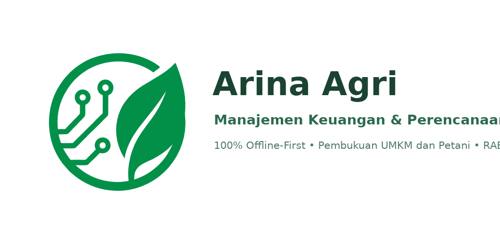
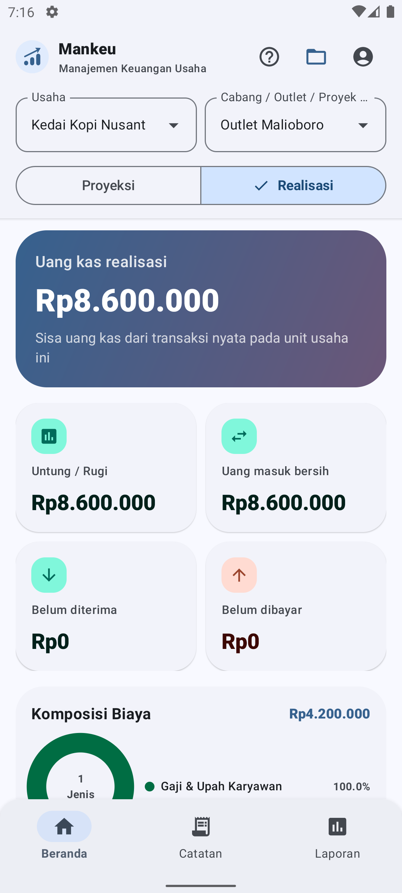
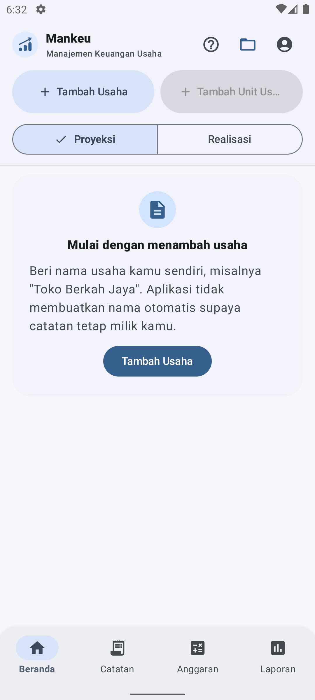
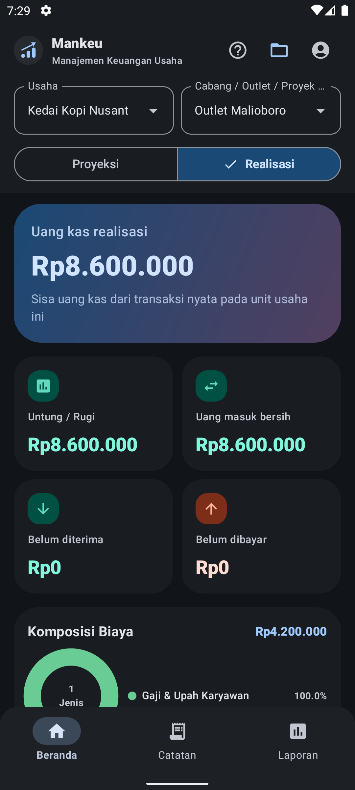
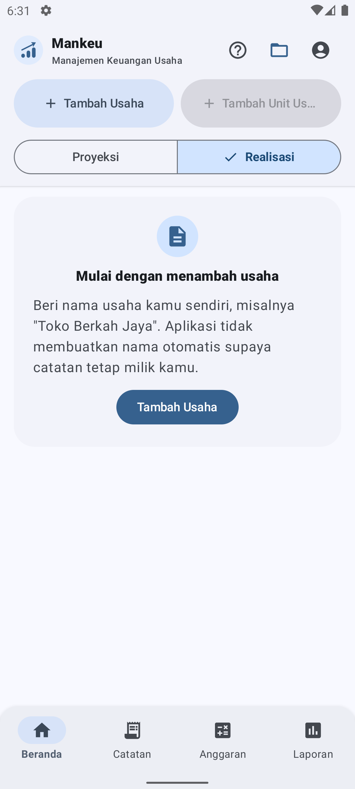

<p align="center">
  
</p>

<p align="center">
  
</p>

<h1 align="center">Arina Agri — Manajemen Keuangan & Perencanaan Usaha</h1>

<p align="center">
  <strong>Pantau arus kas, analisis biaya, telusuri profil pengeluaran, serta rencanakan kelayakan usaha tani dan UMKM Anda — 100% Offline-First, Privat, dan Modern.</strong>
</p>

<p align="center">
  <a href="https://github.com/adsurkasur/Mankeu/actions/workflows/android.yml"></a>
  <a href="https://github.com/adsurkasur/Mankeu/actions/workflows/deploy_play_store.yml"></a>
  <a href="https://github.com/adsurkasur/Mankeu/releases"></a>
  
  
  
  
</p>

---

## 📌 Sekilas Tentang Arina Agri

**Arina Agri** *(sebelumnya dikembangkan dengan kode proyek Mankeu)* adalah aplikasi Android native yang menghadirkan fitur **Manajemen Keuangan** dan **Manajemen Stok** khas ekosistem Arina Agri langsung ke genggaman pelaku usaha tani dan UMKM. Dirancang untuk menjawab kebutuhan petani, kelompok tani, penyedia jasa alsintan, pedagang sarana produksi, serta pelaku UMKM lapangan yang membutuhkan pembukuan tangguh tanpa bergantung pada koneksi internet.

Mengadopsi alur, struktur, dan istilah standar yang sama dengan aplikasi web Arina Agri, versi mobile ini mengombinasikan pencatatan Buku Besar harian yang gesit dengan akuntansi berstandar industri, Rencana Anggaran Biaya (RAB), dan Analisis Kelayakan Usaha (HPP & BEP):

- 🔒 **100% Offline-First & Privat Tanpa Login Paksa**: Beroperasi penuh tanpa butuh koneksi internet, tanpa server luar, dan tanpa kewajiban mendaftar. Tersedia layar selamat datang (*Welcome Screen*) dengan opsi masuk Google (opsional untuk cadangan Drive) dan jalur penggunaan offline yang setara.
- ⚖️ **Dual-Mode Skenario: Rencana (Proyeksi) vs Aktual (Realisasi)**: Memisahkan secara tegas antara simulasi anggaran biaya sebelum masa tanam/usaha (*Mode Rencana*) dengan catatan transaksi riil di lapangan (*Mode Aktual*).
- 🌾 **Rencana Anggaran Biaya (RAB) & Resep Biaya HPP**: Menyusun item RAB per proyek/komoditas, menghitung HPP per satuan dari resep biaya variabel (benih, pupuk, pestisida, tenaga kerja), mendukung produk musiman (*seasonal products*), serta mengestimasi Kebutuhan Modal Kerja dari defisit kas puncak.
- 🧮 **Analisis Kelayakan Usaha & Titik Impas (BEP)**: Menghitung Titik Impas (BEP Volume/kg & BEP Nominal Rupiah) bauran penjualan (*sales mix*), Estimasi Laba Bersih, R/C Ratio, B/C Ratio, serta memantau "Status BEP Bulan Ini" pada fase realisasi.
- 📦 **Manajemen Stok Persediaan**: Memantau stok bahan baku dan hasil panen, mencatat mutasi keluar-masuk (Stok Masuk, Stok Keluar, Opname Fisik), peringatan stok menipis, serta alokasi stok per unit usaha maupun stok bersama (*shared stock*).
- 💼 **Multi Usaha & Multi Proyek/Lahan**: Kelola beberapa unit usaha (kebun budidaya, toko tani, jasa alsintan, olahan pangan) beserta blok lahan/musim tanamnya dengan pemisahan data independen dan pemulihan sesi otomatis.
- 📑 **Pratinjau & Rekonsiliasi Impor/Ekspor Excel (.xlsx)**: Menggunakan satu format template standar Arina Agri (Template v4 / DEC-012) yang mendukung siklus *round-trip* (ekspor dapat diimpor kembali tanpa kehilangan data), dilengkapi pratinjau rekonsiliasi kelompok biaya dan ekspor laporan PDF formal.
- 🛡️ **Cadangan Terenkripsi AES-256-GCM & Google Drive**: Cadangkan data lokal terenkripsi dengan kata sandi, atau sinkronisasikan secara privat ke folder aplikasi Google Drive (`appDataFolder`) tanpa perantara pihak ketiga.
- 💡 **Pusat Bantuan & Panduan Interaktif**: Dilengkapi Pusat Bantuan terintegrasi berisi 27 artikel panduan praktis (ID & EN) beserta tangkapan layar dan fitur *"Tunjukkan di aplikasi"*, ditambah tur panduan (*spotlight tour*) kontekstual pada setiap halaman.

---

## 📱 Galeri Antarmuka

| Beranda & Buku Besar Kas | Perencanaan & Kelayakan Usaha | Mode Gelap Slate Garden | Multi Usaha & Proyek |
| :---: | :---: | :---: | :---: |
|  |  |  |  |

---

## 🚀 Fitur Unggulan

### 1. Buku Besar Transaksi (Catat Transaksi Kas Murni)
- **Jenis Transaksi**: Catat **Pemasukan (+)** dan **Pengeluaran (−)** kas harian secara cepat dengan kategorisasi terstruktur.
- **Ringkasan Bisnis Real-Time**: Pantau kartu ringkasan **Total Pemasukan**, **Total Pengeluaran**, **Estimasi Laba Bersih**, dan **Defisit Kas / Saldo Kas**.
- **Kalkulasi Otomatis Volume & Harga Satuan**: Input kuantitas (kg, sak, liter, hari-orang kerja) dan harga satuan untuk menghitung nominal transaksi secara otomatis ($Nominal = Volume \times Harga Satuan$).
- **Setoran Modal & Prive (Ambil Pribadi)**: Memisahkan modal awal pemilik dan penarikan pribadi dari biaya operasional usaha agar perhitungan laba rugi tetap murni.
- **Perolehan Aset & Alat Tani**: Catat pembelian alat mesin pertanian atau aset modal dengan estimasi umur ekonomis (bulan) untuk penyusutan berkala.
- **Pembalikan Transaksi (Reversals)**: Transaksi yang keliru dapat dibatalkan melalui jurnal pembalik (*reversal audit trail*), menjaga riwayat audit buku besar tetap transparan dan akuntabel.
- **Prinsip Kas Murni (Strict Cash-Only, DEC-011)**: Menjamin keselarasan 100% antara saldo kas riil, laba rugi kas, dan laporan arus kas tanpa distorsi utang/piutang kredit fiktif.

### 2. Rencana Anggaran Biaya (RAB) & Perencanaan Usaha (Mode Rencana / Proyeksi)
- **Struktur Rencana Usaha Multi-Produk**: Susun proyeksi penerimaan dan biaya sebelum musim tanam atau siklus usaha dimulai.
- **Resep Biaya Pokok Produksi (HPP Recipe)**: Rinci komponen biaya variabel per batch (benih, pupuk, pestisida, tenaga kerja kerja) beserta proyeksi hasil panen (*yield*) untuk menghitung estimasi HPP per satuan unit.
- **Produk Musiman (Seasonal Products)**: Fitur *"Mulai dijual bulan ke-"* memungkinkan perhitungan masa tunggu sebelum panen, sehingga kebutuhan modal pada bulan-bulan tanpa penjualan tercermin secara akurat.
- **Biaya Tetap Operasional & Biaya Satu Kali**: Alokasikan biaya sewa lahan, operasional bulanan, dan biaya persiapan awal.
- **Penyusutan Aset Otomatis**: Depresiasi aset dihitung otomatis berdasarkan estimasi umur ekonomis bulan pakai.
- **Kebutuhan Modal Kerja (Financing Gap)**: Dihitung secara objektif dari titik defisit kas kumulatif puncak sepanjang siklus rencana.

### 3. Analisis Kelayakan Usaha & Titik Impas (BEP)
- **Titik Impas Multi-Produk**: Menghitung **BEP Produksi / Volume (Unit/kg)** dan **BEP Nominal (Rupiah)** berdasarkan bauran penjualan (*sales mix*), dilengkapi indikator peringatan jika harga jual berada di bawah biaya variabel.
- **Rasio Kelayakan Usaha Standar**:
  - **R/C Ratio (Revenue to Cost Ratio)**: Mengukur rasio penerimaan kotor terhadap total biaya usaha.
  - **Net B/C Ratio (Benefit to Cost Ratio)**: Menilai kelayakan manfaat laba bersih terhadap modal yang dikeluarkan.
  - **Margin Laba Bersih (Net Profit Margin %)**: Persentase keuntungan bersih dari total omzet penjualan.
- **Status Kelayakan Usaha**: Indikator instan apakah rencana usaha berstatus **LAYAK** (*"Usaha ini layak dijalankan"*) atau **BELUM LAYAK** (*"Proyeksi panen tidak mencukupi BEP"*).
- **Status BEP Bulan Ini**: Pada *Mode Aktual (Realisasi)*, pantau perbandingan pencapaian omzet riil, volume panen terjual, dan penyerapan biaya resep terhadap target impas bulan berjalan.

### 4. Distribusi Pengeluaran & Profil Biaya Kebun
- **Kategori Domain Pertanian Standar**: Klasifikasi pengeluaran bawaan khas Arina Agri: **Pupuk**, **Pestisida**, **Tenaga Kerja**, **Irigasi & Air**, **Alat Tani**, serta kategori kustom tak terbatas.
- **Visualisasi Komposisi Biaya**: Grafik donat interaktif di Beranda yang memetakan persentase pengeluaran per kelompok biaya untuk mempermudah evaluasi efisiensi operasional.

### 5. Manajemen Stok Persediaan (Tab Stok)
- **Ringkasan Nilai Persediaan**: Pantau total estimasi nilai rupiah stok (*inventory valuation*) dan total item aktif secara *real-time*.
- **Pencatatan Mutasi Stok Lengkap**:
  - **Stok Masuk**: Pembelian sarana produksi (saprotan) atau hasil panen yang masuk gudang.
  - **Stok Keluar**: Penggunaan pupuk/pestisida di kebun atau penjualan hasil panen.
  - **Opname Fisik**: Penyesuaian stok fisik gudang terhadap catatan sistem.
- **Peringatan Stok Menipis (Low-Stock Alert)**: Penandaan otomatis untuk item persediaan yang mencapai batas minimum stok.
- **Kepemilikan Stok Fleksibel**: Alokasikan item khusus ke proyek/lahan tertentu, atau jadikan stok bersama (*shared stock*) lintas cabang/kebun.

### 6. Laporan Keuangan & Arus Kas Bulanan
- **Laporan Laba Rugi (Income Statement)**: Menyajikan Total Pendapatan Operasional, Beban Operasional per kelompok biaya, Biaya Penyusutan, dan Laba Bersih Operasional.
- **Laporan Arus Kas Bulanan (Cash Flow Statement)**: Pemisahan arus kas otomatis ke dalam tiga kelompok standar akuntansi:
  - **Arus Kas Operasi**: Penerimaan dan pengeluaran kas operasional harian.
  - **Arus Kas Investasi**: Pembelian dan pelepasan aset alat mesin atau sarana fisik.
  - **Arus Kas Pendanaan**: Setoran modal pemilik dan penarikan pribadi (prive).
- **Grafik Dinamis Pergerakan Kas Bulanan (Vico Chart)**: Visualisasi tren Kas Masuk (*Inflow*), Kas Keluar (*Outflow*), Kas Bersih (*Net*), dan Saldo Kas Kumulatif per periode.
- **Perbandingan Proyeksi vs Realisasi**: Laporan komparasi komprehensif yang membandingkan rencana awal (Proyeksi) dengan eksekusi nyata di lapangan (Realisasi) secara berdampingan, mencakup metrik finansial utama, arus kas bulanan, dan selisih persentase per kategori.
- **Ekspor Laporan PDF Formal**: Unduh laporan keuangan rapi siap cetak dan bagikan, lengkap dengan ringkasan eksekutif dan analisis kelayakan BEP.

### 7. Pratinjau & Rekonsiliasi Impor Excel (.xlsx)
- **Format Resmi Tunggal (Template v4 / DEC-012)**: Menjamin konsistensi 100% antara template kosong Arina Agri dengan berkas ekspor data.
- **Ekspor Multi-Lembar Komprehensif**: Menghasilkan workbook Excel terstruktur rapi (Petunjuk, Transaksi, Rencana Anggaran, Produk, Resep Produk, Laba Rugi, dan Arus Kas).
- **Siklus Round-Trip Terjamin**: Berkas Excel hasil ekspor dapat diimpor kembali ke proyek kosong tanpa kehilangan formula, struktur, maupun data historis.
- **Pratinjau & Rekonsiliasi Impor Cerdas**: Memeriksa kesesuaian angka sebelum disimpan ke sistem, mendeteksi potensi duplikasi berkas, memvalidasi kategori, dan mencatat riwayat batch impor yang dapat dibatalkan (*reversible*).

### 8. Pusat Bantuan Terpadu & Panduan Interaktif
- **27 Artikel Panduan Praktis**: Panduan terstruktur langkah demi langkah (Bahasa Indonesia & English) mencakup seluruh alur pencatatan dan analisis, lengkap dengan tangkapan layar antarmuka asli.
- **Navigasi Cerdas "Tunjukkan di Aplikasi"**: Mengetuk tombol ini pada artikel bantuan akan langsung mengarahkan pengguna ke layar yang tepat dan menyorot elemen UI terkait (*spotlight*).
- **Tur Terpandu Kontekstual (Spotlight Tour)**: Panduan sorotan per halaman yang membantu memahami fungsi tombol dan metrik tanpa mengganggu ritme kerja pengguna.

### 9. Desain Visual Modern, Aksesibilitas & Keamanan Data
- **Desain Arina Agri Terpadu**: Palet warna resmi hijau Arina (`#2D6A4F` terang / `#52B788` gelap) dan terakota (`#E07A5F`), dipadukan dengan tipografi *Plus Jakarta Sans* dan *Sora*.
- **Hirarki Warna Semantik Ketat (DEC-029)**: Tombol aksi utama menggunakan hijau Arina yang tegas, merah dikhususkan murni untuk aksi destruktif/bahaya, dan kuning/amber untuk peringatan.
- **Ilustrasi Lottie Offline Kontekstual (DEC-026, DEC-027, DEC-028)**: Lima aset animasi vektor deterministik (Rencana Usaha, Laporan, Stok, Impor Excel, Cadangan Cloud) yang adaptif terhadap tema terang/gelap dan mendukung mode hemat gerak (*Reduced/Off Motion*).
- **Enkripsi Cadangan AES-256-GCM**: Mengamankan berkas cadangan lokal dengan enkripsi standar industri berbasis kata sandi.
- **Penyelarasan Google Drive Scoped**: Sinkronisasi privat ke folder aplikasi Google Drive (`appDataFolder`) tanpa akses ke berkas Drive pribadi pengguna lainnya.

---

## 🛠️ Arsitektur & Teknologi

Arina Agri dibangun menggunakan arsitektur modern Google Android:

| Komponen | Teknologi / Pustaka | Keterangan |
| :--- | :--- | :--- |
| **Target Platform** | Android 8.0+ (API 26+) hingga Android 15 (API 36) | `minSdk = 26`, `compileSdk = 36`, `targetSdk = 36` |
| **Bahasa Pemrograman** | Kotlin 2.0+ | 100% Coroutines & StateFlow |
| **Antarmuka (UI)** | Jetpack Compose, Material Design 3 | Adaptif: Bottom Navigation (ponsel) & NavigationRail (tablet) |
| **Desain Visual & Tema** | Arina Light & Slate Garden Dark | Hirarki semantik (DEC-024, DEC-029), StatusBadge kanonikal |
| **Tipografi** | Plus Jakarta Sans & Sora | Font lokal tersemat untuk penggunaan 100% offline |
| **Animasi & Ilustrasi** | Lottie Compose & Vector Graphics | 5 animasi offline kontekstual dengan palet adaptif (DEC-026) |
| **Visualisasi Data** | Vico Cartesian Charts | Grafik arus kas ter-memoized dengan komputasi latar belakang |
| **Pola Arsitektur** | MVI / Clean Architecture | Presentation, Domain, Data terisolasi dengan `Dispatchers.Default` |
| **Basis Data Lokal** | Room ORM (SQLite) — Skema 10 | Migrasi otomatis teruji (Skema 3 → 10 tanpa kehilangan data) |
| **Aritmatika Finansial** | Pure Integer Arithmetic (`Long` Rupiah) | Bebas dari kesalahan pembulatan desimal (*zero floating-point drift*) |
| **Format Lembar Kerja** | Native Streaming OpenXML Parser & Exporter | Pemrosesan cepat `.xlsx` tanpa dependensi runtime pihak ketiga yang berat |
| **Dokumen Cetak** | Android Native `PdfDocument` | Pembuatan laporan PDF bersertifikasi cetak |
| **Kriptografi** | Jetpack Security Crypto (AES-256-GCM) | Enkripsi cadangan berbasis passphrase |
| **Penyelarasan Awan** | Google Drive REST API v3 | Autentikasi Google Sign-In dengan cakupan privat `appDataFolder` |
| **Build & Optimasi** | Android Gradle Plugin 8.9+, R8 Minifier | Bytecode shrinking dan inlining aktif pada build rilis |

---

Palet visual dan token Material 3 mengikuti [referensi font dan warna](font-dan-color-palette.md). Standar kontras aksesibilitas, perilaku animasi, dan lisensi aset dijelaskan di [panduan UX](docs/UX_AND_ACCESSIBILITY.md) serta [provenance aset](docs/design/ASSET_PROVENANCE.md). Jalankan `python scripts/verify_visual_system.py` untuk menguji token dan kontras warna.

## 💻 Membangun & Menjalankan Proyek (Build Guide)

### Prasyarat
- **JDK 17** atau yang lebih baru.
- **Android SDK Platform 36** dan Build-Tools 36.0.0.
- Android Studio Ladybug / Meerkat atau Visual Studio Code + Android Extension Pack.
- Python 3.10+ (untuk menjalankan skrip verifikasi sistem visual dan aset).

### Perintah Gradle

1. **Menjalankan Unit Test**:
   ```bash
   ./gradlew testDebugUnitTest
   ```

2. **Menjalankan Linting**:
   ```bash
   ./gradlew lintDebug
   ```

3. **Membangun Debug APK**:
   ```bash
   ./gradlew assembleDebug
   ```
   *Berkas APK terletak pada `app/build/outputs/apk/debug/app-debug.apk`.*

4. **Membangun Release App Bundle (AAB)**:
   ```bash
   ./gradlew bundleRelease
   ```

5. **Memeriksa Sistem Visual & Kontras Warna (WCAG AA)**:
   ```bash
   python scripts/verify_visual_system.py
   ```

6. **Memeriksa Integritas Aset Animasi Offline**:
   ```bash
   python scripts/prepare_lottiefiles.py --check
   ```

---

## 🧪 Jaminan Kualitas (Quality Gates)

Setiap baris kode di repositori ini diverifikasi dengan standar mutu ketat:
- **64+ Automated Unit Tests**: Menguji keabsahan penjurnalan ganda, kalkulator bauran BEP, perputaran stok, impor Excel, penyusutan aset, dan enkripsi AES-256.
- **24+ Instrumented Android Emulator Tests**: Menguji migrasi skema basis data Room (Skema 3 hingga 10), integritas buku besar (*ledger integrity*), transaksi komit impor, dan sinkronisasi.
- **Verifikasi Kontras Aksesibilitas Visual**: Memeriksa 284 aturan token dan 166 pasangan kontras warna terhadap standar WCAG AA (rasio kontras minimum 4.5:1 untuk teks normal).
- **Exact Rupiah Invariant**: Seluruh komputasi uang menggunakan bilangan bulat (`Long`), menjamin akurasi 100% tanpa risiko drift desimal komputer.
- **Strict Lint Compliance**: Tanpa peringatan kritis kompilasi pada konfigurasi rilis.

---

## 📄 Lisensi & Privasi

- **Lisensi Perangkat Lunak**: Proyek ini dilisensikan di bawah [GNU General Public License v3.0 (GPLv3)](./LICENSE).
  - Pengecualian aset animasi: lima ilustrasi vektor pihak ketiga dari LottieFiles beserta adaptasi warnanya mengikuti **Lottie Simple License (FL 9.13.21)**. Sumber, kreator, hash berkas, dan atribusi lengkap dicatat di [provenance aset](docs/design/ASSET_PROVENANCE.md) serta dapat diakses secara offline melalui menu Tentang di dalam aplikasi.
  - Hak Cipta © 2026 adsurkasur <adsurkasur.dev@gmail.com>.
  - Anda bebas menggunakan, memodifikasi, dan mendistribusikan kode ini dengan syarat mencantumkan hak cipta asli dan merilis seluruh turunan kode di bawah lisensi GPLv3 yang sama.
- **Kebijakan Privasi**: Aplikasi ini beroperasi 100% *offline-first*. Tidak mengumpulkan, menjual, melacak, atau mentransmisikan data finansial pengguna ke server manapun. Seluruh data keuangan berada sepenuhnya dalam kontrol lokal pengguna di perangkat.