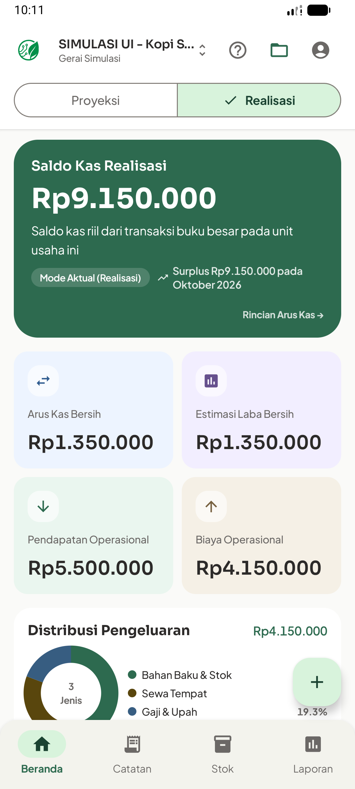
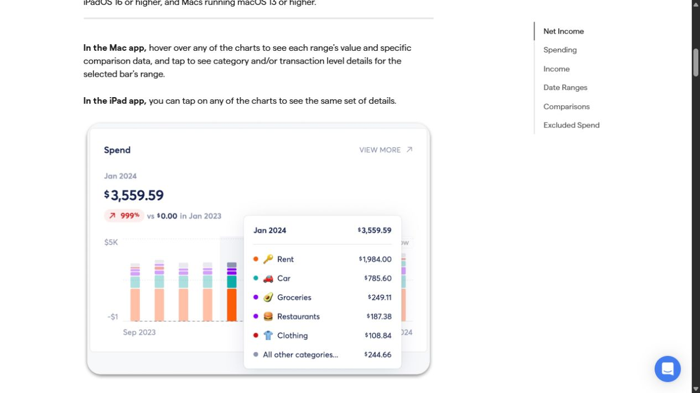
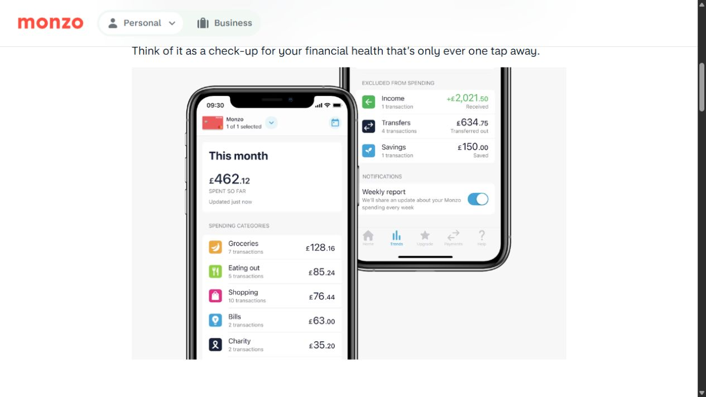
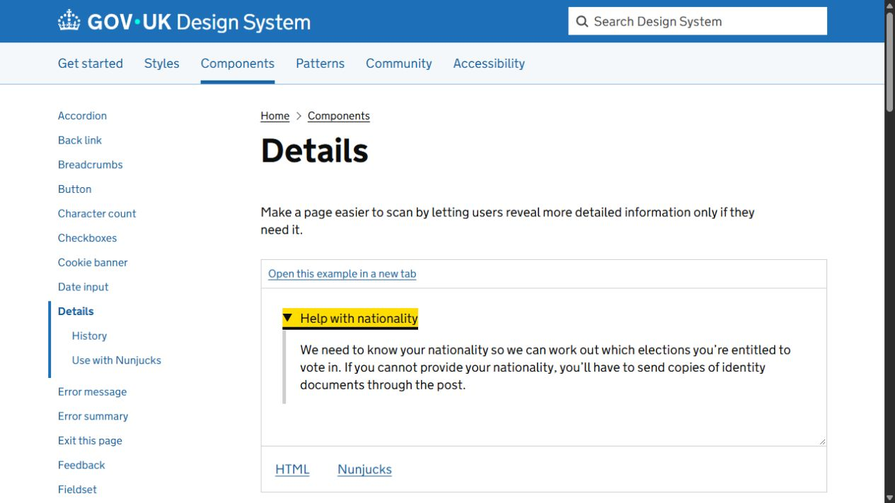

# Riset dan usulan penyederhanaan informasi kartu

Status: **proposed, untuk review visual**. Tidak ada perubahan kode aplikasi pada sesi ini. Permintaan pengguna adalah membuat informasi lebih menarik, ringkas, mudah dipahami, dan menelusuri referensi melalui Browser Use.

## Temuan dari tampilan terbaru

Screenshot berikut diambil langsung dari emulator `emulator-5554` setelah membuka aplikasi yang terpasang. Warna pastel memang sudah terlihat. Bukti ini bukan klaim bahwa seluruh source working tree telah sama persis dengan APK terpasang; APK build lokal tidak tersedia pada lokasi output normal saat pemeriksaan.



Tiga temuan **verified dari tampilan**:

1. Hero saldo menampilkan judul, angka, paragraf definisi, badge mode, informasi surplus/periode, dan CTA. Mode Realisasi juga sudah dipilih di header. Banyak ruang dipakai untuk menjelaskan kembali konteks yang sama.
2. Empat kartu kecil mempunyai bobot visual serupa. Arus kas bersih dan laba kebetulan bernilai sama pada fixture ini; pengguna harus memahami definisinya sendiri untuk mengetahui mengapa keduanya tampil. Keduanya tidak boleh dianggap selalu sama.
3. Grafik pengeluaran berikut legend muncul sebelum ringkasan stok/BEP di bawahnya. Hal yang perlu ditindaklanjuti bersaing dengan rincian analisis yang belum tentu sedang dibutuhkan.

**Verified dari source:** `HomeScreen.kt` tetap memanggil `PlanFeasibilityCard`/`ActualMonthCard` dengan rincian. `components/PlanCards.kt` menampilkan baris produk, laba, rasio, modal, dan penjelasan dalam satu kartu. Menambah aksen warna tidak dengan sendirinya mengurangi informasi yang dirender.

## Referensi browser yang diperiksa

### 1. Copilot Cash Flow — ringkasan dahulu, detail saat dipilih

[Artikel resmi dan screenshot](https://help.copilot.money/en/articles/9682232-cash-flow-tab-overview), bertanggal Februari 2026. **Observed:** kartu Spend menonjolkan nominal dan grafik; tersedia View More, sedangkan kategori ditampilkan sebagai detail pilihan. Artikel juga menjelaskan perpindahan dari ringkasan ke kategori/transaksi. Tidak dilakukan login atau pengujian akun Copilot.



**Proposed untuk Arina:** jadikan satu hasil utama sebagai fokus kartu; rincian transaksi/komponen dibuka melalui satu CTA jelas. Arina tidak meniru fitur koneksi bank, perlakuan transfer, double-tap yang sulit ditemukan, atau grafik tanpa data historis.

### 2. Monzo Trends — satu nominal utama dan baris kategori singkat

[Artikel resmi Monzo](https://monzo.com/blog/trends). **Observed:** contoh menampilkan This month, angka Spent so far, kemudian daftar kategori dengan nominal. **Referensi historis tahun 2021**, bukan klaim tampilan aplikasi Monzo terkini. Tidak menggunakan informasi paket/harga dalam artikel sebagai fakta terkini.



**Proposed untuk Arina:** gunakan judul periode, satu angka utama, dan daftar ringkas. Pengeluaran terbesar cukup tiga baris dengan Lihat semua; tidak harus ditampilkan sekaligus sebagai donut, legend panjang, dan penjelasan tertulis. Warna merah merek Monzo dan fitur perbankannya tidak disalin.

### 3. GOV.UK Details — rincian tambahan yang dapat dibuka

[Panduan resmi Details](https://design-system.service.gov.uk/components/details/). **Observed:** contoh benar-benar dibuka melalui browser; kontrol berubah dari collapsed menjadi expanded dan menampilkan bantuan. Panduan menyatakan detail tambahan dapat disembunyikan, tetapi informasi yang mayoritas pengguna butuhkan tidak boleh disembunyikan.



**Proposed untuk Arina:** definisi istilah, rincian rumus, dan komponen analisis sekunder menggunakan disclosure berlabel jelas. Jumlah uang, periode, kerugian, validasi gagal, konflik impor, serta peringatan material tetap terlihat. Yang diadaptasi adalah pola akses informasi, bukan styling web pemerintah.

## Pilihan pendekatan

| Pilihan | Dampak | Penilaian |
| --- | --- | --- |
| A. Ringkasan + rincian dalam kartu | Tampilan awal singkat, satu ketukan untuk analisis tambahan; navigasi utama tetap | **Direkomendasikan** |
| B. Ringkasan + halaman detail | Kartu sangat bersih, tetapi membaca rincian menambah perpindahan layar | Cocok untuk daftar transaksi lengkap, bukan setiap definisi |
| C. Ringkas label saja | Perubahan kecil, semua data tetap tampil sekaligus | Tidak cukup menjawab masalah kepadatan saat ini |

Usulan menggabungkan A untuk penjelasan/analisis dalam kartu dan memakai halaman detail yang sudah ada untuk daftar lengkap. Tidak menambah tab mode Ringkas/Detail atau preference permanen baru.

## Kontrak informasi yang diusulkan

| Bagian | Terlihat sejak awal | Dibuka saat diperlukan |
| --- | --- | --- |
| Saldo kas | Label Saldo kas, nominal, mode/scope yang jelas dari header, CTA Rincian kas | Arus operasi, investasi, modal/prive, definisi saldo |
| Hasil usaha | Laba kas sebagai angka utama; Pendapatan usaha dan Biaya usaha sebagai dua nilai pendukung | Arus kas operasi, penyusutan, kategori biaya, sumber transaksi |
| Impas/BEP aktual | Status Pendapatan sudah/belum melewati titik impas, progres berlabel, periode | Omzet, nilai ambang BEP, produk terjual, biaya dan rasio |
| Kelayakan rencana | Status rencana, target omzet, angka impas yang bermakna untuk periodenya | BEP per produk, R/C, B/C, rincian modal dan asumsi |
| Pengeluaran | Tiga kategori terbesar dengan nominal, Lihat semua | Daftar lengkap dan chart analisis |
| Stok | Jumlah barang menipis atau Semua stok di atas minimum, Periksa stok | Nilai persediaan, jumlah per barang, mutasi |
| Produk/HPP | Nama, HPP per unit, margin per unit | Harga/target, resep dan biaya komponen |
| Form | Label singkat, input yang sedang dibutuhkan, hasil/error yang relevan | Tutorial/contoh panjang lewat bantuan kontekstual |
| Impor | Nama file, jumlah data, total dan semua konflik/duplikat sebelum simpan | Provenance dan penjelasan teknis per kolom |

Contoh copy **proposed**, memakai fixture yang sudah ada:

```text
Saldo kas
Rp9.150.000
Rincian kas →

Hasil usaha · Oktober 2026
Laba kas Rp1.350.000
Pendapatan usaha  Rp5.500.000
Biaya usaha       Rp4.150.000
Lihat perhitungan ▾

Perlu diperhatikan
1 barang menipis
Periksa stok →
```

Contoh tersebut adalah rancangan teks, bukan screenshot hasil implementasi. Saldo tidak diberi label uang bebas dipakai atau usaha aman: saldo positif bisa berasal dari modal dan tidak membuktikan laba/kelayakan. Periode contoh Oktober hanya sah bila data sumber memang terbatas pada periode tersebut. Jangan memberi label Bulan ini pada `summary` semua waktu; gunakan periode sumber atau Berdasarkan seluruh catatan.

### Aturan penyederhanaan

- Satu kartu menjawab satu pertanyaan dan mempunyai satu CTA utama. Default tanpa paragraf definisi; paling banyak satu kalimat kesimpulan yang benar-benar berguna.
- Dua metrik pendukung boleh terlihat, dengan bobot lebih rendah. Jangan menampilkan seluruh rincian sebagai deretan heading dan angka yang sama kuat.
- Nilai rupiah utuh memakai formatter yang ada; tidak mengubah Long menjadi Float, tidak menyamarkan Rp1.350.000 sebagai laba setelah penyusutan Rp1.150.000.
- Tidak memaksa rumus laba sama dengan arus kas. Arus kas operasi tetap tersedia dan dibedakan dari saldo serta laba pada rincian.
- Status data tidak lengkap, kerugian, defisit, harga jual di bawah biaya, konflik impor, dan stok menipis tidak disembunyikan dalam disclosure.
- Progres BEP memakai data/ambang dari analisis domain yang ada. Jangan membuat persentase jika ambang nol/tidak diketahui atau mengklaim kelayakan usaha keseluruhan dari satu bulan pendapatan.
- Tombol Lihat perhitungan membuka rincian pada kartu dan berubah menjadi Sembunyikan perhitungan, dengan state expanded/collapsed yang diumumkan TalkBack. Target minimal 48 dp; isi tidak diklip untuk menyembunyikan data.
- Gunakan aksen pastel yang sudah ada, ruang kosong secukupnya, dan satu visual fungsional. Tidak menambah dekorasi/mini-chart yang menyulitkan perbandingan.
- Pelaksanaan dimulai dari komponen bersama `PlanCards.kt`, `HomeScreen.kt`, dan komponen ringkasan yang relevan. Detail finansial dan perhitungannya tetap dimiliki domain yang sama; tidak membuat mesin analisis kedua di UI.

## Kriteria penerimaan untuk rancangan ini

1. Dari tampilan awal pengguna bisa menemukan saldo, hasil usaha, periode/scope, dan peringatan penting tanpa membuka rincian.
2. Rincian dapat ditemukan dalam satu tindakan berlabel jelas, dapat ditutup kembali, dan tidak kehilangan draft/scroll atau mengubah data.
3. Nilai sebelum/sesudah dan sumber hitung tetap sama. Nol dan data belum lengkap tidak diberi kesimpulan optimistis.
4. Dua tema, lebar 360 dp, font 200%, TalkBack, dan Reduced/Off diperiksa saat implementasi. Tidak mengecilkan font agar seluruh informasi muat.
5. Target pemahaman dapat diuji dengan pertanyaan saldo berapa, usaha untung/rugi, dan apa yang perlu diperhatikan. Saat ini **belum ada hasil uji pengguna atau bukti peningkatan pemahaman**.

## Status dan batas sesi

Riset browser dan pemeriksaan tampilan telah dilakukan. Source working tree mempunyai perubahan UI dari pekerjaan sebelumnya dan tetap dipertahankan. Rancangan ini belum mengubah aplikasi atau menggantikan hasil QA sebelumnya. Tindakan implementasi menunggu review rancangan ringkasan/detail agar pemilihan informasi utama tidak ditetapkan diam-diam.
