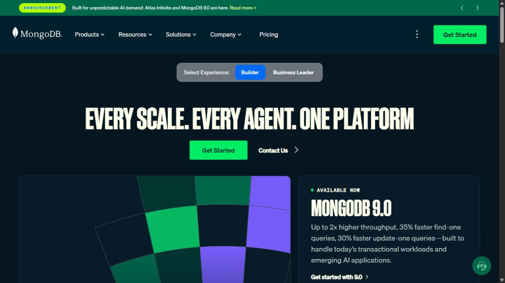

# Referensi dark mode yang tetap membawa hijau Arina

Tanggal: 25 Oktober 2026. Status: **proposed**, belum diterapkan ke aplikasi.

**user-confirmed:** dark mode pengganti tetap harus mempunyai nuansa hijau sesuai branding Arina. Ini memperbarui arah riset sebelumnya: cyan, indigo dan plum tidak lagi diusulkan sebagai pengganti primary hijau. Perubahan tetap sebatas palet dark; belum ada perubahan Kotlin atau data.

## Referensi browser yang dipilih

### 1. Supabase — paling relevan untuk fondasi Arina

[Color usage, sumber resmi](https://supabase.com/design-system/docs/color-usage#brand-green).

**Observed:** dark charcoal dipadukan dengan hijau pada swatch identitas/aksen; green ink dan button plate dibedakan. Panduan menjelaskan bright ink untuk keterbacaan dan solid fill lebih dalam agar tombol tidak terasa lime. Situs juga memisahkan background, control, surface dan overlay. Ini tampilan dokumentasi publik, bukan pengujian dashboard dengan akun.

**Adaptasi untuk Arina:** hijau tetap primary/identitas, dengan hijau terang untuk link/focus dan hijau lebih dalam untuk tombol. Card lebih gelap dengan sedikit tint hijau, sedangkan angka/teks utama tetap netral. Tidak menyalin identitas, logo, token web, atau hue hijau persis Supabase. Panduan sumber sendiri mencatat beberapa keterbatasan skala warna brand; tidak diasumsikan semuanya siap disalin.

### 2. MongoDB — hijau tetap kuat pada fondasi gelap

[Homepage resmi](https://www.mongodb.com/).

**Observed:** hero/header memakai dark bernuansa blue-green; tombol Get Started dan elemen grafis memakai hijau terang. Panel konten tetap gelap sehingga aksen hijau mudah ditemukan. Ini referensi halaman marketing, bukan bukti seluruh dashboard MongoDB memakai pola identik.

**Adaptasi untuk Arina:** identitas hijau dapat terasa kuat melalui CTA, logo, active state dan satu area penekanan, tanpa memberi semua permukaan warna hijau sama kuat. Hindari menyalin hijau neon serta komposisi marketingnya ke tabel keuangan Arina.

Spotify juga dibuka sebagai pembanding: [panduan branding](https://developer.spotify.com/documentation/design) menyebut green sebagai resting brand color, tetapi halaman [web player publik](https://open.spotify.com/) yang diperiksa terutama menunjukkan permukaan hitam/abu dan CTA putih. Karena tidak menampilkan aksen hijau yang kuat pada state tersebut, Spotify tidak dipilih sebagai referensi visual utama untuk keputusan ini.

## Arah yang direkomendasikan: Arina Forest Charcoal

Preview adalah ilustrasi warna dengan angka sintetis, bukan screenshot hasil perubahan APK. Hex berikut merupakan **usulan khusus Arina**, bukan hasil eyedropper dari referensi.

| Role | Usulan | Penggunaan |
| --- | --- | --- |
| Background | `#101613` | Charcoal gelap dengan tint hijau tipis |
| Card | `#19211C` | Lebih terang dari halaman, tetap tenang |
| Dialog/elevated | `#243027` | Lapisan yang terangkat |
| Input | `#131B16` | Permukaan input, dengan outline kontrol |
| Teks utama | `#F1F5F2` | Angka dan isi utama, tidak kehijauan kuat |
| Teks pendukung | `#AAB8AF` | Netral lembut |
| Hijau brand | `#52B788` | Identitas Arina yang sudah ada |
| Hijau teks/focus | `#8ED8AE` | Link, ikon aktif dan focus ring |
| Hijau tombol | `#357956` | Fill tombol, dengan teks putih |
| Container hijau | `#1B3A2A` | Area penekanan terpilih |
| Terakota lembut | `#DDA58D` | Aksen pelengkap brand, bukan error otomatis |
| Info / data | `#A8CBE8` | Informasi netral dan chart |

**Perbedaannya dari Slate Garden saat ini, verified dari source:** background sekarang `#1E2620`, card `#262D28`, dan teks utama `#DDE8DF`. Usulan memperdalam fondasi gelap, mengurangi tint hijau pada teks utama, menegaskan beda lapisan, serta membedakan green ink dengan green fill. Jadi tetap hijau Arina, dengan hierarki warna yang lebih jelas.

Cara penggunaan:

- Hijau paling terlihat pada primary CTA, active tab, focus dan satu highlight card. Pertahankan area baca utama gelap dengan teks netral.
- Pemasukan/berhasil boleh memakai success hijau; normal expense tetap netral. Warning amber, danger salmon dan info biru tetap berbeda, disertai label/ikon.
- Grafik dapat memakai sage, biru, lavender, sand, terakota dan teal secara konsisten per kategori. Jangan menyamakan kategori dengan status masalah.
- Dark token Material 3, semantic helper, MetricColors, hero, input, sheet, chart dan recolor artwork perlu memakai arah sama saat implementasi. Menambahkan background hijau saja tidak cukup.

## Bukti dan batas

Jalankan `rtk proxy python scripts/qa/verify_arina_green_dark.py` untuk memeriksa pasangan solid-color, dua hash screenshot dan keberadaan preview. Rasio teks minimal 4.5:1; kontrol/focus dan series terhadap latar minimal 3:1. Outline `border` hanya dekoratif; boundary input memakai `borderStrong`.

Klaim kontras hanya berlaku pada pasangan yang diperiksa, bukan seluruh UI, alpha/gradient, disabled states atau color vision deficiency. Tidak ada build, uji perangkat, atau studi pengguna pada sesi riset ini. Perubahan source dan log dari implementasi sebelumnya tetap dipertahankan. Usulan ini memberi arah hijau untuk menggantikan kandidat dark nonhijau dari riset sebelumnya; pemetaan serta implementasi token belum dilakukan.
