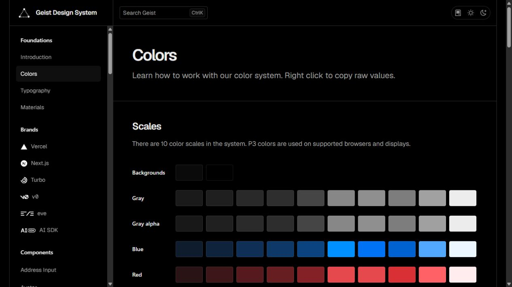
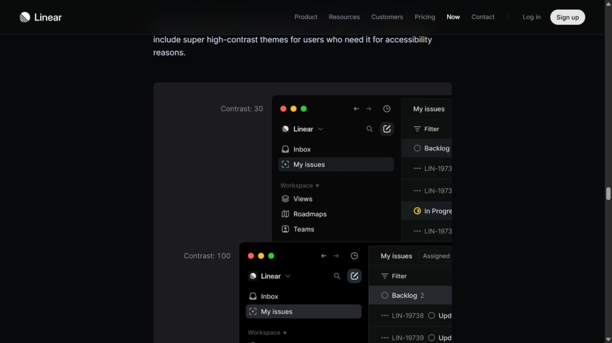
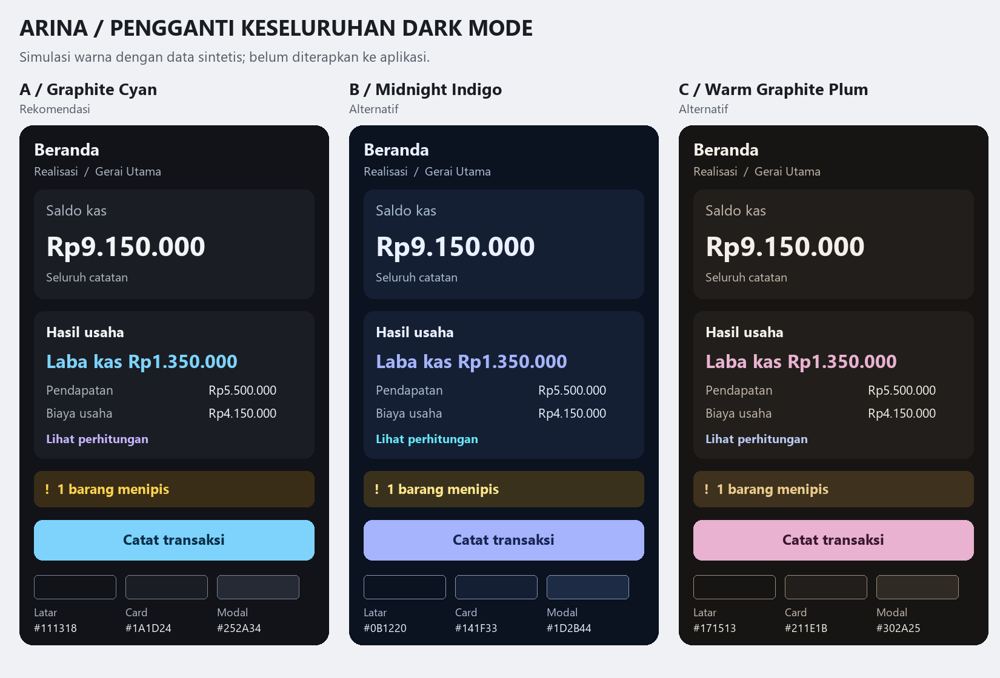

# Penggantian keseluruhan palet dark mode

Tanggal: 25 Oktober 2026. Status: **proposed untuk pemilihan arah**, belum diimplementasikan. Permintaan terbaru memperluas scope dari tambahan accent menjadi penggantian seluruh sistem warna dark mode. Pilihan dark pada riset tambahan accent sebelumnya tidak lagi menjadi default usulan.

## Diagnosis dari source terkini

**Verified:** `MankeuDarkColors` memakai background/surface `#1E2620`, card rendah `#262D28`, elevated `#2B322C`, teks utama `#DDE8DF`, teks sekunder/outline `#8BA08E`, primary `#52B788` dan tertiary `#7DB88A`. Latar, permukaan, teks dan beberapa aksen sama-sama mengandung hijau. `MankeuDarkSemanticColors` serta varian dark `MetricColors.kt` mempunyai container berwarna tambahan. Mengganti background saja akan meninggalkan banyak elemen berpalet lama.

**user-confirmed:** pengguna tidak menyukai palet dark sekarang dan meminta penggantian menyeluruh beserta referensi browser. Tidak ada instruksi untuk mengubah tema light, data atau fungsi finansial.

## Referensi yang ditelusuri melalui Browser Use

### 1. Geist — fondasi netral dan warna dengan peran jelas

[Geist Colors, sumber resmi Vercel](https://vercel.com/geist/colors). Mode Dark pada contoh benar-benar dipilih melalui browser. **Observed:** halaman menggunakan hitam/abu netral untuk fondasi, tangga gray, serta skala blue/red/amber/green/teal/purple/pink. Dokumentasi memisahkan background, border, high-contrast background, serta text/icons.

**Adaptasi:** pilih charcoal netral dan pemisahan peran yang jelas; gunakan warna aksen pada kontrol serta informasi terpilih. Arina tidak perlu menyalin hitam pekat Vercel atau mengadopsi komponen/library web.

### 2. Linear — dark netral dan hierarki permukaan

[How we redesigned the Linear UI, sumber resmi](https://linear.app/now/how-we-redesigned-the-linear-ui). Artikel bertanggal **28 Maret 2024**, jadi contoh produk ini adalah referensi historis, bukan klaim tampilan Linear terbaru. **Observed:** gambar light/dark pada bagian Appearance menampilkan dark netral, teks terang dan lapisan navigasi/panel yang dibedakan. Teks artikel menjelaskan pengurangan chroma agar lebih netral serta perbaikan kontras teks.

**Adaptasi:** buat tiga tingkat permukaan yang terlihat berbeda dan pakai teks netral, tanpa menyelimuti seluruh layar dengan tint aksen. Tidak menyalin layout/sidebar desktop atau menganggap angka hex usulan di bawah milik Linear.

Artikel historis GitHub tentang [pembuatan tema](https://github.blog/news-insights/product-news/accelerating-github-theme-creation-with-color-tooling/) juga dibaca untuk proses tone → hue → contrast. Dua referensi visual utama yang dipertahankan adalah Geist dan Linear; keduanya sudah cukup menjawab keputusan fondasi dark.

## Tiga alternatif yang benar-benar berbeda

Hex adalah **usulan khusus Arina**, bukan ekstraksi CSS atau eyedropper referensi. Preview adalah simulasi komponen dengan data sintetis, bukan screenshot APK setelah diperbaiki.

| Role | A — Graphite Cyan (rekomendasi) | B — Midnight Indigo | C — Warm Graphite Plum |
| --- | --- | --- | --- |
| Latar halaman | `#111318` | `#0B1220` | `#171513` |
| Card | `#1A1D24` | `#141F33` | `#211E1B` |
| Input | `#151820` | `#101A2A` | `#1C1916` |
| Dialog / elevated | `#252A34` | `#1D2B44` | `#302A25` |
| Teks utama | `#F3F4F6` | `#EAF1FF` | `#F4EFE9` |
| Teks pendukung | `#B0B7C3` | `#ADBDD5` | `#C1B6A9` |
| Primary / CTA | `#7DD3FC` | `#A5B4FC` | `#E9B2D0` |
| Teks di atas CTA | `#082F49` | `#172554` | `#3B1730` |
| Secondary | `#C4B5FD` | `#67E8F9` | `#B8C9F1` |
| Outline kontrol | `#778397` | `#8496B2` | `#9A8C7C` |
| Success | `#86EFAC` | `#6EE7B7` | `#A7D9B2` |
| Warning | `#FCD34D` | `#FDE68A` | `#EBCB8B` |
| Danger | `#FDA4AF` | `#FDA4AF` | `#FFB4AB` |
| Info | `#93C5FD` | `#7DD3FC` | `#A6D4E8` |

- **A — direkomendasikan:** fondasi charcoal netral, cyan pada aksi, lavender sebagai pelengkap. Menghilangkan tint hijau pada fondasi maupun primary; hijau tinggal untuk status success atau kategori data yang sesuai. Pilihan paling netral untuk membaca nominal dan tabel keuangan.
- **B:** lebih dingin dan bernuansa biru, dengan primary periwinkle. Memberikan perubahan paling jelas, tetapi beberapa tingkat permukaan masih mempunyai tint biru sehingga perlu dijaga saturasinya.
- **C:** fondasi abu hangat dan primary plum. Lebih lembut/earthy daripada dua lainnya; perbedaan primary pink-plum dan status danger merah-salmon harus selalu diperkuat label/ikon agar maknanya jelas.

Pilihan ini alternatif: gunakan satu sistem utuh, bukan mencampurkan latar A, teks B dan status C secara acak. Tidak menambah pemilih tiga tema di aplikasi.

## Cakupan penggantian setelah arah dipilih

1. Seluruh role dark Material 3 di `Theme.kt`: background, surface/container levels, inverse/fixed roles, primary/secondary/tertiary, foreground, outline, error, scrim dan surfaceTint. Isi alias berdasarkan fungsi, bukan membiarkan role yang tidak terlihat di preview tetap hijau.
2. Seluruh `MankeuDarkSemanticColors`: success/warning/danger/info beserta foreground/container, neutral badge, chart palette dan kategori. Beberapa helper dark di `containerFor`, `textFor`, `borderFor` serta artwork memakai literal; semuanya perlu diaudit karena mengubah `darkColorScheme` saja tidak mencakupnya.
3. Seluruh varian dark `MetricColors.kt`: container/icon kas, laba, pemasukan dan pengeluaran. Normal expense tetap netral; rugi/defisit menggunakan danger berdasarkan keadaan, bukan nama kartu.
4. Hero, tab terpilih, form/focus, tombol, dialog/sheet, snackbar, empty/loading/disabled state dan chart harus mengikuti role dark baru; identifikasi literal lokal lewat audit source. Warna ilustrasi Lottie tetap mengikuti mekanisme recolor existing dan lisensi aset.
5. Pusatkan perubahan pada pemilik token native yang ada. Perubahan sumber light hanya dibenarkan untuk memisahkan literal helper agar dark dapat diganti tanpa merusak light; tidak ada perubahan perilaku domain, login, data, navigasi atau schema.

Data lengkap kandidat berada di [palettes.json](palettes.json). Ini fondasi desain dan pasangan warna, bukan patch siap tempel untuk seluruh field Material 3. Setelah memilih satu arah, pemetaan role lengkap disusun dari sumber penggunaan nyata agar tidak ada elemen dark yang terlewat.

## Verifikasi dan batas bukti

Jalankan `rtk proxy python scripts/qa/verify_dark_palette_research.py` dari root untuk memeriksa kandidat, pasangan foreground/background, hash screenshot dan preview. Pemeriksaan meliputi body/muted pada background/card/input/elevated, primary dan secondary dengan foreground, semantic foreground pada container, outline kontrol pada input dan focus primary pada latar.

Target statis: teks normal minimal 4.5:1 dan outline kontrol/focus minimal 3:1 pada pasangan yang diperiksa. `border` lembut hanya divider dekoratif, bukan satu-satunya batas input atau indikator fokus. Kontras antar-layer tidak harus 3:1 bila tidak membawa informasi wajib; interactive boundary memakai `borderStrong`.

Preview dan perhitungan tidak membuktikan TalkBack, font 200%, keterbacaan perangkat, color vision deficiency, pressed/disabled states, seluruh recolor Lottie atau semua grafik. Implementasi harus memverifikasi light sebagai regresi dan dark sebagai perubahan utama melalui build, screenshot aktual dan workflow. Saat sesi riset ini tidak ada kode Kotlin atau warna aplikasi yang diubah.

## Keputusan berikutnya

Usulan utama adalah **A — Graphite Cyan** untuk mengganti Slate Garden secara menyeluruh. Pemilihan alternatif diperlukan sebelum implementasi, sesuai gate desain pada `.agents/skills/brainstorming/SKILL.md`: rancangan harus disajikan dan disetujui terlebih dahulu. Permintaan mengganti dark mode sudah mengotorisasi scope perubahan; yang belum ditetapkan adalah arah visual penggantinya.
