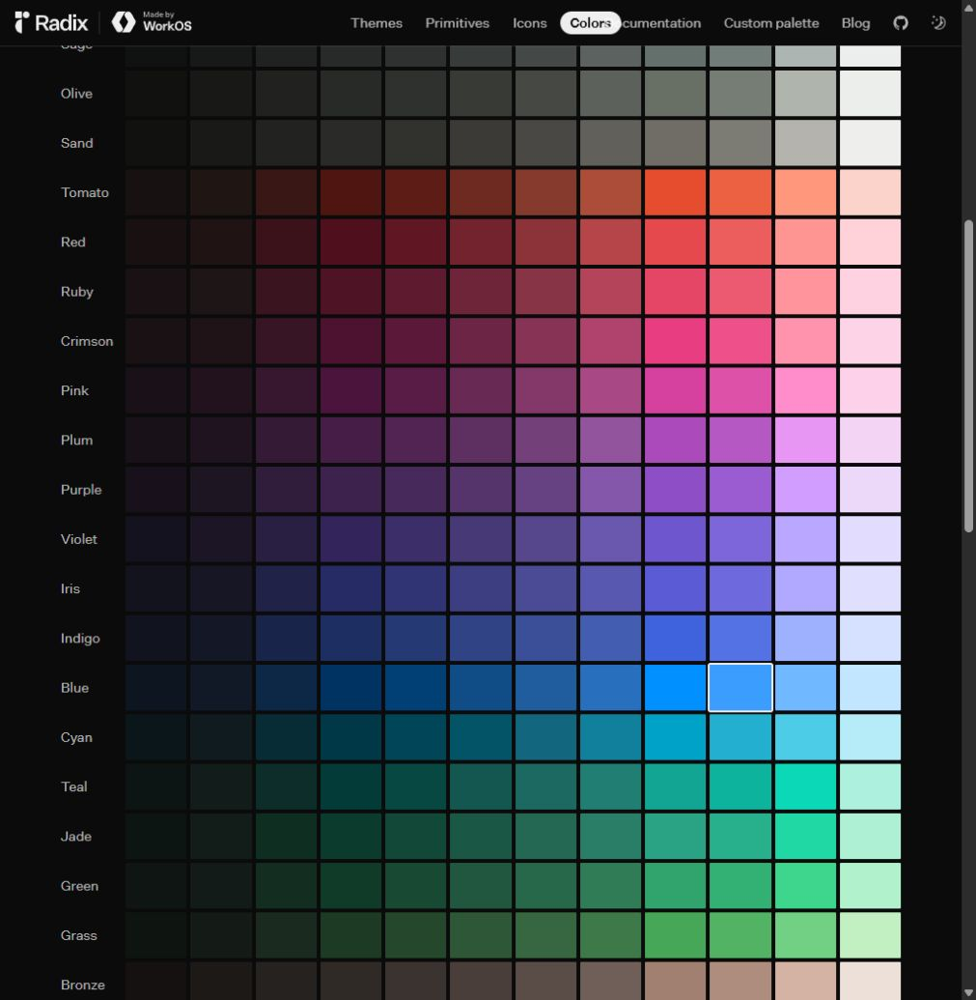
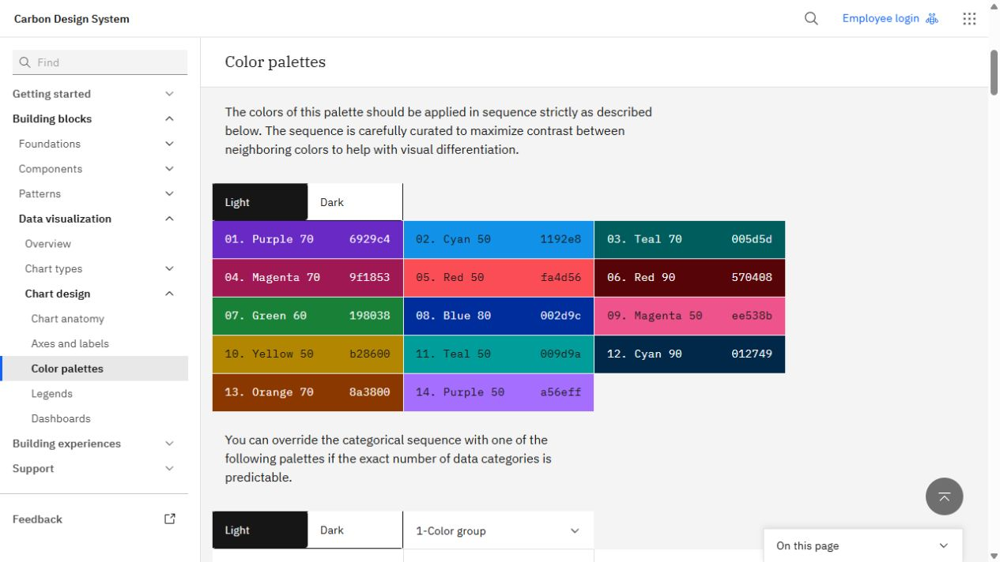
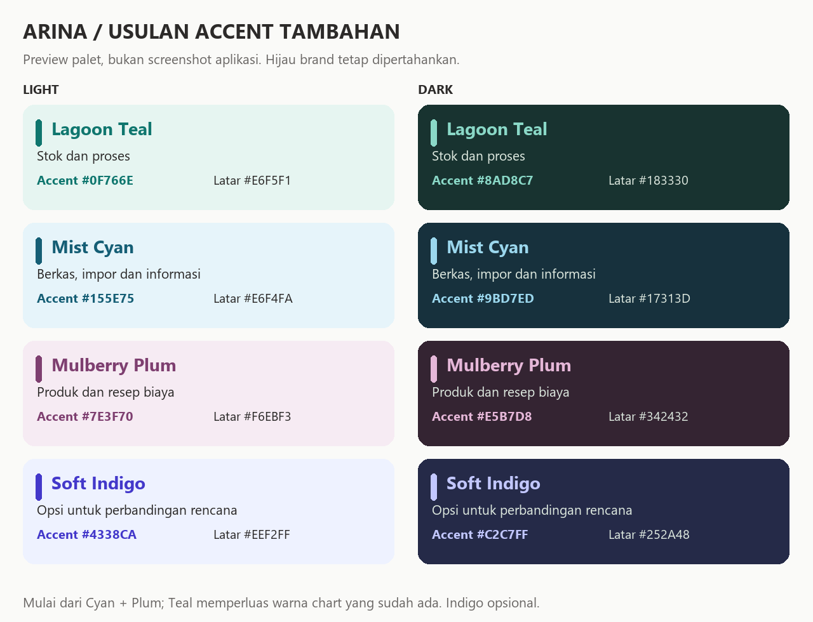

# Referensi tambahan palet Arina — 25 Oktober 2026

Status: **proposed**. Riset melalui Browser Use; tidak mengubah warna aplikasi. Nilai hex di bawah adalah usulan khusus Arina yang diinformasikan oleh referensi, bukan salinan literal swatch Radix/Carbon.

## Temuan dari source

**Verified:** `Theme.kt` tetap memiliki hijau primary `#2D6A4F` / `#52B788`, terakota secondary, dan netral hangat. `MetricColors.kt` sudah menyediakan biru untuk kas, lavender untuk profit, mint untuk income, serta sand untuk expense. Chart juga sudah memiliki varian teal dan ungu.

**Verified:** `resolveAgricultureCategoryColor` memetakan pupuk ke success, tenaga kerja ke info (sage), irigasi ke warna chart pertama (hijau); pestisida ke danger dan alat/sewa ke warning. Karena itu kategori yang dikenali masih terkumpul pada hijau atau status colors, meskipun fallback chart mempunyai variasi lebih luas. Ini temuan source, bukan klaim screenshot build terkini.

**Proposed:** perluas pemakaian accent pada card dan bedakan warna kategori secara stabil. Jangan memaknai pestisida sebagai transaksi bermasalah atau sewa sebagai warning hanya karena nama kategorinya. Kategori dan status merupakan dua makna berbeda; warning/kerugian tetap harus mempunyai label dan ikon.

## Dua referensi yang diperiksa lewat browser

### Radix Colors

[Sumber resmi](https://www.radix-ui.com/colors). **Observed:** keluarga Plum, Indigo, Cyan dan Teal tersedia sebagai tonal scales; halaman memisahkan background, komponen interaktif, border, solid dan text. Screenshot saat riset berada pada tema gelap.

**Adaptasi:** setiap accent Arina mempunyai pasangan container lembut dan foreground yang lebih kuat, dengan pasangan dark tersendiri. Tidak mengadopsi seluruh warna atau memasang library web pada Android. Klaim kontras milik Radix tidak otomatis berlaku pada hex usulan ini.

### IBM Carbon — Data visualization color palettes

[Sumber resmi](https://www.carbondesignsystem.com/building-blocks/data-visualization/color-palettes). **Observed:** palet kategori menampilkan Purple, Cyan, Teal, Magenta dan keluarga lain dengan urutan yang dirancang untuk membedakan kategori berdekatan. Panduan membedakan categorical, sequential dan alert palettes. Panduan situs menyatakan masih work in progress.

**Adaptasi:** grafik multi-kategori tidak perlu didominasi hijau. Gunakan warna kategori secara konsisten, disertai label/nominal. Tidak menyalin semua warna IBM atau mengklaim susunan warna khusus Arina sudah diuji untuk color blindness.

## Usulan warna tambahan

| Kandidat | Accent light | Container light | Accent dark | Container dark | Pemakaian yang disarankan |
| --- | --- | --- | --- | --- | --- |
| Lagoon Teal | `#0F766E` | `#E6F5F1` | `#8AD8C7` | `#183330` | Ringkasan stok dan proses; warning stok tetap amber |
| Mist Cyan | `#155E75` | `#E6F4FA` | `#9BD7ED` | `#17313D` | Berkas/impor dan informasi netral |
| Mulberry Plum | `#7E3F70` | `#F6EBF3` | `#E5B7D8` | `#342432` | Produk/resep biaya; tidak menandai untung/rugi |
| Soft Indigo | `#4338CA` | `#EEF2FF` | `#C2C7FF` | `#252A48` | Opsi accent perbandingan rencana; cukup pilih bila berbeda jelas dari lavender |

Rekomendasi utama: mulai dari **Cyan dan Plum**, lalu perluas **Teal yang sebenarnya sudah hadir pada chart** ke card terkait. Indigo adalah opsi tambahan, tidak perlu dipakai bersamaan dengan semua warna lain. Hijau tetap untuk aksi utama dan identitas; biru/lavender/sand existing tidak harus diganti.

## Cara pemakaian agar variasi tetap terarah

- Pertahankan latar halaman netral dan mayoritas teks `onSurface`; gunakan container berwarna pada kartu ringkasan terpilih. Jangan memenuhi seluruh layar dengan semua warna kandidat.
- Accent kuat untuk ikon, label singkat, atau garis penanda. Angka rupiah utama memakai warna teks utama; bila rugi/defisit, status danger tetap terlihat.
- Gunakan sekitar dua atau tiga keluarga accent per tampilan sebagai titik awal desain, bukan aturan aksesibilitas baku. Tidak perlu memberikan warna baru pada setiap baris.
- Tombol Simpan/Tambah tetap hijau. Danger/error dan warning tidak dijadikan variasi dekoratif; jangan menambahkan coral/ochre untuk card normal sebelum benturan makna status diselesaikan.
- Untuk kategori grafik, warna mengikuti identitas kategori, bukan posisi setelah sort nominal. Daftar dan grafik dengan kategori sama harus mempunyai mapping konsisten. Jika kategori banyak, gunakan top categories + rincian, bukan terus menambah warna yang makin mirip.
- Warna kategori bukan satu-satunya pembeda: label, nilai, ikon, dan bila perlu pola/marker harus tetap tersedia. Nilai kontras teks tidak membuktikan dua series grafik mudah dibedakan.

## Verifikasi dan batas klaim

Jalankan `rtk proxy python scripts/qa/verify_palette_extension.py` dari root repository. Verifier memeriksa kontras WCAG 2.x sRGB untuk pasangan accent/container serta body/container di light dan dark, validitas hex, keberadaan preview dan hash screenshot sumber.

**Verified statically:** 16 pasangan teks solid terhadap latar solid memenuhi 4.5:1. Tidak memakai opacity/gradient pada perhitungan tersebut. Teks putih di atas accent, focus ring, disabled state, kontras antar-series, color vision deficiency dan keterbacaan pada device belum diverifikasi. Preview adalah diagram swatch usulan, bukan hasil implementasi aplikasi.

Tidak ada perubahan Kotlin, token theme, schema, dependency, data atau plan implementasi sebelumnya. Penerapan kandidat membutuhkan review pada layout nyata dan pengujian kedua tema. Tujuan sesi ini memberi saran dan bukti referensi; tidak mengklaim perbaikan aplikasi telah selesai.
