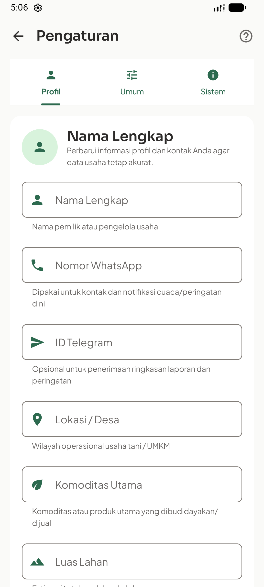
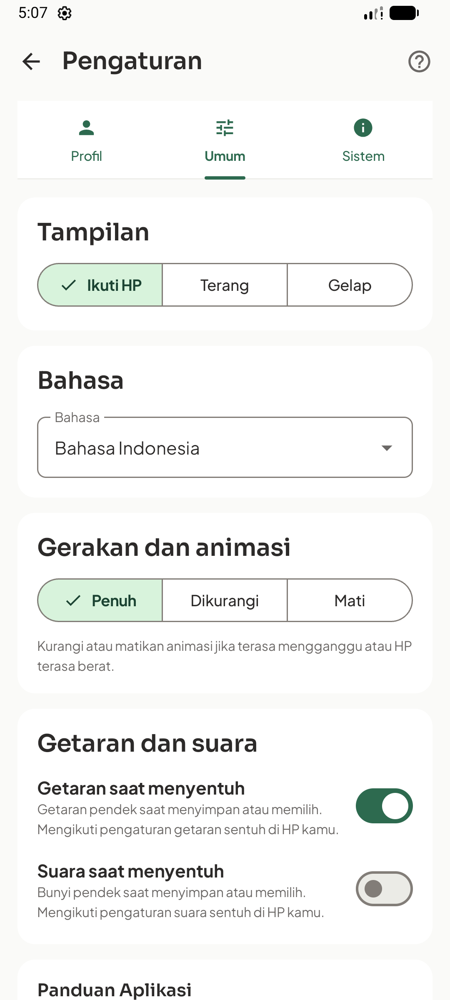
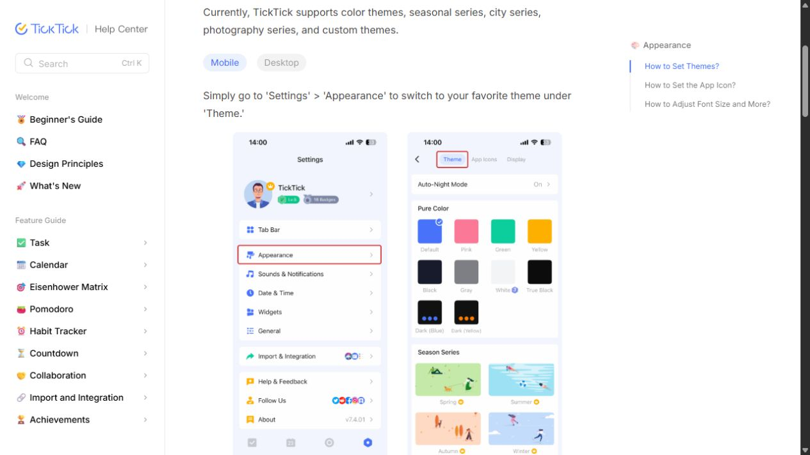
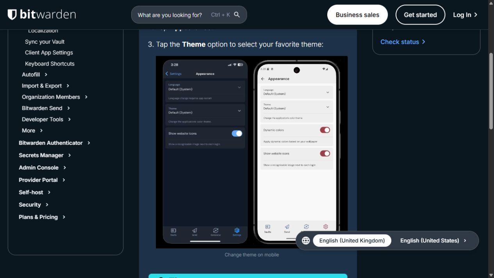
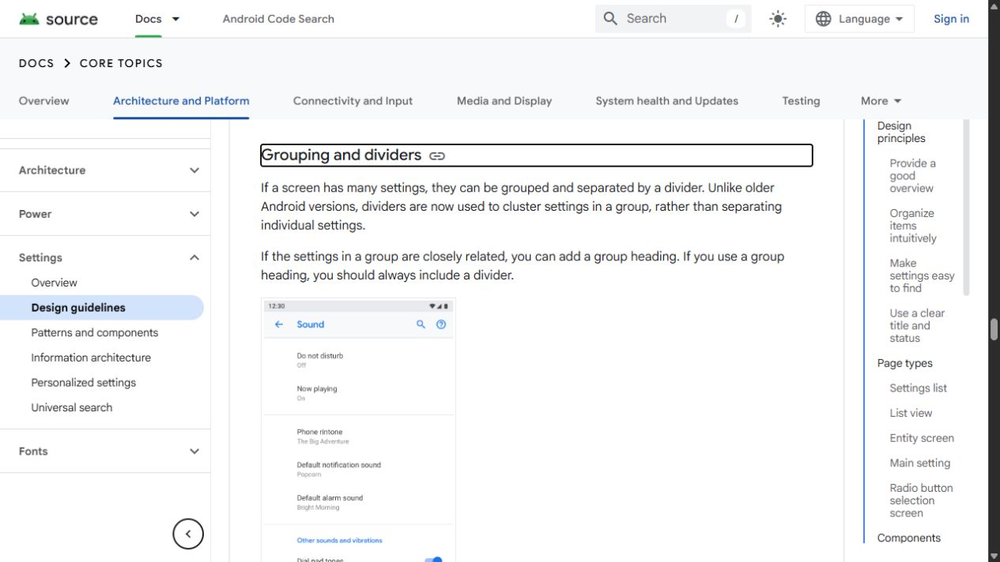

# Referensi perombakan halaman Settings Arina

Tanggal: 25 Oktober 2026. Status: **riset selesai, arah desain proposed**. Tidak ada perubahan kode aplikasi pada sesi ini.

## Kondisi yang diperiksa

**Verified dari source:** `AccountSettingsScreen.kt` berisi `SettingsScreen` dengan tab Profil, Umum, Sistem. Profil langsung merender `ProfileEditCard` dan `AccountCard`. Umum memuat theme, bahasa, motion, getaran/suara serta panduan; Sistem memuat banner aplikasi, spesifikasi, kontak dan lisensi animasi. `MoreScreen.kt` menjelaskan pemisahan operasional impor/ekspor ke Berkas dan Data. `MankeuApp.kt` membuka Settings sebagai overlay dan memasok callback/preferensi existing.

**Verified dari capture historis:** dua gambar berikut berasal dari simulasi native 24 Oktober, bukan pengambilan dari build baru. Keduanya memperlihatkan form profil sebagai konten awal dan beberapa card besar pada Umum. Source working tree mempunyai perubahan dari sesi lain; paritas screenshot historis dengan APK/source terkini belum dibuktikan.





**Inferred:** halaman awal akan lebih mudah dipindai bila memperlihatkan ringkasan identitas dan nilai pengaturan terlebih dahulu, sementara form/penjelasan teknis dibuka saat diperlukan. Belum ada uji pemahaman pengguna untuk membuktikan peningkatannya.

## Tiga referensi terpilih melalui browser

### 1. TickTick — profil ringkas dan kelompok menu

[Appearance, help resmi](https://help.ticktick.com/external/articles/7254750337695744000). Pilihan **Mobile** benar-benar dibuka di browser.



**Observed:** ilustrasi mobile menampilkan avatar/nama pada bagian atas dan baris menu berikon, dengan kelompok terpisah. Appearance menjadi tujuan tersendiri; contoh di sebelahnya menampilkan pilihan tema. Ilustrasi ini terlihat memakai gaya iOS, jadi tidak diklaim sebagai screenshot Android atau versi TickTick yang sedang dijalankan.

**Adaptasi untuk Arina:** jadikan profil lokal sebagai ringkasan, dengan aksi Edit menuju editor; gunakan kelompok row untuk pengaturan. Ikon diberi warna secukupnya dari palet Arina. Jangan menyalin level, badge premium, upgrade, katalog tema musiman atau tuntutan login TickTick.

**Paling relevan untuk:** halaman utama Settings.

### 2. Bitwarden — pengaturan mobile dengan nilai aktif

[Change App Appearance, help resmi](https://bitwarden.com/help/change-theme/). Tab **Mobile** benar-benar dipilih.



**Observed:** screenshot memperlihatkan Appearance pada dua platform, dengan Language, Theme, nilai Default (System), dan pengaturan toggle. Ada label pendek dan penjelasan per opsi. Dokumentasi menjelaskan Settings → Appearance → Theme; tidak dilakukan login atau perubahan pengaturan akun Bitwarden.

**Adaptasi untuk Arina:** row `Tampilan — Ikuti perangkat`, `Bahasa — Indonesia`, dan `Gerakan — Dikurangi` menunjukkan nilai sebenarnya sebelum dibuka. Switch hanya untuk nilai on/off seperti getaran/suara; theme dan motion memakai pilihan tunggal. Tidak menyalin dynamic colors yang dapat menggeser branding Arina, fitur keamanan vault, atau kebijakan login produknya.

**Paling relevan untuk:** halaman detail preferensi dan pola row.

### 3. Android Settings Design Guidelines — struktur dan kontrol native

[Panduan resmi AOSP](https://source.android.com/docs/core/settings/settings-guidelines#grouping-dividers), dibuka melalui tautan dari Android Developers.



**Observed:** contoh menempatkan pengaturan terkait dalam kelompok; nilai aktif tampil sebagai supporting text. Panduan menyarankan overview yang jelas, judul singkat, pengaturan umum di atas, dan screen tersendiri untuk pilihan yang banyak. Contoh visual menggunakan generasi Android lama; ia dipakai sebagai referensi pola interaksi, bukan styling Material 3 terkini.

**Adaptasi untuk Arina:** target sentuh minimal 48dp, label boleh membungkus, nilai tidak terpotong, kelompok mempunyai heading bermakna. Gunakan Compose Material 3 yang sudah ada; tidak mengadopsi library XML Preference, tampilan Android lama, atau semua aturan warna status dari halaman tersebut.

**Paling relevan untuk:** konsistensi Android dan hierarki pengaturan.

## Arah yang direkomendasikan untuk Arina

**Proposed:** satu halaman ringkasan Settings dengan kelompok menu, kemudian editor/detail sesuai kebutuhan. Ini perubahan struktur internal Settings yang perlu dirancang sebelum implementasi; bukan sekadar menambahkan warna pada tab yang ada. Navigasi utama aplikasi tidak perlu diubah.

```text
Pengaturan

[Avatar] Profil pemilik                         Edit >
         Nama lokal / Belum diisi

PENGALAMAN APLIKASI
Tampilan                              Ikuti perangkat >
Bahasa                                      Indonesia >
Gerakan                                     Dikurangi >
Getaran dan suara                                     >

AKUN OPSIONAL
Akun Google                           Belum terhubung >
Digunakan untuk cadangan cloud opsional

BANTUAN
Pusat bantuan                                         >
Panduan interaktif                                    >

TENTANG
Tentang Arina                                         >
Versi, privasi, lisensi, dan dukungan
```

Nilai di wireframe hanya contoh keadaan, bukan default baru. Akun terhubung menampilkan keadaan aktual; belum terhubung tidak diberi badge merah seolah error. Status backup sukses tidak boleh disimpulkan dari login Google saja.

- **Profil:** layar utama cukup avatar/initial, nama dan Edit. Nama tetap dapat diisi secara lokal tanpa Google. Form dengan banyak input memakai editor yang cukup luas; data tersimpan tidak berubah sampai aksi Simpan. Draft, validasi, Back dan keyboard harus diuji saat implementasi.
- **Preferensi:** satu grouped card dapat menampung beberapa row terkait. Gunakan ikon kecil dengan tile pastel, judul jelas, current value dan chevron untuk navigasi. Jangan membuat satu card besar untuk setiap preference sederhana.
- **Pilihan tema:** detail Tampilan dapat memperlihatkan preview Terang/Gelap/Ikuti perangkat. Ini hanya mengganti tema existing, bukan menambah banyak custom theme. Palet light/dark mengikuti [usulan keluarga warna Arina](../2026-10-25-light-dark-palette-alignment/README.md), yang masih berstatus proposed.
- **Gerakan dan respons:** Full/Reduced/Off tetap dimiliki preference existing; getaran dan suara tetap boolean. Reduced menghilangkan spatial travel/scale. Perubahan preferensi langsung tercermin; tidak menambah tombol Simpan global untuk setting instan.
- **Bantuan:** pusat bantuan, izin penawaran tur dan reset tur tetap dapat ditemukan. Reset tur tidak disamakan dengan reset data usaha dan perlu copy yang menyatakan dampaknya secara tepat.
- **Tentang:** versi dari `BuildConfig`, privasi offline, spesifikasi, lisensi aset/animasi serta kontak dukungan ditempatkan sebagai detail. Hindari spesifikasi platform mendominasi layar utama.
- **Berkas dan data:** impor, ekspor, backup lokal/Drive dan reversal tetap berada pada layar operasional existing. Tidak menggandakan semua operasional itu ke Settings hanya karena referensi lain memilikinya.
- **Visual:** hijau Arina untuk active state dan aksi utama. Biru/lavender/sand/teal untuk membedakan kelompok secara ringan; permukaan utama tetap tenang. Tema light dan dark mempunyai hierarki sama. Row tidak mengandalkan warna saja.

## Cakupan yang perlu dibahas sebelum implementasi

Pemilik UI utama tetap `AccountSettingsScreen.kt`; entry overlay, Back dan callback berada pada `MankeuApp.kt`. `AppPreferences.kt`, domain/profile persistence dan autentikasi tidak ditulis ulang untuk perubahan visual. Tour deep link `SETTINGS_DISPLAY`, `SETTINGS_GUIDES`, `SETTINGS_DRIVE` perlu diarahkan ke detail yang sesuai bila tab dihapus. Perubahan struktur harus mempertahankan draft, posisi scroll, selected option serta fokus aksesibilitas.

Alternatif lebih kecil adalah mempertahankan tiga tab dan hanya merampingkan card/row. Itu mengurangi risiko perubahan navigasi, tetapi halaman awal masih kurang memberi overview dibandingkan satu hub. Rekomendasi riset ini tetap **hub ringkas + detail**, dengan TickTick sebagai acuan struktur, Bitwarden untuk kontrol, dan Android untuk perilaku native.

## Bukti dan batas sesi

Tiga screenshot browser tersimpan beserta URL dan SHA256 di [sources.json](sources.json). Jalankan `rtk proxy python scripts/qa/verify_settings_references.py` untuk memeriksa lima embedded screenshot/link lokal, tiga hash sumber, dan code fences. Verifikasi ini hanya untuk dokumen/evidence; tidak ada build, runtime test, screenshot APK baru, perubahan UI aplikasi atau klaim peningkatan usability pada sesi ini.
