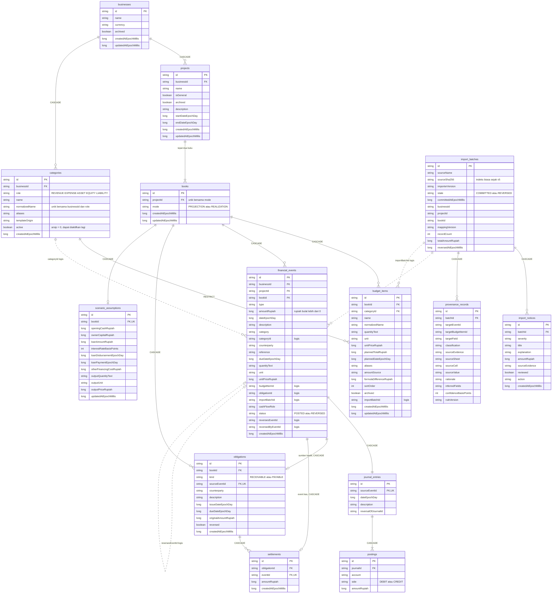

# Entity Relationship Diagram - Basis Data Mankeu

Skema Room SQLite **versi 5** (`com.mankeu.data`), diselaraskan dengan `Entities.kt` dan `app/schemas/com.mankeu.data.AppDatabase/5.json`.

> Garis **tegas** adalah foreign key sungguhan (dengan aturan `CASCADE` atau `RESTRICT`). Garis **putus-putus** adalah referensi logis: kolomnya diindeks, tetapi tidak dijaga foreign key, sehingga integritasnya ditegakkan oleh `FinanceRepository`.

## Aturan integritas

1. **Dua buku per lahan.** Indeks unik `(projectId, mode)` dan `ensureBookPair` menjamin tepat satu buku `PROJECTION` dan satu `REALIZATION`.
2. **Jurnal selalu seimbang.** Setiap event memiliki tepat satu `journal_entries` (unik pada `sourceEventId`). Jumlah debit dan kredit posting diperiksa sebelum baris ditulis, di dalam transaksi yang sama.
3. **Piutang dan utang.** Transaksi kredit membuat satu `obligations`. Setiap pembayaran menambah satu `settlements` yang menunjuk event kasnya sendiri. Sisa tagihan dan status tidak disimpan, melainkan dihitung dari pembayaran yang belum dibalik.
4. **Koreksi.** Pembalikan dan penghapusan mengikuti tabel aturan di `docs/DOMAIN_MODEL.md` ("Correction rules"), termasuk penolakan saat masih ada pembayaran aktif.
5. **Impor.** `sourceSha256` diindeks tanpa unik sejak v5 (D-076). Duplikat ditolak oleh `hasImported`, yang hanya menghitung batch berstatus `COMMITTED`, sehingga berkas yang batch-nya sudah dibalik dapat diimpor ulang.
6. **Migrasi.** `MIGRATION_3_4` menghapus `units` dan `categories.defaultUnitId`. `MIGRATION_4_5` mengganti indeks unik `sourceSha256` menjadi indeks biasa. Tidak ada migrasi destruktif.
