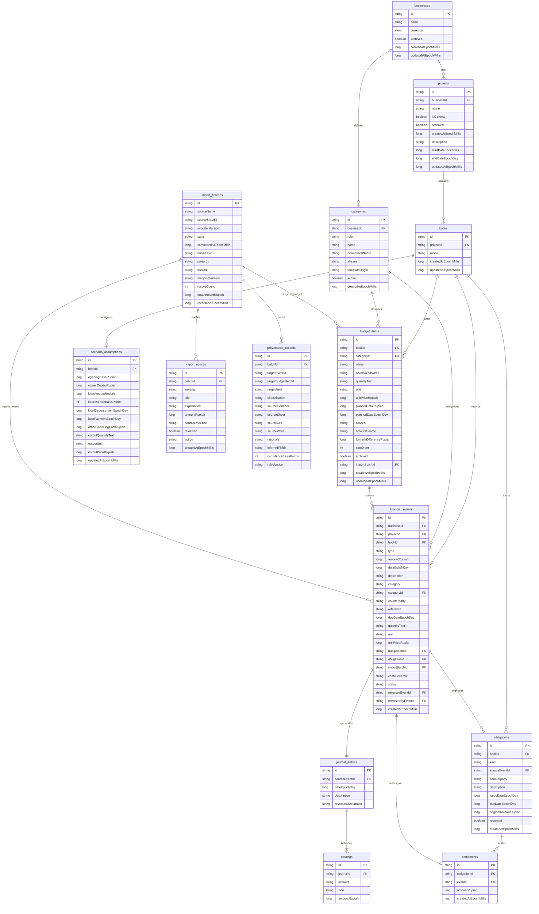

# Entity Relationship Diagram (ERD) - Mankeu Database

Diagram ini merefleksikan skema basis data Room SQLite **Schema Version 4** pada aplikasi Mankeu (`com.mankeu.data`). 

> [!NOTE]
> Pada Schema Version 4, entitas `units` telah dihapus (migrasi murni tanpa kehilangan data/tanpa `destructiveFallback`). Satuan kini dicatat sebagai teks bebas (*free-text string*) pada transaksi dan item anggaran untuk fleksibilitas UMKM.

## Relasi Kunci & Aturan Integritas

1. **Isolasi Buku (`books`)**:
   - Setiap `project` memiliki tepat 2 buku: `mode = 'PROJECTION'` dan `mode = 'REALIZATION'`.
   - Data transaksi dan anggaran terisolasi secara ketat per buku sehingga rencana/simulasi tidak pernah mencemari realisasi kas nyata.
2. **Double-Entry Invariant**:
   - Setiap `financial_events` yang berstatus `POSTED` memiliki relasi 1:1 ke `journal_entries`.
   - `journal_entries` memiliki $\ge 2$ baris `postings` di mana $\sum \text{Debit} == \sum \text{Credit}$.
3. **Integritas Piutang & Utang (`obligations` & `settlements`)**:
   - Transaksi kredit (`CREDIT_SALE`, `CREDIT_PURCHASE_EXPENSE`, `CREDIT_PURCHASE_ASSET`) menghasilkan `obligations`.
   - Pembayaran cicilan/pelunasan menghasilkan `settlements` yang menghubungkan event kas pelunasan dengan kewajiban awal.
   - Aturan pembatalan (*Reversal Guard*): Sebuah transaksi sumber kewajiban tidak dapat dibalik jika telah memiliki `settlements` aktif.
4. **Audit Trail Impor & Pembalikan Atomik**:
   - Seluruh baris yang diimpor dari berkas Excel menyimpan `importBatchId`.
   - Pembalikan batch (`reverseImportBatch`) membatalkan seluruh transaksi dalam batch secara atomik dan mengarsipkan item anggaran terkait.
