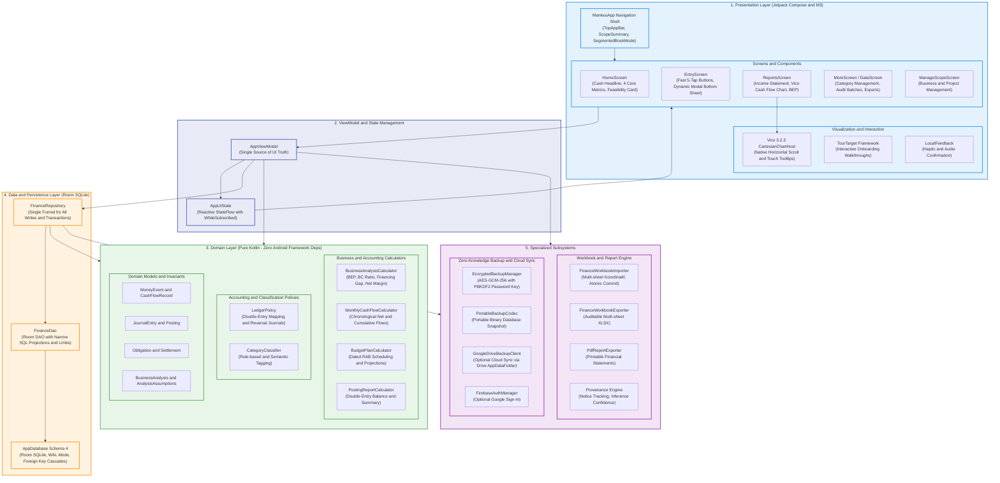

# Arsitektur Sistem Mankeu (Clean and Layered Architecture)

Aplikasi Mankeu dirancang dengan prinsip **Local-First**, **Offline-First**, dan pemisahan tanggung jawab yang ketat (*Clean Architecture*). Operasi lokal tidak bergantung pada koneksi internet, akun eksternal, atau backend server.

## Prinsip Desain Utama

1. **Unidirectional Data Flow (UDF)**:
   - UI hanya membaca immutable `AppUiState`.
   - Perubahan data hanya terjadi melalui pemanggilan fungsi suspend pada `AppViewModel` yang mendelegasikan ke `FinanceRepository`.
2. **Kemandirian Domain (Domain Purity)**:
   - Modul kalkulasi kelayakan (`BusinessAnalysisCalculator`), jadwal kas (`MonthlyCashFlowCalculator`), dan aturan buku besar (`LedgerPolicy`) tidak mengimpor satupun paket Android (`androidx.*`). Semuanya adalah fungsi pure Kotlin yang 100% *unit-testable*.
3. **Penyimpanan Uang Presisi Tinggi**:
   - Nilai uang disimpan secara eksklusif dalam tipe integer `Long` Rupiah.
   - Perhitungan rasio dan margin menggunakan `java.math.BigDecimal` dengan `RoundingMode.HALF_UP` untuk menghindari kesalahan komputasi desimal floating-point.
4. **Keamanan Data (Zero-Knowledge Backup)**:
   - Cadangan data (`.aabk`) dienkripsi menggunakan AES-256 dalam mode GCM dengan otentikasi data (AAD). Kunci diturunkan dari kata sandi pengguna via PBKDF2 (310.000 iterasi). Server atau pihak ketiga tidak dapat membaca isi keuangan.
