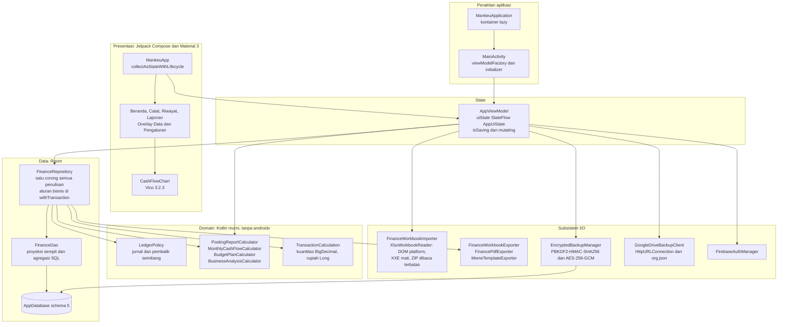
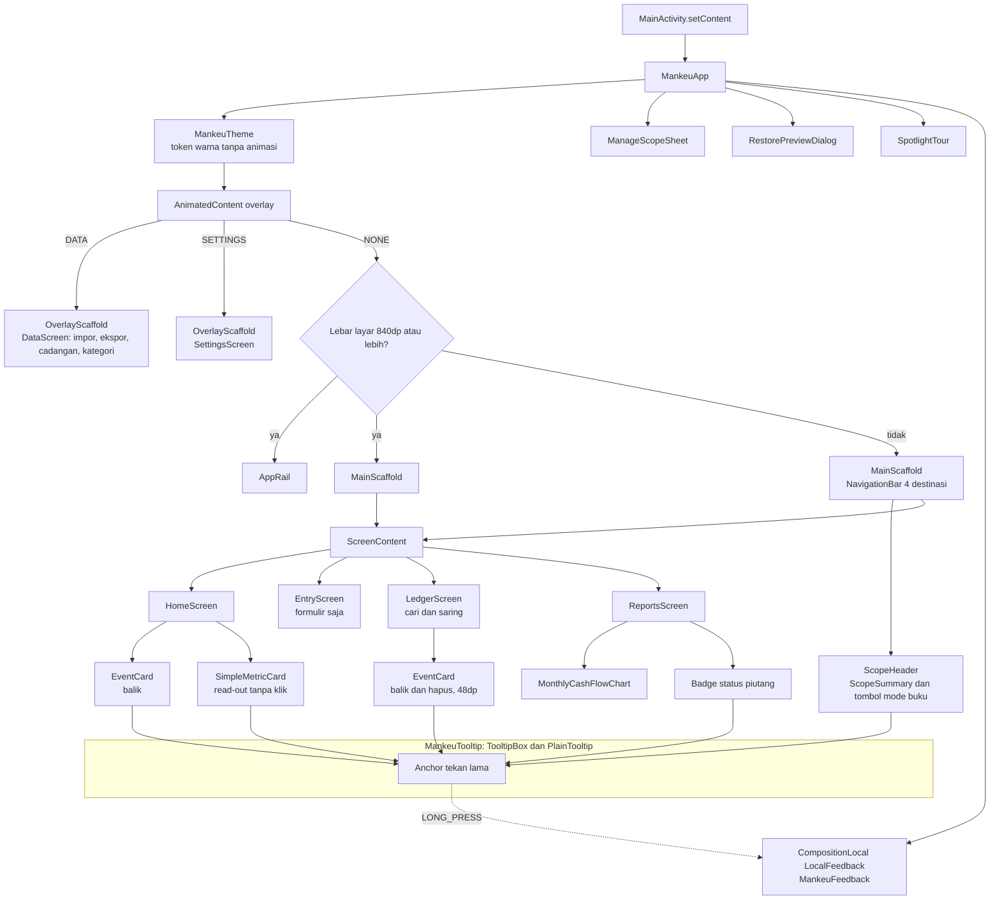

# Arsitektur Sistem Mankeu

Aplikasi native Android yang **offline-first**: semua data keuangan tinggal di Room SQLite di perangkat. Firebase Auth dan Google Drive hanya dipakai untuk cadangan terenkripsi opsional.

## 1. Lapisan dan dependensi

Dependensi dirakit secara manual di `MankeuApplication` (pola *manual dependency injection* yang direkomendasikan Android untuk satu grafik kecil) dan diteruskan ke `AppViewModel` lewat `viewModelFactory { initializer { } }` dari Jetpack Lifecycle.

## 2. Pohon komponen Compose

## 3. Aliran data reaktif

```mermaid
flowchart LR
    roomTables[("Tabel Room")] -->|"invalidation"| daoFlows["Flow FinanceDao<br/>observeEventsForBook LIMIT 200<br/>observeCashFlowRows<br/>observeCategoryTotals<br/>observePostingRows"]
    daoFlows --> repoFlows["FinanceRepository<br/>pemetaan ke model domain"]

    subgraph selectionChain ["Rantai pemilihan: SharingStarted.Eagerly"]
        selBusinesses["businesses"] --> selProjects["projects"]
        selProjects --> selBooks["books"]
        selBooks --> selBookId["selectedBookId"]
    end

    subgraph bookQueries ["Kueri per buku: WhileSubscribed 5000 ms"]
        perBook["events, eventCount, cashFlowRecords,<br/>categoryTotals, budgetItems, obligations,<br/>summary, assumptions, importBatches"]
    end

    repoFlows --> selBusinesses
    selBookId -->|"flatMapLatest"| perBook
    repoFlows --> perBook
    perBook --> combined["combine bertingkat"]
    selBookId --> combined
    combined --> uiState["uiState: StateFlow AppUiState"]
    uiState -->|"collectAsStateWithLifecycle"| composeUi["Compose UI"]
    composeUi -->|"aksi pengguna"| mutatingGuard["mutating<br/>isSaving compareAndSet"]
    mutatingGuard --> repoWrite["FinanceRepository<br/>withTransaction"]
    repoWrite --> roomTables
```

## Prinsip desain

1. **Satu sumber kebenaran.** UI hanya membaca `AppUiState`. Setiap penulisan melewati `AppViewModel.mutating` lalu `FinanceRepository`, dan setiap aturan bisnis ditegakkan di repository di dalam transaksi yang sama dengan penulisannya.
2. **Domain murni.** Kalkulator dan `LedgerPolicy` tidak mengimpor paket Android sehingga seluruhnya diuji dengan unit test JVM.
3. **Uang presisi.** Rupiah disimpan sebagai `Long` bulat. Rasio, margin, dan kuantitas memakai `BigDecimal` dengan `RoundingMode.HALF_UP`.
4. **Primitif standar.** `org.json` bawaan Android untuk JSON Drive, `viewModelFactory` dari Jetpack, parser DOM platform untuk XLSX, dan `NumberFormat` yang di-cache per thread (D-082). Hilt, Apache POI, DataStore, dan AppCompat dipertimbangkan lalu ditolak dengan alasan di D-082.
5. **Cadangan tanpa server.** Berkas `.aabk` dienkripsi AES-256-GCM dengan kunci PBKDF2-HMAC-SHA256 310.000 iterasi. Drive hanya menyimpan ciphertext di `appDataFolder`.
