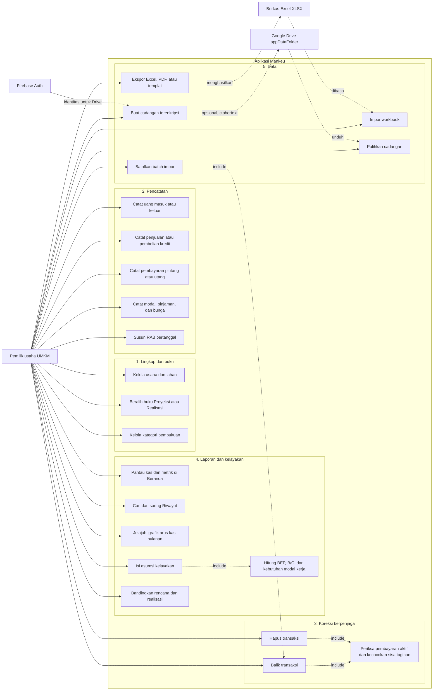

# Use Case Diagram - Mankeu

Mankeu adalah aplikasi satu pengguna tanpa peran atau hak akses bertingkat: satu pemilik usaha mengelola seluruh buku di perangkatnya. Aktor lain adalah sistem eksternal.

| Use case | Tujuan bagi pemilik usaha |
| --- | --- |
| Catat uang masuk atau keluar | Mengganti buku kas tulis dengan beberapa ketukan, tanpa istilah debit dan kredit. |
| Koreksi berpenjaga | Membalik atau menghapus catatan yang salah tanpa pernah membuat saldo kas, piutang, atau utang menjadi tidak cocok. |
| Kelayakan | Menjawab "berapa modal yang harus disiapkan" dan "berapa unit harus terjual agar tidak rugi". |
| Impor workbook | Membawa pembukuan Excel yang sudah ada tanpa mengetik ulang. Setiap batch dapat dibatalkan dan diimpor ulang. |
| Cadangan terenkripsi | Memindahkan atau menyelamatkan data tanpa pihak mana pun dapat membaca isinya. |
