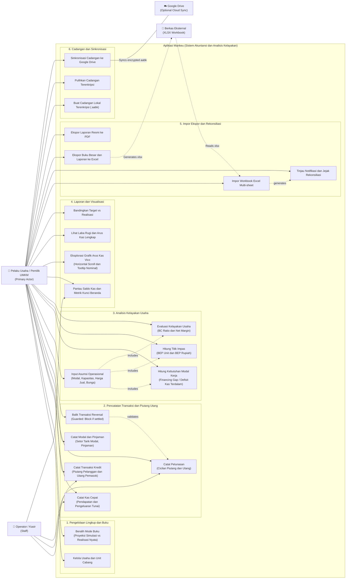

# Use Case Diagram - Mankeu

Diagram ini menggambarkan interaksi antara aktor (Pelaku Usaha UMKM, Operator/Kasir, Berkas Eksternal Excel, dan Google Drive) dengan sistem Mankeu.

## Deskripsi Ringkas Skenario Utama

| Use Case | Sasaran Bisnis Pengguna |
| :--- | :--- |
| **Catat Kas Cepat** | Menggantikan pencatatan buku tulis kasir dengan input 4-5 tap tanpa beban istilah akuntansi rumit. |
| **Analisis Kelayakan** | Menjawab pertanyaan krusial UMKM: *"Berapa uang yang harus disiapkan sebelum buka usaha?"* (Financing Gap) dan *"Berapa mangkok/porsi harus laku agar tidak rugi?"* (BEP). |
| **Beralih Mode Buku** | Memastikan rencana anggaran (RAB) dan realisasi transaksi berjalan di dua wadah terisolasi penuh sehingga data nyata tidak terkotori oleh angka perkiraan. |
| **Impor & Rekonsiliasi** | Mengizinkan UMKM membawa data pembukuan Excel yang sudah berjalan tanpa perlu mengetik ulang transaksi masa lalu satu per satu. |
| **Grafik Arus Kas Vico** | Memvisualisasikan naik-turunnya kas bulanan secara interaktif dengan kemampuan digeser dan disentuh untuk melihat angka rupiah pastinya. |
