# Class Diagram (UML) - Mankeu Core Domain and Architecture

Diagram kelas ini mendeskripsikan model domain murni (*Domain Entities & Value Objects*), kalkulator finansial, *Repository*, *DAO*, dan *ViewModel* pada aplikasi Mankeu.

```mermaid
classDiagram
    %% ==========================================
    %% ENUMS
    %% ==========================================
    class BookMode {
        PROJECTION
        REALIZATION
    }

    class FinancialEventType {
        CASH_INCOME
        CASH_EXPENSE
        CREDIT_SALE
        CREDIT_PURCHASE_EXPENSE
        CREDIT_PURCHASE_ASSET
        RECEIVABLE_COLLECTION
        PAYABLE_SETTLEMENT
        OWNER_CAPITAL
        OWNER_DRAWING
        LOAN_RECEIVED
        LOAN_PRINCIPAL_REPAID
        LOAN_INTEREST_PAID
        ASSET_PURCHASE_CASH
        REVERSAL
    }

    class LedgerAccount {
        CASH
        REVENUE
        OPERATING_EXPENSE
        ACCOUNTS_RECEIVABLE
        ACCOUNTS_PAYABLE
        OWNER_EQUITY
        OWNER_DRAWING
        LOAN_PAYABLE
        INTEREST_EXPENSE
        EQUIPMENT_ASSET
    }

    class PostingSide {
        DEBIT
        CREDIT
    }

    class CashFlowRole {
        OPERATING
        INVESTING
        FINANCING
    }

    %% ==========================================
    %% DOMAIN ENTITIES & MODELS
    %% ==========================================
    class MoneyEvent {
        +String id
        +LocalDate date
        +FinancialEventType type
        +Long amountRupiah
        +String description
        +String category
        +CashFlowRole cashFlowRole
        +String counterparty
        +String reference
        +LocalDate dueDate
        +String quantityText
        +String unit
        +Long unitPriceRupiah
        +String reversesEventId
        +String reversedByEventId
    }

    class JournalEntry {
        +String id
        +String sourceEventId
        +LocalDate date
        +String description
        +List postings
        +String reversalOfJournalId
        +requireBalanced()
    }

    class Posting {
        +LedgerAccount account
        +PostingSide side
        +Long amountRupiah
    }

    class Obligation {
        +String id
        +String kind
        +String sourceEventId
        +String counterparty
        +LocalDate issueDate
        +LocalDate dueDate
        +Long originalAmountRupiah
        +Long settledAmountRupiah
        +Long outstandingRupiah
        +Boolean reversed
    }

    class AnalysisAssumptions {
        +Long openingCashRupiah
        +Long ownerCapitalRupiah
        +Long loanAmountRupiah
        +Int interestRateBasisPoints
        +Long otherFinancingCostRupiah
        +String outputQuantityText
        +String outputUnit
        +Long outputPriceRupiah
    }

    class BusinessAnalysis {
        +Long estimatedInterestRupiah
        +Long cashBeforeAssumedFinancingRupiah
        +Long financingGapRupiah
        +Long endingCashAfterAssumptionsRupiah
        +Long estimatedRevenueRupiah
        +Long totalCostRupiah
        +Long costPerOutputRupiah
        +BigDecimal breakEvenQuantity
        +BigDecimal benefitCostRatio
        +Boolean feasible
        +Long grossProfitRupiah
        +Long netProfitRupiah
        +BigDecimal netProfitMarginPercent
        +Long breakEvenRevenueRupiah
    }

    class MonthlyCashFlow {
        +YearMonth month
        +Long operatingRupiah
        +Long investingRupiah
        +Long financingRupiah
        +Long netRupiah
        +Long cumulativeRupiah
    }

    class CashFlowRecord {
        +String id
        +LocalDate date
        +FinancialEventType type
        +CashFlowRole cashFlowRole
        +Long amountRupiah
        +String reversesEventId
    }

    class FinancialSummary {
        +Long operatingIncomeRupiah
        +Long operatingExpenseRupiah
        +Long profitRupiah
        +Long operatingCashFlowRupiah
        +Long investingCashFlowRupiah
        +Long financingCashFlowRupiah
        +Long cashBalanceRupiah
        +Long receivableOutstandingRupiah
        +Long payableOutstandingRupiah
    }

    %% ==========================================
    %% DOMAIN SERVICES & CALCULATORS
    %% ==========================================
    class LedgerPolicy {
        +journalFor(event)
        +reversalFor(original, reversal)
    }

    class BusinessAnalysisCalculator {
        +calculate(summary, assumptions, flows)
    }

    class MonthlyCashFlowCalculator {
        +calculateFromRecords(events, openingCash)
    }

    class BudgetPlanCalculator {
        +summarize(lines)
        +schedule(lines, openingCash)
    }

    %% ==========================================
    %% DATA LAYER
    %% ==========================================
    class FinanceRepository {
        -AppDatabase database
        -FinanceDao dao
        +recordEvent(draft)
        +reverseEvent(eventId, date, reason)
        +settleObligation(obligationId, amount, date)
        +observeRecentEvents(bookId, limit)
        +observeCashFlowRecords(bookId)
        +observeSummary(bookId)
        +commitImport(preview)
        +reverseImportBatch(batchId)
    }

    class FinanceDao {
        +insertEvent(event)
        +insertJournalEntry(entry)
        +insertPostings(postings)
        +observeRecentEvents(bookId, limit)
        +observeCashFlowRecords(bookId)
        +countLiveSettlementsForSource(eventId)
    }

    class AppDatabase {
        +financeDao()
    }

    %% ==========================================
    %% PRESENTATION LAYER
    %% ==========================================
    class AppViewModel {
        -FinanceRepository repository
        +selectBusiness(id)
        +selectProject(id)
        +selectBookMode(mode)
        +recordTransaction(draft)
        +reverseTransaction(eventId, reason)
        +settleObligation(obligationId, amount)
        +saveAssumptions(assumptions)
    }

    class AppUiState {
        +List businesses
        +String selectedBusinessId
        +List projects
        +String selectedProjectId
        +BookMode selectedBookMode
        +FinancialSummary summary
        +List events
        +List cashFlowRecords
        +ScenarioAssumptionEntity assumptions
        +Int eventCount
    }

    %% ==========================================
    %% RELATIONSHIPS
    %% ==========================================
    JournalEntry "1" *-- "*" Posting : contains
    MoneyEvent --> JournalEntry : generates
    MoneyEvent --> Obligation : originates
    Obligation --> FinancialSummary : reflected_in
    LedgerPolicy --> JournalEntry : produces
    BusinessAnalysisCalculator --> BusinessAnalysis : produces
    MonthlyCashFlowCalculator --> MonthlyCashFlow : produces
    BudgetPlanCalculator --> MonthlyCashFlow : schedules
    FinanceRepository --> AppDatabase : writes_tx
    FinanceRepository --> FinanceDao : queries
    FinanceRepository --> LedgerPolicy : validates
    AppViewModel --> FinanceRepository : delegates
    AppViewModel --> AppUiState : emits
```

## Karakteristik Desain & Integritas Kelas

1. **Invarian `JournalEntry.requireBalanced()`**:
   - Setiap kali `JournalEntry` dibuat oleh `LedgerPolicy`, metode `requireBalanced()` wajib dipanggil untuk memvalidasi $\sum \text{Debit} == \sum \text{Credit}$. Jika tidak seimbang, sistem melempar pengecualian (*fail-fast*) sebelum menyentuh lapisan persistensi.
2. **Proyeksi Ramping `CashFlowRecord`**:
   - `CashFlowRecord` hanya memuat 5 tipe primitif (`id`, `date`, `type`, `cashFlowRole`, `amountRupiah`). Hal ini mencegah pemborosan memori (OOM) saat menghitung grafik historis ribuan transaksi pada perangkat Android berspesifikasi rendah.
3. **Pemisahan `MoneyEvent` dan `BudgetItem`**:
   - Transaksi aktual (`MoneyEvent`) dan pos anggaran (`BudgetItem`) memiliki daur hidup dan model terpisah, sehingga tidak pernah terjadi tumpang tindih data antara realisasi nyata dan simulasi proyeksi.
