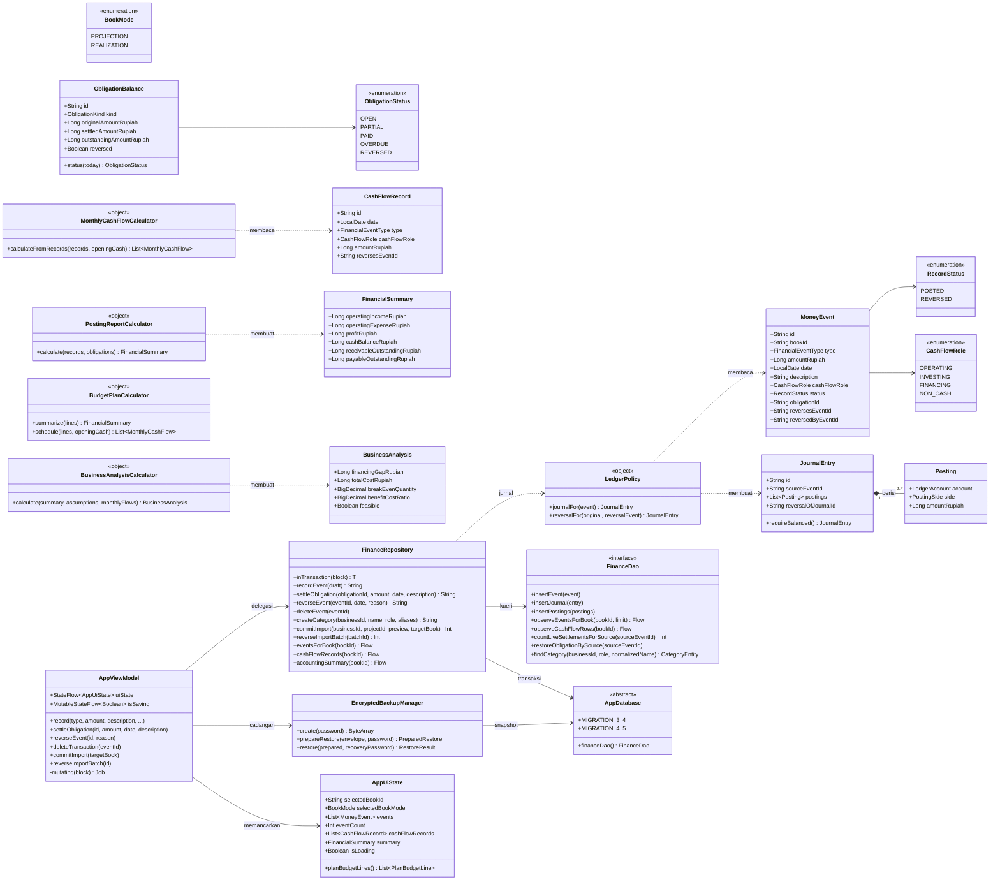

# Class Diagram - Domain, Data, dan Presentasi Mankeu

Nama kelas, properti, dan metode di bawah ini sama dengan kode sumber. Hanya anggota yang relevan bagi alur bisnis yang ditampilkan.

## Catatan desain

1. **Keseimbangan dua lapis.** `LedgerPolicy` memanggil `JournalEntry.requireBalanced()` saat membuat jurnal, lalu `FinanceRepository.insertEventAndJournal` memeriksa ulang debit sama dengan kredit tepat sebelum baris ditulis.
2. **Status dihitung, bukan disimpan.** `ObligationBalance.status(today)` menurunkan OPEN, PARTIAL, PAID, OVERDUE, atau REVERSED dari angka dan tanggal.
3. **Proyeksi sempit.** `CashFlowRecord` hanya membawa kolom yang dibutuhkan jadwal kas, sehingga buku berisi ribuan transaksi tidak memuat seluruh deskripsi ke memori.
