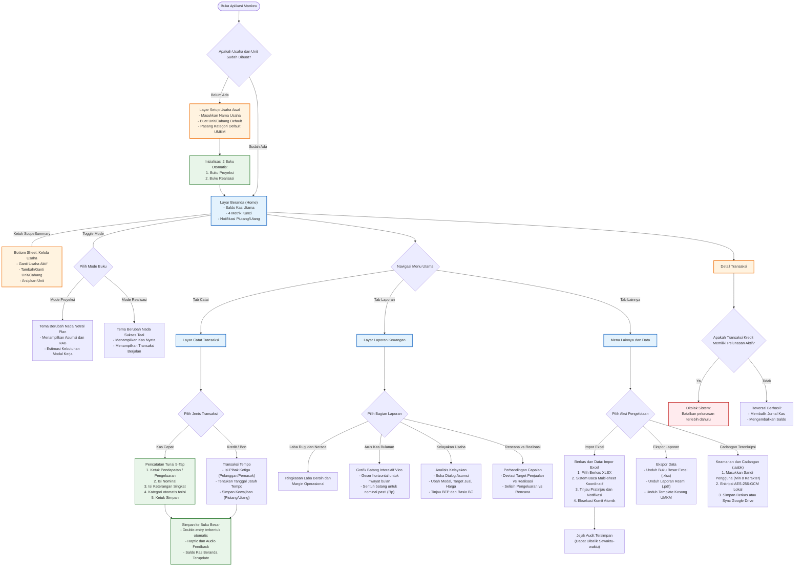

# User Flow Diagram - Mankeu Mobile Application

Diagram ini memetakan alur navigasi pengguna (*User Journey & Information Architecture*) mulai dari peluncuran aplikasi, penentuan lingkup (*scope*), pencatatan transaksi cepat, simulasi kelayakan, hingga impor berkas Excel.

## Evaluasi Kemudahan Penggunaan (*Ease of Use Audit*)

1. **Zero-Friction Cash Recording**:
   - Alur pencatatan pengeluaran operasional warung dirancang dalam 5 sentuhan layar tanpa membingungkan pengguna dengan terminologi debit/kredit akuntansi.
2. **Perlindungan Kesalahan Manusia (*Error Prevention*)**:
   - Sistem menolak pembatalan faktur piutang yang sudah menerima uang cicilan, mencegah piutang "hantu" tanpa jejak kas.
3. **Penyelarasan Warna Antarmuka**:
   - Mode Proyeksi (Simulasi) dan Realisasi (Kas Nyata) mengubah palet kontainer utama antarmuka secara visual sehingga pengguna tidak pernah salah mencatat transaksi nyata ke dalam simulasi.
