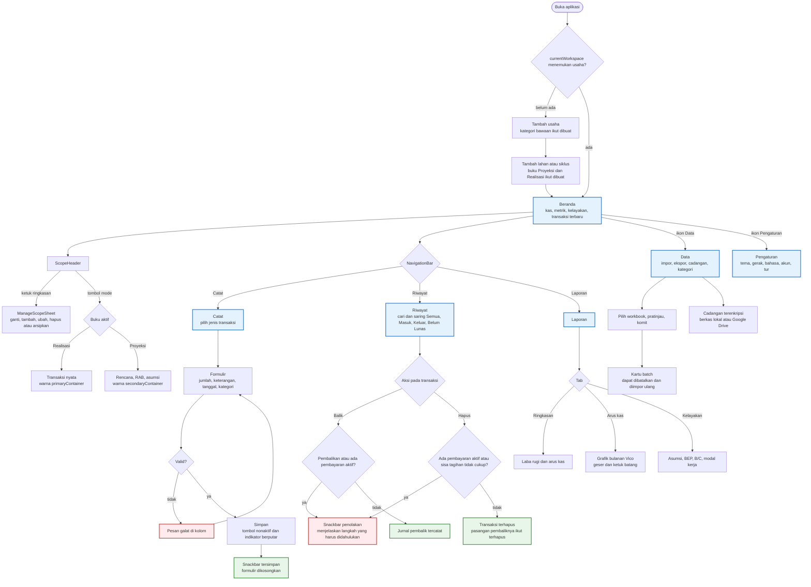

# User Flow Diagram - Mankeu

Alur navigasi sesuai `MankeuApp`: empat destinasi di `NavigationBar` (atau `AppRail` pada layar lebar), dua overlay yang dibuka dari bar atas, dan satu bottom sheet lingkup.

## Catatan kegunaan

1. **Catat hanya formulir, Riwayat hanya daftar** (D-070), sehingga pencarian dan saringan tidak tersembunyi di balik tombol segmen.
2. **Penolakan selalu menjelaskan jalan keluarnya.** Contohnya: batalkan pembayaran dulu, atau hapus pembalikan untuk memulihkan transaksi asli.
3. **Warna buku berbeda** agar transaksi nyata tidak tercatat ke buku rencana.
