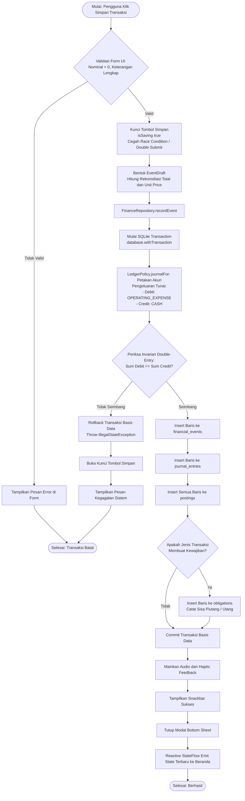
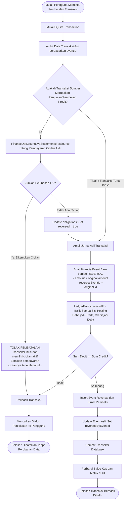
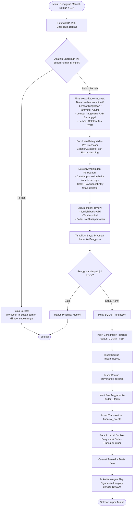
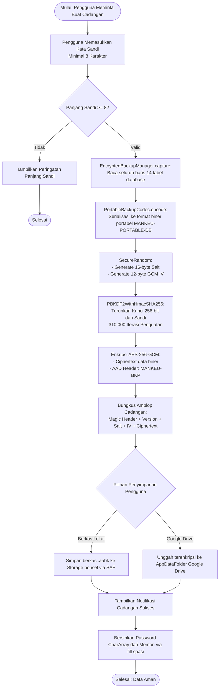

# Activity Diagrams (UML) - Mankeu Core Workflows

Dokumen ini memodelkan logika eksekusi 4 proses bisnis paling kritikal di aplikasi Mankeu:
1. **Pencatatan Transaksi & Penegakan Double-Entry**
2. **Pembatalan Transaksi Berpenjaga (*Guarded Reversal*)**
3. **Impor Workbook Excel & Penelusuran Jejak Asal (*Provenance Audit*)**
4. **Enkripsi Cadangan Portabel (*Zero-Knowledge Backup*) & Sinkronisasi Drive**

---

## 1. Alur Pencatatan Transaksi & Penegakan Double-Entry

Memastikan setiap transaksi keuangan yang dicatat selalu menghasilkan jurnal berpasangan yang seimbang secara matematis sebelum disimpan ke database SQLite.

---

## 2. Alur Pembatalan Transaksi Berpenjaga (*Guarded Reversal*)

Aturan ketat integritas: Menolak pembatalan transaksi piutang/utang jika sudah ada pembayaran cicilan yang tercatat, mencegah timbulnya uang kas tak bertuan.

---

## 3. Alur Impor Excel Multi-Sheet & Jejak Audit Asal (*Provenance*)

Menafsirkan workbook Excel sebagai kesatuan lembar yang terkoordinasi (bukan file terpisah), melakukan klasifikasi otomatis semantik, dan merekam audit asal per sel.

---

## 4. Alur Enkripsi Cadangan Portabel (*Zero-Knowledge Backup*)

Proses pengamanan data keuangan lokal menggunakan kriptografi standar industri tanpa ketergantungan server terpusat.

