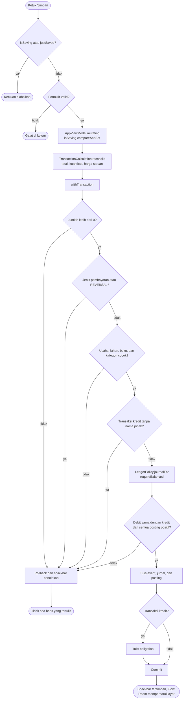
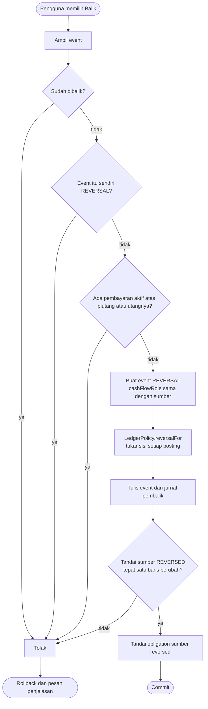
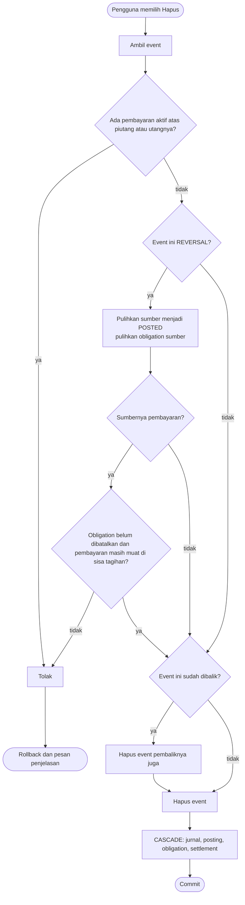
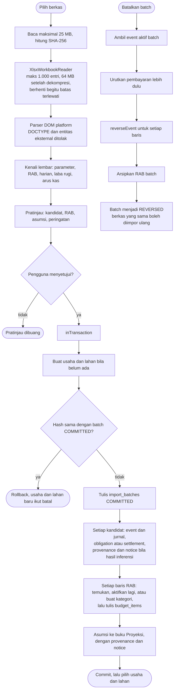
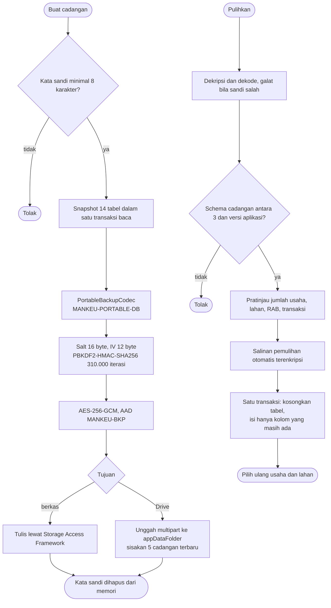

# Activity Diagrams - Alur Bisnis Kritis Mankeu

Lima alur yang menulis atau mengoreksi uang. Semua pemeriksaan di bawah ini berada di `FinanceRepository`, di dalam `withTransaction`: satu penolakan membatalkan seluruh penulisan.

## 1. Mencatat transaksi

## 2. Membalik transaksi

## 3. Menghapus transaksi

## 4. Impor workbook dan pembatalan batch

## 5. Cadangan dan pemulihan terenkripsi

