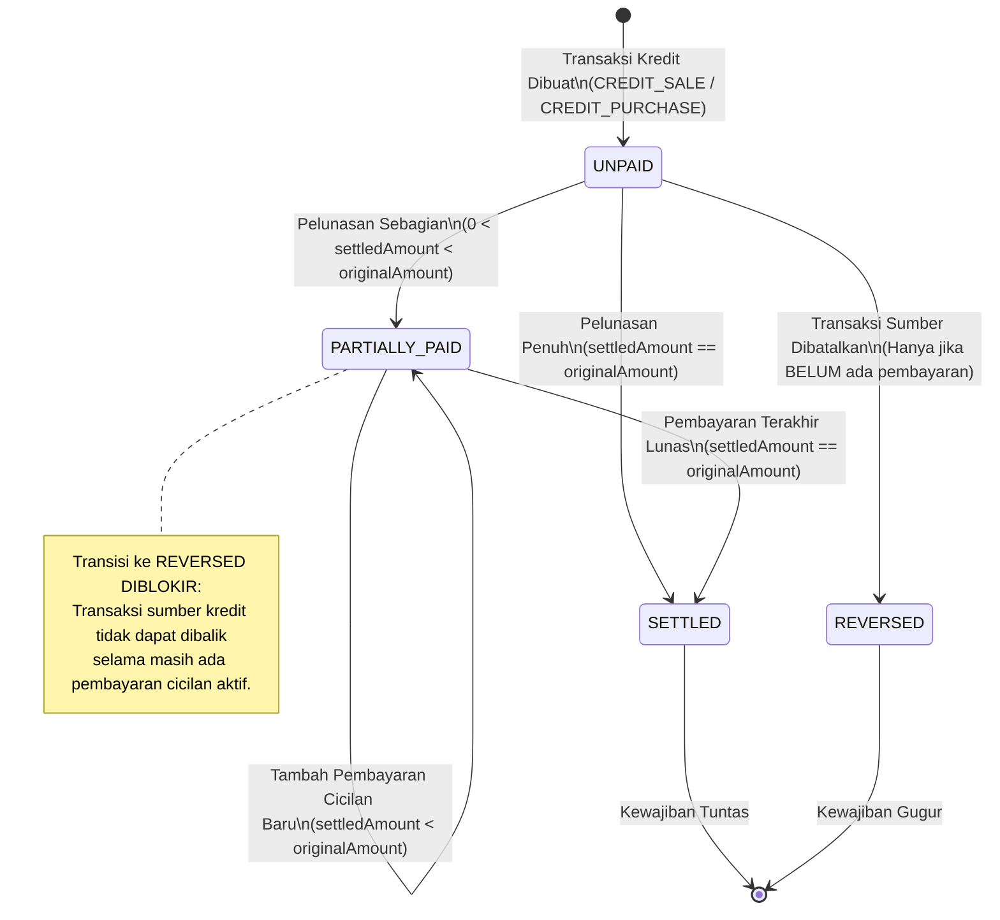
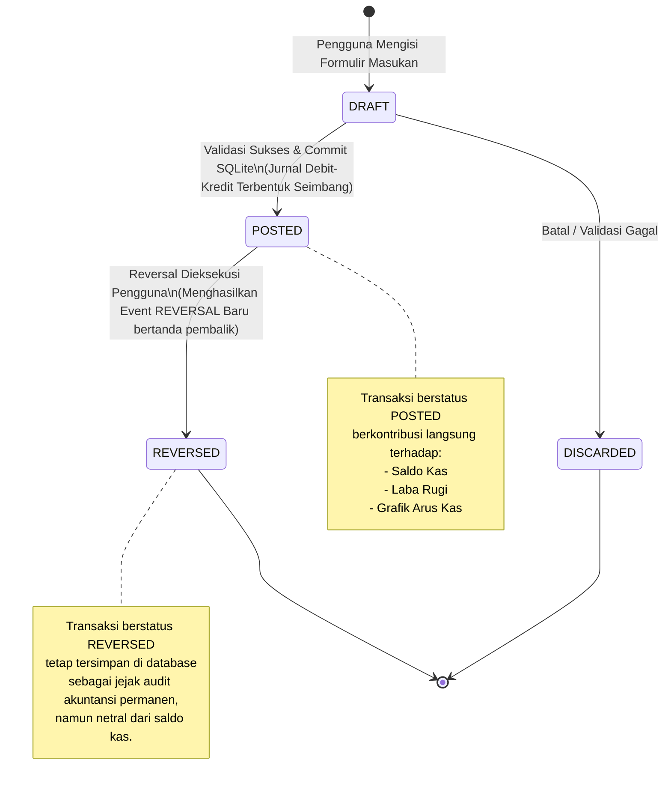
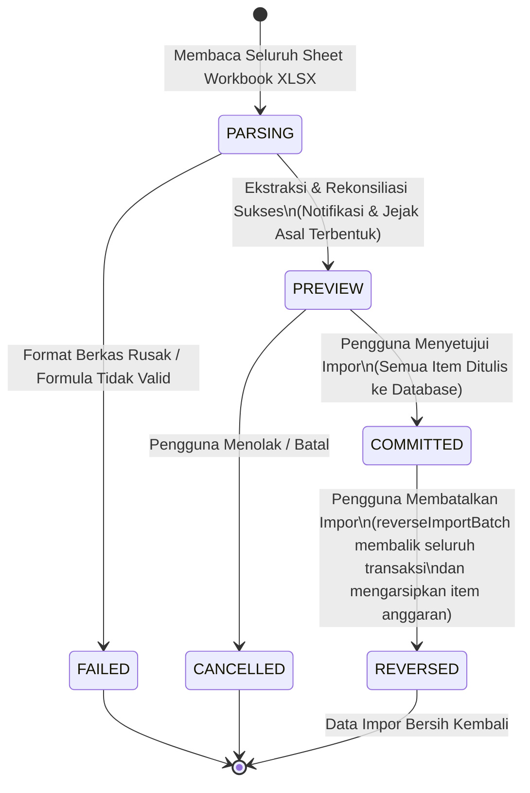
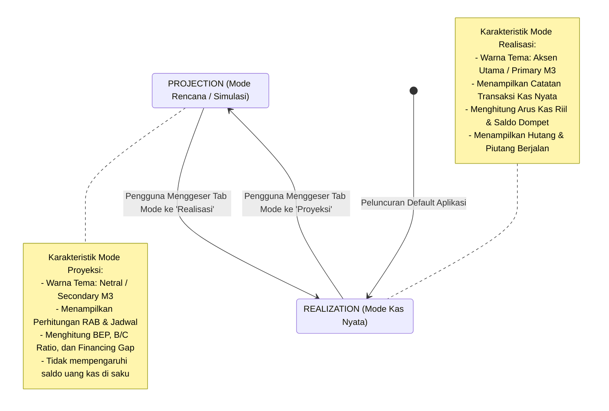

# State Machine Diagrams (UML) - Mankeu Lifecycles

Dokumen ini mendeskripsikan mesin status (*State Machines*) untuk siklus hidup entitas vital:
1. **Siklus Hidup Kewajiban (Piutang & Utang)**
2. **Siklus Hidup Transaksi Keuangan (*Financial Event*)**
3. **Siklus Hidup Batch Impor (*Import Batch*)**
4. **Siklus Pergantian Mode Buku (*Book Mode*)**

---

## 1. Siklus Hidup Kewajiban (`Obligation`)

Menelusuri status tagihan piutang pelanggan atau utang dagang ke pemasok.

---

## 2. Siklus Hidup Transaksi Keuangan (`FinancialEvent`)

Prinsip dasar akuntansi buku besar Mankeu: **Kekekalan Transaksi (*Immutability*)**. Transaksi yang sudah masuk buku besar tidak pernah di-*update* atau di-`DELETE` secara sembarangan, melainkan dinetralkan melalui jurnal pembalik (*reversal*).

---

## 3. Siklus Hidup Batch Impor (`ImportBatch`)

Setiap impor dari workbook Excel diperlakukan sebagai satu unit transaksi besar yang atomik dan dapat diputar balik (*reversible*).

---

## 4. Siklus Pergantian Mode Buku (`BookMode`)

Aplikasi Mankeu membedakan secara tegas antara **Proyeksi** (simulasi rencana) dan **Realisasi** (fakta kas nyata) pada setiap unit/proyek bisnis.

