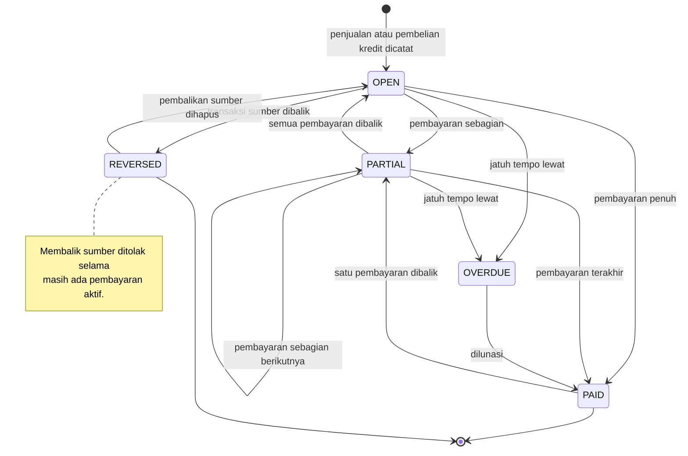
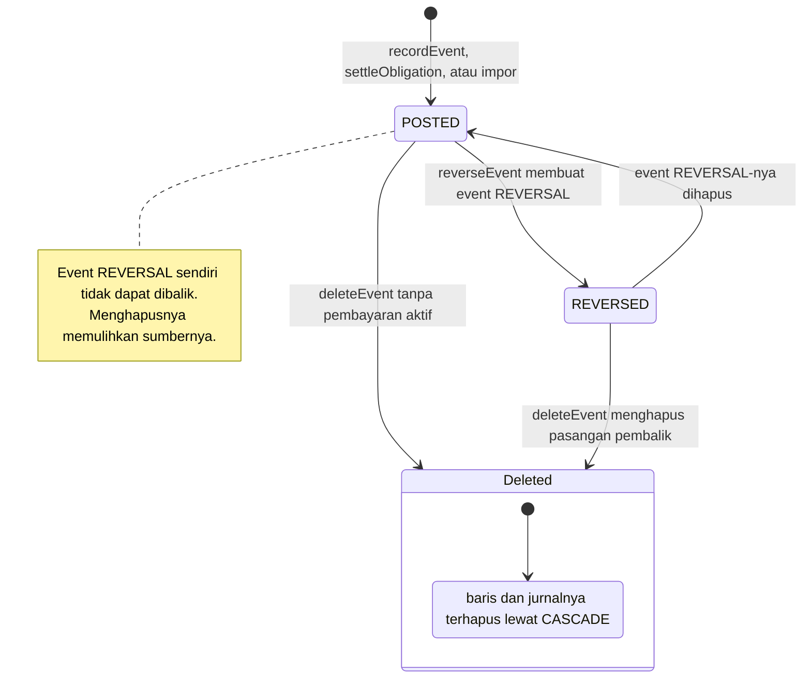
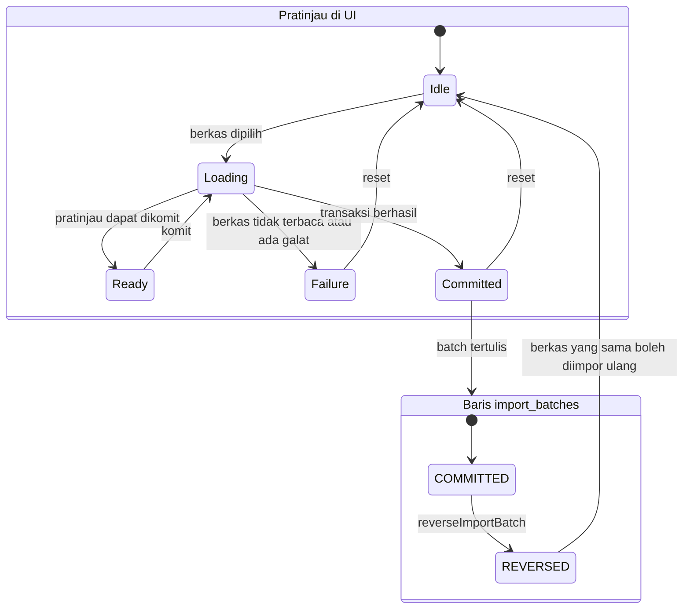
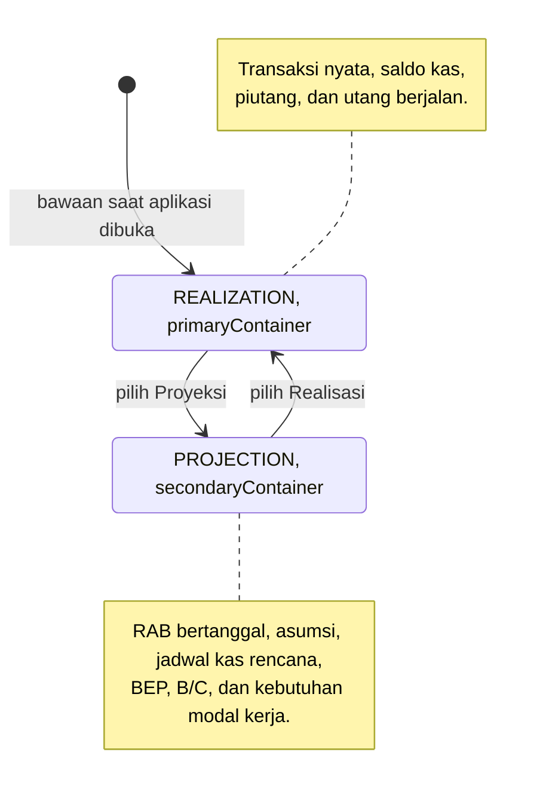

# State Diagrams - Siklus Hidup Mankeu

## 1. Piutang dan utang (`ObligationStatus`)

Status tidak disimpan. `ObligationBalance.status(today)` menurunkannya dari jumlah awal, pembayaran yang belum dibalik, tanggal jatuh tempo, dan penanda `reversed`.

## 2. Transaksi (`RecordStatus`)

Tidak ada status draf di basis data: formulir yang belum disimpan hanya ada di UI.

## 3. Batch impor dan pratinjau (`ImportUiState`)

## 4. Buku aktif (`BookMode`)

