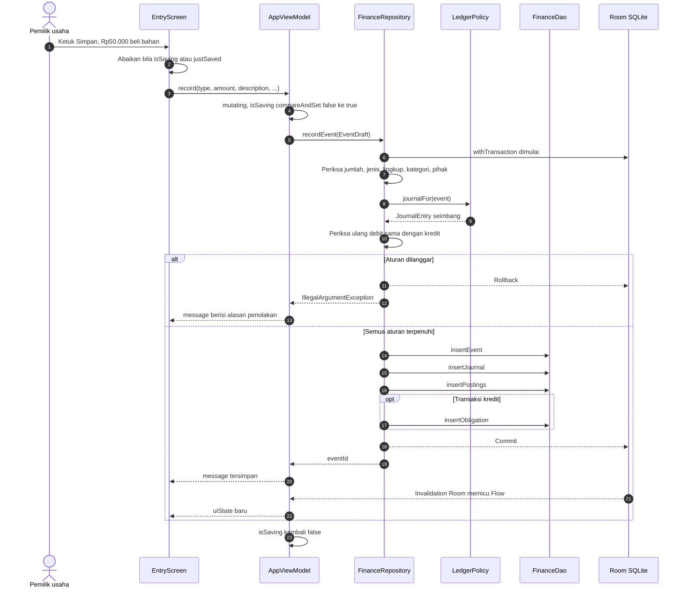
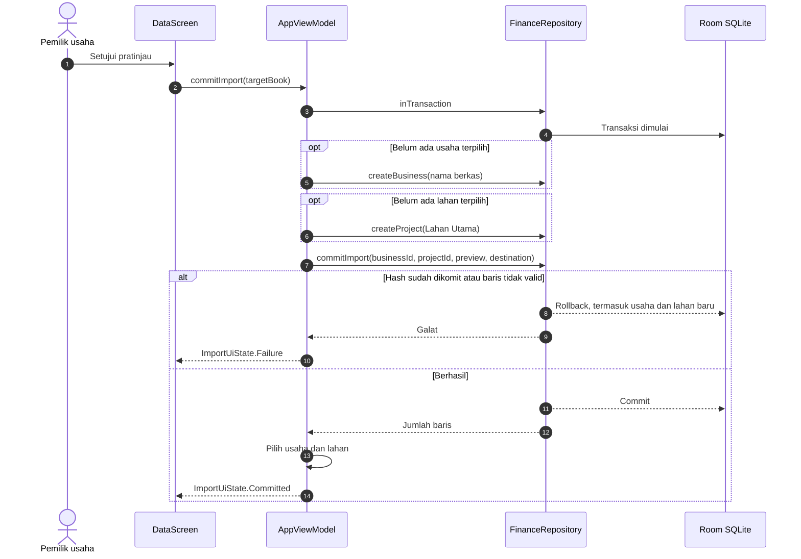

# Sequence Diagrams - Mankeu

## 1. Mencatat transaksi kas

## 2. Komit impor ke lingkup yang belum ada

## Jaminan

1. **Atomik.** Semua penulisan dan pemeriksaan satu aksi berada dalam satu transaksi SQLite. Penolakan tidak meninggalkan baris setengah jadi, termasuk usaha atau lahan yang dibuat untuk impor yang gagal (D-079).
2. **Tidak ada ketukan ganda.** `compareAndSet` di `mutating` menolak aksi kedua yang tiba sebelum aksi pertama selesai, termasuk ketukan dalam satu frame (D-072).
3. **Reaktif.** Setelah commit, invalidation Room memancarkan ulang Flow, dan `uiState` memperbarui layar tanpa pemanggilan manual.
