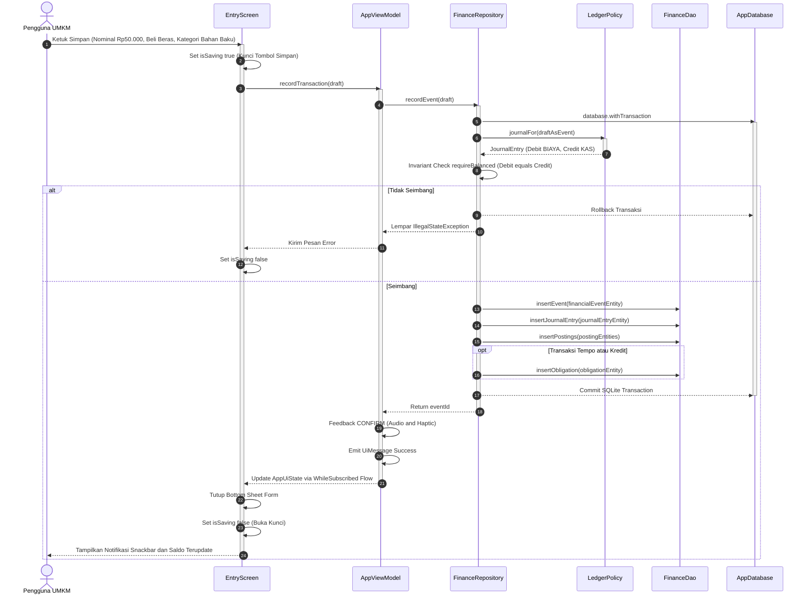

# Sequence Diagram (UML) - Alur Transaksi Double-Entry

Diagram urutan ini memperlihatkan interaksi antar komponen perangkat lunak saat pengguna mencatat sebuah transaksi kas, mulai dari penekanan tombol di Jetpack Compose UI hingga komit transaksi ganda di basis data SQLite.

## Jaminan Integritas (*Transactional Guarantees*)

1. **Atomisitas SQLite**:
   - Pemanggilan `insertEvent`, `insertJournalEntry`, dan `insertPostings` berada di dalam blok tunggal `database.withTransaction`. Jika terjadi kegagalan sistem pada salah satu tahap (misalnya kegagalan memori atau baterai mati), basis data akan melakukan *rollback* otomatis sehingga tidak ada data setengah jadi (*no orphan entries*).
2. **Pencegahan Klik Ganda (*Race Condition Prevention*)**:
   - Status `isSaving` segera diaktifkan pada langkah pertama sebelum sinyal coroutine dikirimkan ke ViewModel, sehingga penekanan tombol berulang-ulang pada layar sentuh yang responsif tidak akan menciptakan transaksi kembar.
3. **Pemberitahuan Reaktif**:
   - Begitu transaksi berhasil di-*commit*, Room DAO secara otomatis memicu emisi baru pada *Flow* reaktif yang didengarkan oleh `AppViewModel`, sehingga saldo kas dan ringkasan metrik di layar Beranda diperbarui secara seketika (*real-time*).
