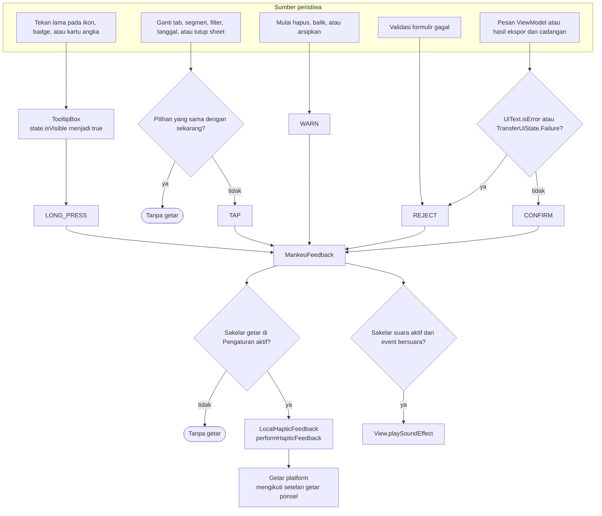
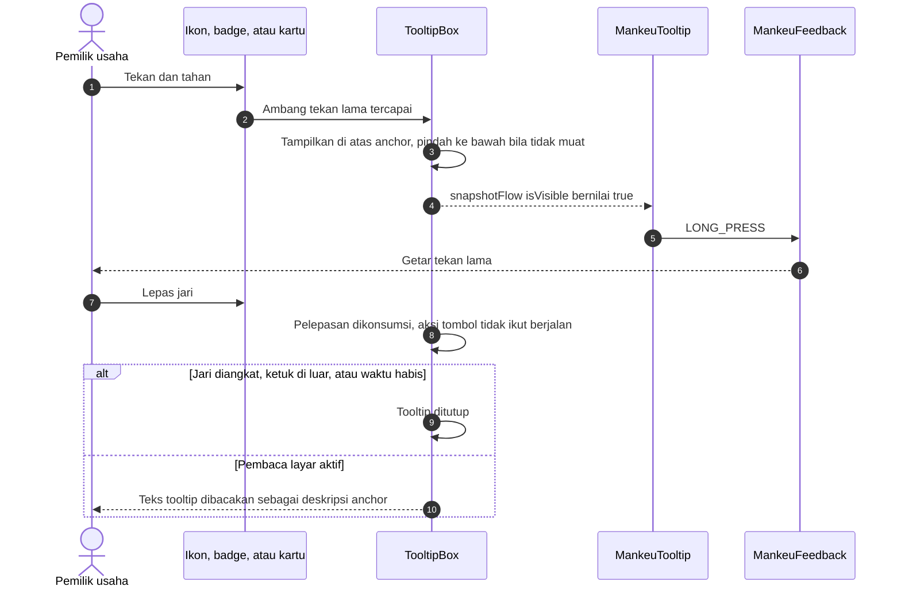
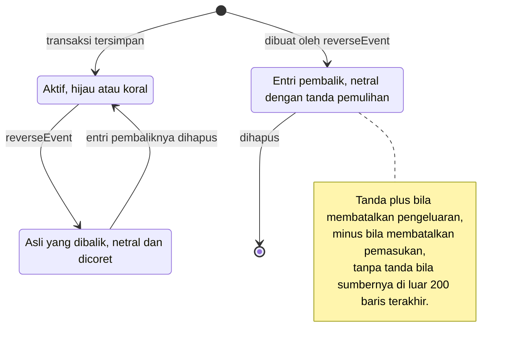

# Interaction Feedback - Tooltip dan Haptic

Cara Mankeu memberi tahu pengguna bahwa sentuhannya diterima: tooltip tekan lama dari Material 3 dan lima jenis getar. Aturannya ada di `docs/UX_AND_ACCESSIBILITY.md` ("Touch targets, tooltips and haptics") dan keputusan D-084 sampai D-087.

## 1. Dari peristiwa ke getar

| Event | `HapticFeedbackType` | Contoh |
| --- | --- | --- |
| TAP | SegmentTick | Tab Laporan, Proyeksi atau Realisasi, filter Riwayat, tanggal di kalender |
| LONG_PRESS | LongPress | Tooltip ikon Data, badge DIBALIK, kartu Uang masuk bersih |
| WARN | GestureThresholdActivate | Ketuk ikon hapus atau balik pada transaksi |
| CONFIRM | Confirm | Transaksi tersimpan, impor dikomit, cadangan dibuat |
| REJECT | Reject | Jumlah kosong, hapus transaksi kredit yang sudah dibayar sebagian |

## 2. Siklus tooltip

## 3. Tampilan kartu transaksi

