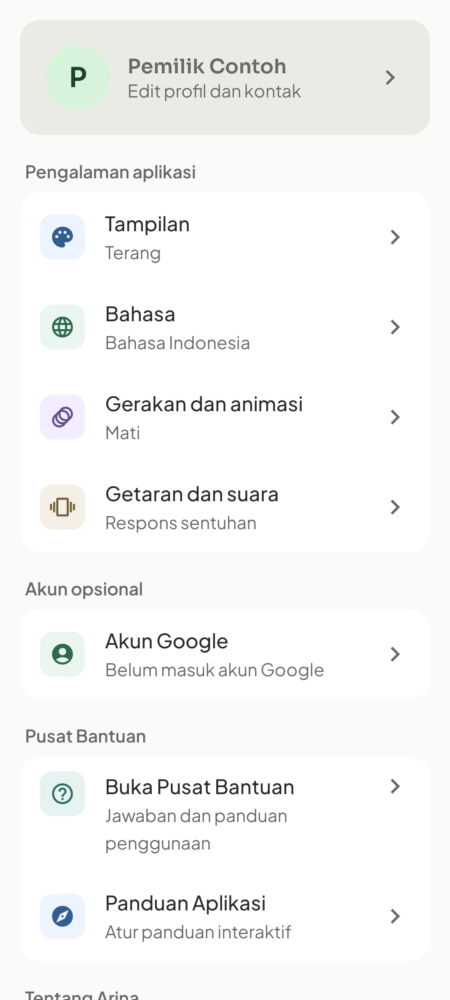
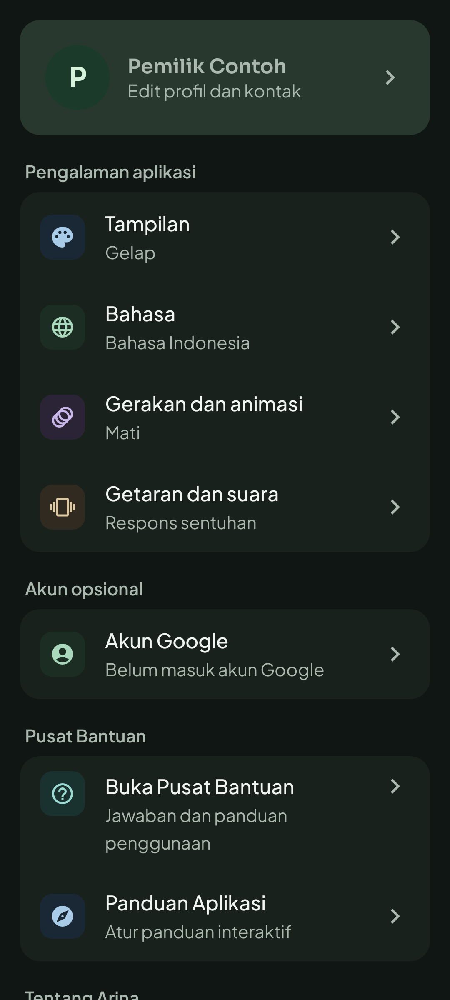
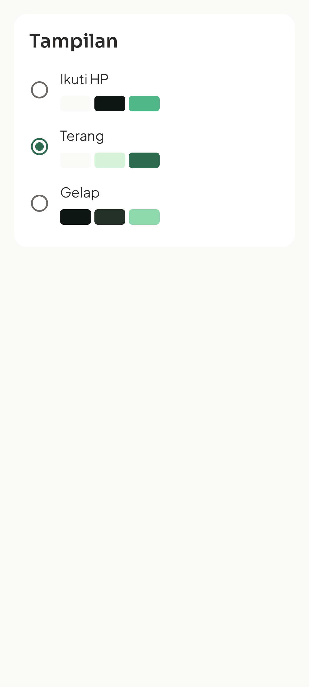
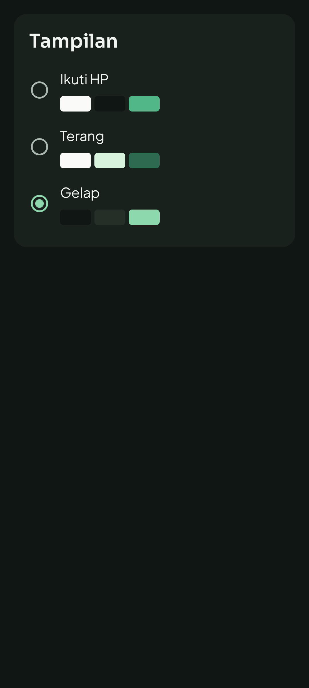
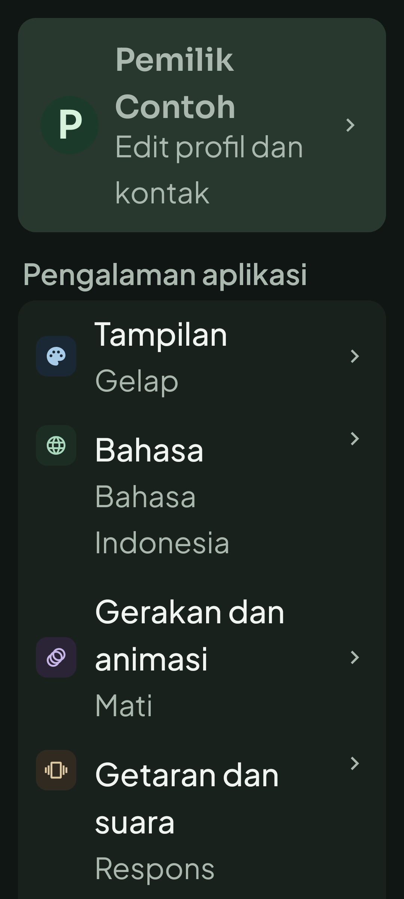
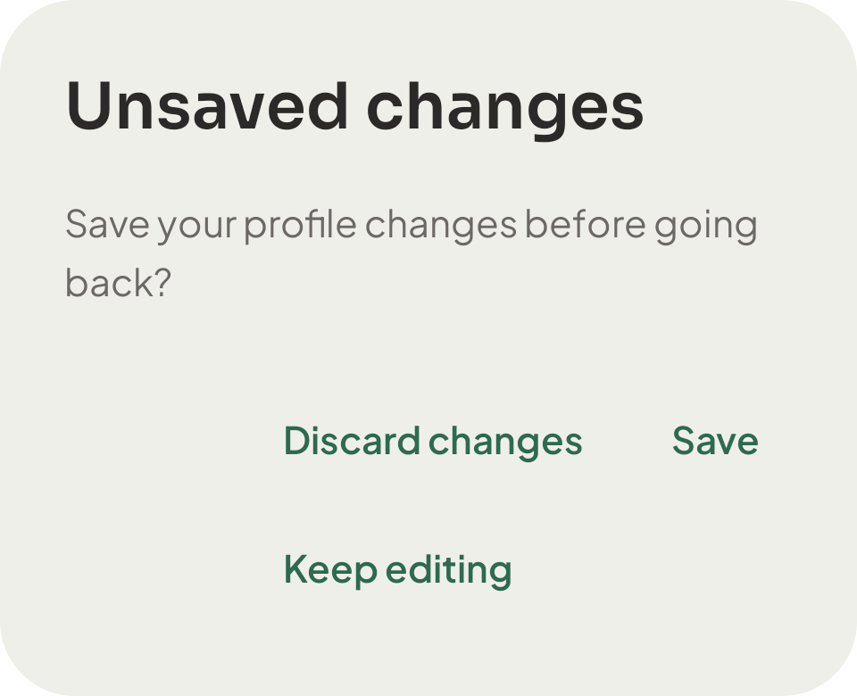
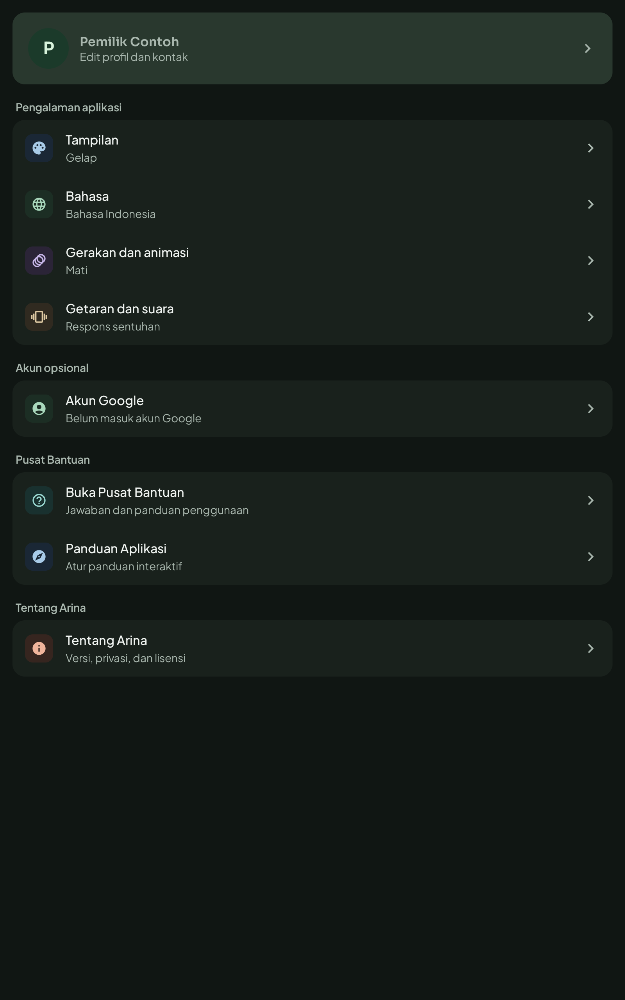

# Native UI colors and Settings — 25 October 2026

User-confirmed scope: implement the consolidated plan at
`docs/superpowers/plans/2026-10-25-consolidated-ui-colors-settings.md`.
Target: Kotlin/Compose in this checkout. No web code, money calculation, database
schema, template, backup contract, preference key or dependency changes.

## Evidence boundaries and baseline

Baseline HEAD: `af89cddad6ec74df316d2aa3cccd22526ace417c`, branch `Radit`.
The checkout already contained card simplification edits, test edits, localization,
QA documentation and logs. `.gitignore` was already dirty and was preserved.
Prior QA reports are historical; the results below must come from this execution.

Initial actual-token verifier passed **324 checks / 198 contrast pairs**. The first
Gradle attempt could not start without JAVA_HOME. Subsequent commands explicitly use
`C:/Users/daffa/.jdks/jbr-21.0.11`. A build overlapped source edits and failed on
intermediate unresolved resources; it is not a valid clean baseline. No fresh,
source-matched before APK was captured, so historical research screenshots are not
presented as before/after proof.

First device pass on the intermediate APK: **4/6 Settings cases passed**. Two
assertions expected Indonesian dialog text while a test ContextWrapper displayed
Indonesian only outside dialogs on an English Activity. The root fixtures now use
the real Activity context, consistent with D-017. Production theme/language
callbacks retain Activity.recreate; no locale override was introduced in production.
An intermediate Lint run crashed inside detector/Kotlin PSI processing while source
was still changing. The final stable-source Lint run completed after correcting one
LocalContextConfigurationRead finding in the isolated test fixture.

## Existing card and motion reconciliation

| Requirement | Actual source owner | Acceptance check |
| --- | --- | --- |
| Hidden secondary information, explicit disclosure | CardDetails.kt | CardDetailsTest |
| Cash versus cash profit, all-record period label | HomeScreen.kt | CardSimplificationTest, CardPeriodSemanticsTest |
| Top three expense groups plus remaining amount | HomeScreen.kt | CardSimplificationTest |
| Compact stock summary, full stock details | StockSection.kt | CardSimplificationTest |
| BEP warning remains visible outside details | PlanCards.kt | CardSimplificationTest |
| HPP/form input guidance, loss labels | PlanScreen.kt, EntryScreen.kt | CardSimplificationTest |
| Conflict blocks import, duplicate remains explicit | MoreScreen.kt | ImportCardLayoutTest, ImportCommitTest |
| Full/Reduced/Off preferences | Theme.kt, ContentTransitions.kt | MotionPreferenceTest, NavigationMotionTest, SectionMotionTest |
| Settings native navigation, draft and Help | MankeuApp.kt | SettingsRedesignTest |

The two-month fixture uses synthetic records: starting cash balance 9,150,000;
income 5,500,000; cash expense 4,150,000; cash profit 1,350,000; depreciation
200,000; profit after depreciation 1,150,000. Adding income in the previous month
must change all-record totals while leaving the current-month result unchanged.
Reports remain derived from their existing data owners.

## Implementation and reproducible checks

Forest Charcoal replaces all dark Material roles. Material primary ink and filled
actions use separate roles. Six category accent families align with light mode.
Chart category identity is independent of sorting and locale; collisions remain
possible, so text/markers are retained. Five static Lottie dark derivatives are
regenerated; all light derivative hashes remain unchanged.

Settings HOME groups preferences, optional account, Help and About. Each detail has
one shell toolbar. The root owns page, profile baseline/draft, Back and Help return.
Profile only saves on explicit Save; dirty Back asks Save/Discard/Keep editing.
Page scroll and all six draft fields are saveable. Appearance, language, motion and
feedback use existing callbacks and preference keys. Tours relocate again when the
new page registers its list/target. Profile list consumes IME padding.

```powershell
rtk proxy python scripts/verify_visual_system.py
rtk proxy python scripts/prepare_lottiefiles.py --check
# Set JAVA_HOME in the current process, not in checked-in project configuration.
rtk proxy .\gradlew.bat testDebugUnitTest --console=plain
rtk proxy .\gradlew.bat lintDebug --console=plain
rtk proxy .\gradlew.bat assembleDebug assembleDebugAndroidTest --console=plain
rtk git diff --check
```

Instrument `SettingsRedesignTest`, `CardPeriodSemanticsTest`, `CardDetailsTest`,
`CardSimplificationTest`, `VisualSystemTest`, `NavigationMotionTest`,
`SectionMotionTest`, `ContextualLottieTest`, `ImportCardLayoutTest`,
`UiRefinementWorkflowTest` and `ImportCommitTest`. Optional runner argument
`uiSettingsScreenshots=true` captures native Compose frames into the private test
directory `files/ui-colors-settings`, using only synthetic fixture data.

## Final results

| Scenario | Expected | Actual | Result / evidence |
| --- | --- | --- | --- |
| Native debug + test APK build | Successful tasks | BUILD SUCCESSFUL | reports/final-check.log |
| Unit regression | No failure/skip | 77 passed, 17 suites | verification.json and app/build/test-results/testDebugUnitTest |
| Android Lint | No errors, checks enabled | BUILD SUCCESSFUL; existing warnings retained | reports/final-check.log, reports/lint-results-debug.txt |
| Static colors/fonts | Actual-source contrast | 334 checks, 204 pairs passed | scripts/verify_visual_system.py |
| Artwork integrity | Offline variants, light unchanged | 10 variants / 5 pinned sources passed | scripts/prepare_lottiefiles.py --check |
| Full phone regression | 54 named cases | 52 passed initially; two fixture errors fixed | reports/phone360.log |
| Final phone Settings + motion | All related cases pass | 8 Settings + 3 motion passed | reports/phone360-verified.log |
| Final two-month period fixture | Exact amounts and all-record UI | 1/1 passed after correcting scroll/semantics selector | reports/card-period-verified.log |
| Tablet render/tour/recreation | All selected cases pass | 3/3 passed, zero skip | reports/tablet800-verified.log |
| UI matrix | ID/EN x light/dark x 100/200% x 9 pages | 72 combinations at each width | capture manifests and curated screenshots |
| Financial fixture | Exact period separation | Required cash/profit/depreciation plus second-month assertions passed | CardPeriodSemanticsTest |
| Back/Save/discard/Help | No silent save or lost draft | Actual root actions passed | SettingsRedesignTest |
| Activity recreation | Retain page, choices, six-field draft | Actual ComponentActivity recreation passed | SettingsRedesignTest |

The final 54 unique native cases combine 42 unchanged passing regression cases from
the full run, 11 passing cases from the targeted run and the final passing period test. They are not described
as a single clean 54/54 execution. Initial failures were (a) an amount below the
viewport/incorrect semantics ancestry, fixed by scrolling the exact amount into view, and (b) an old SectionMotionTest
fixture using plain remember within SaveableStateHolder, corrected to rememberSaveable.
The final Settings layout also explicitly enforces a 56dp minimum feedback row.
Stable-source Lint reported one new test error for reading Configuration via
LocalContext; it now reads LocalConfiguration. No lint check or threshold was disabled.

The supplied source-state manifest hashes the tested native sources, including the
reviewed in-scope card work that was already present at session start. Those card
changes and their regression tests are included in the coherent UI commit because
the new two-month acceptance depends on their resource/copy contract. Unrelated
gitignore, historical QA edits and earlier log entries remain outside that commit.
This is current-checkout evidence, not a release or representative-user validation.

## Curated native screenshots

These are fresh APK/Compose fixture frames, not browser simulations or design references.
Matrix captures use isolated Settings content; root dialog/tour/recreation captures
exercise the actual MankeuApp shell. Their locale is identified in the filename;
root fixture dialog captures use the actual English host Activity.

| Phone 360dp, light | Phone 360dp, dark |
| --- | --- |
|  |  |
|  |  |







Other pages, large-font controls, tours and recreation captures are in the screenshots
folders. Capture manifests identify every generated frame by SHA-256 and which were
retained as curated source artifacts. Full raw frames remain in the local QA scratch
directory and can be regenerated using the instrumentation screenshot argument.


## Limits and rollback

StateRestorationTester verifies saveable reconstruction; it is distinct from real
Activity recreation. The native ComponentActivity recreation fixture checks page,
preference and dirty profile retention. It does not prove MainActivity's localized
resource switch, which belongs to attachBaseContext. Simulated auth proves local UI
behavior only; no real OAuth/Drive service or cloud backup success is asserted.

TalkBack reading order, color-vision-deficiency review, representative-user
comprehension, production devices/performance and full alpha/pressed/disabled
render coverage require separate evidence before those qualities can be claimed.

Rollback by reverting the UI implementation commit with its corresponding log
correction. Restore tour mapping and Back ownership with Settings layout. No data
conversion or preference migration is required. Do not reset the checkout or clear
application data to roll back a visual change.
