# Arina Agri UI Refinement Implementation Plan

> **For agentic workers:** REQUIRED SUB-SKILL: Use superpowers:subagent-driven-development (recommended) or superpowers:executing-plans to implement this plan task-by-task. Steps use checkbox (`- [ ]`) syntax for tracking.
> Nama skill pada header dipetakan ke `subagent-driven-development` atau `executing-plans` yang tersedia dalam proyek. Dokumen ini tidak memulai eksekusi atau delegasi.

**Goal:** Memperbaiki UI Android Arina agar lebih menarik dan mudah dibaca melalui hierarki, warna kategori, daftar, dan form yang konsisten, dengan memperbaiki tumpang tindih impor terlebih dahulu.

**Architecture:** Perluas token dan komponen Compose yang sudah menjadi pemilik tampilan. Pertahankan `AppViewModel`, kalkulasi domain, Room, scope usaha/unit, navigasi, dan kontrak impor. Perubahan visual kategori dipisahkan dari warna status finansial; seluruh transisi mengikuti `LocalMotion` yang ada.

**Tech Stack:** Kotlin, Jetpack Compose, Material 3, Room, Vico, Lottie Compose yang sudah terpasang, Compose UI Test, Python verifier proyek. Tidak menambah dependensi runtime.

**Status:** proposed — rencana dan referensi untuk ditinjau, belum implementasi UI. **Tanggal:** 24 Oktober 2026. **Baseline bukti:** commit `27e1192` dan workspace dengan perubahan animasi/UI yang sudah ada sebelum pekerjaan ini. Lokasi pelaksanaan: `D:/Arina Agri/Arina Agri Kotlin`; folder web `D:/Arina Agri/arina-agri` tetap read-only.

---

## 1. Bukti, batas, dan cara membaca screenshot

**user-confirmed:** pengguna meminta UI dipercantik berdasarkan simulasi sebelumnya dan meminta implementation plan dengan screenshot. **verified:** 91 capture native dan matriks cakupan tersedia di [laporan simulasi](../../qa/2026-10-24-ui-simulation/README.md). **inferred:** dugaan penyebab impor bertumpuk didukung call path `DataScreen → ImportCard → AnimatedContent`, tetapi perbaikannya belum diuji. Semua rancangan dalam dokumen ini **proposed**. Kinerja, penerimaan pengguna, dan fitur yang belum dijalankan tetap **unknown**.

Tiga gambar eksternal di bawah adalah **screenshot browser atas halaman pemasaran resmi**, bukan hasil login atau pengujian aplikasi pihak ketiga. Tampilan Arina berasal dari aplikasi Android asli dengan data fiktif. Screenshot sorotan `help_*` sengaja memakai scrim gelap; jangan menjadikannya patokan kontras tampilan normal.

Gambar ditautkan ke berkas lokal yang ikut dalam repositori sehingga dapat diperiksa offline. Galeri lengkap tetap tersedia di [index simulasi](../../qa/2026-10-24-ui-simulation/index.html). Tidak perlu menyalin ulang seluruh 91 capture ke direktori plan.

## 2. Referensi visual yang digunakan

### R1 — Monarch: hierarki dashboard dan laporan

Sumber: [Monarch Tracking](https://www.monarch.com/features/tracking). Yang terlihat: nominal penting dominan, grafik biru, permukaan netral, dan kelompok rincian yang jelas. Adaptasi: urutan penekanan angka dan grafik, bukan sidebar desktop, warna oranye merek, koneksi bank, investasi, atau fitur kreditnya.

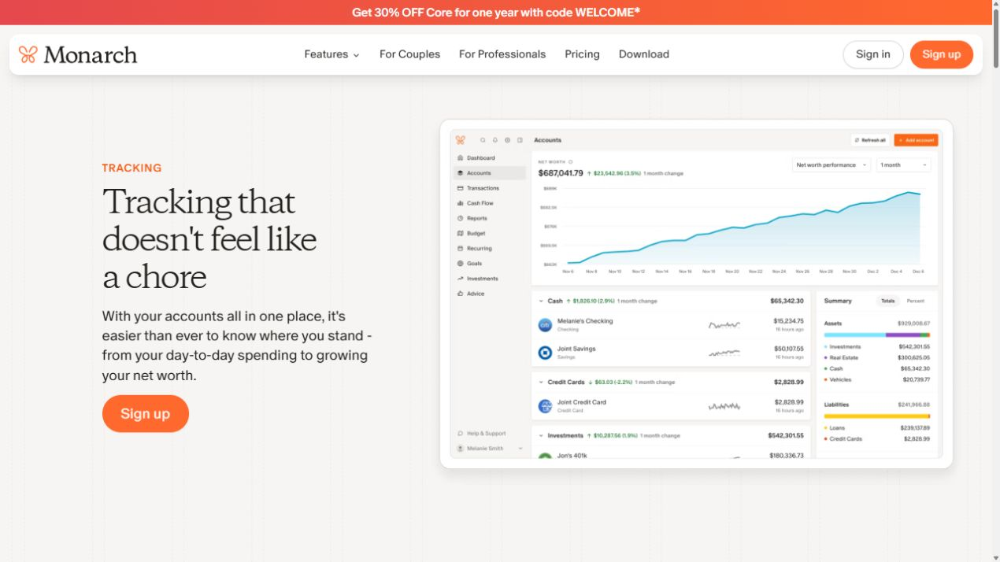

### R2 — YNAB: kelompok input dan progres target

Sumber: [YNAB Goal Tracking](https://www.ynab.com/features/goal-tracking). Yang terlihat: pilihan periode, nominal, tanggal, dan pengulangan terpisah pada editor target. Adaptasi: kelompok input RAB/HPP dan hierarki hasil BEP; jangan menyalin metode budgeting personal, fitur pinjaman, atau progres tanpa data.

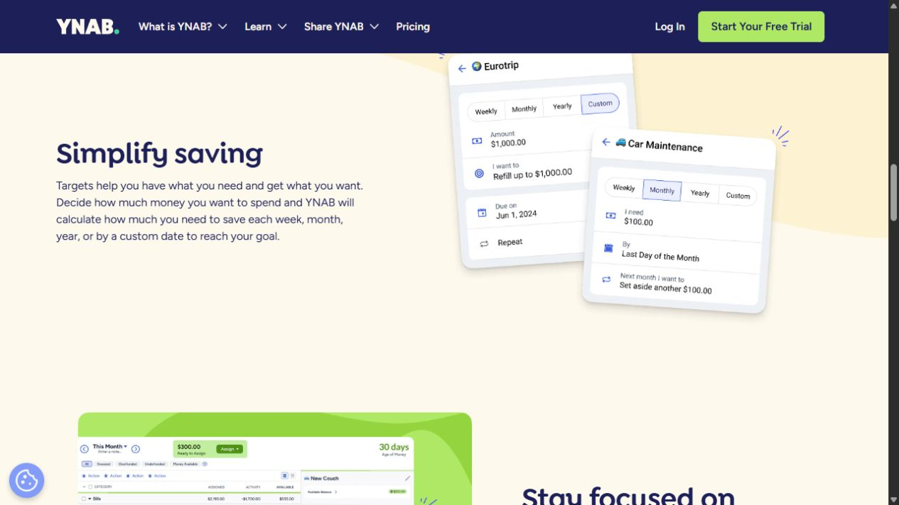

### R3 — Sortly: identitas barang dan keterbacaan stok

Sumber: [Sortly Inventory App](https://www.sortly.com/business-inventory-app/). Yang terlihat: identitas barang, kuantitas, dan detail terstruktur pada contoh seluler. Adaptasi: baris barang dan status stok. Gunakan ikon inventori yang ada; foto barang, barcode, sinkronisasi tim, dan warna merah merek Sortly tidak masuk lingkup.

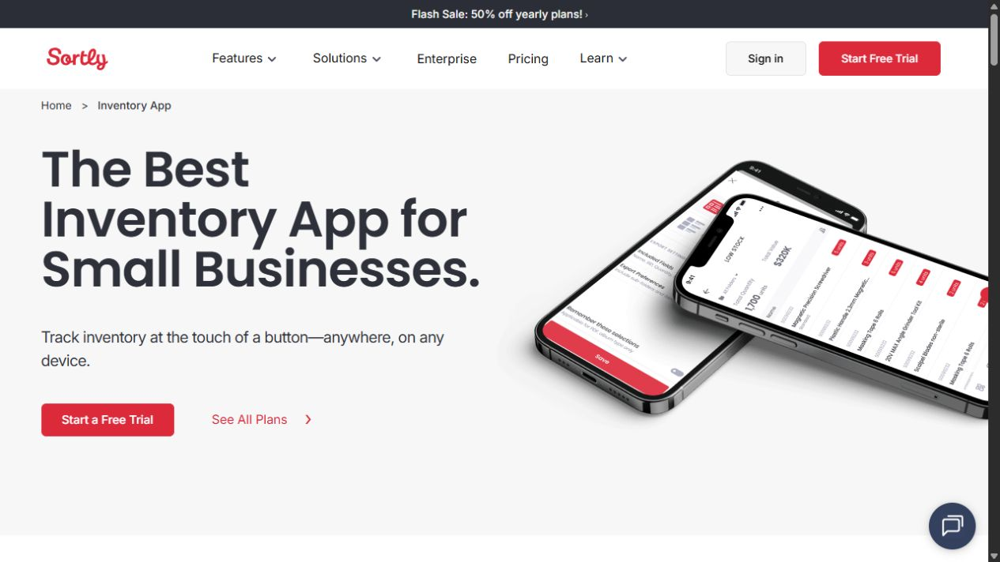

## 3. Kontrak desain

| Elemen | Target implementasi |
| --- | --- |
| Identitas | Hijau Arina pada saldo dan CTA utama; background ivory dan permukaan netral yang ada |
| Metrik Beranda | Grid 2×2 dipertahankan; biru untuk arus kas, lavender untuk laba, mint untuk pendapatan, krem untuk biaya |
| Status | Merah/terracotta untuk kerugian, defisit, kegagalan, dan destruktif; amber untuk peringatan; Rp0 netral |
| Angka | `Long` rupiah dan formatter yang ada; nominal tidak dianimasikan sebagai angka pecahan, tidak dipotong menjadi angka bermakna lain |
| Tipografi | Pertahankan Sora/Plus Jakarta Sans yang dibundel; heading, nominal, label, dan keterangan mempunyai penekanan berbeda |
| Spasi | Ikuti skala 4/8 dp; kartu ringkasan 16 dp internal, kelompok form 16–24 dp; tanpa tinggi tetap untuk teks/form |
| Bentuk | Gunakan `MaterialTheme.shapes`; hindari menambah bentuk dan shadow yang berbeda pada setiap layar |
| Interaksi | Target sentuh minimum 48 dp; label/ikon/status tidak mengandalkan warna saja; Save/Batal tetap terjangkau dengan keyboard |
| Gerakan | Reuse `LocalMotion`, `crossFade`, `sharedAxisX`, `itemMotion`; Reduced tidak memakai travel/scale, Off langsung |
| Tata letak | Bottom navigation ponsel dan rail tablet tetap; uji 360 dp, 411 dp, dan ≥840 dp serta font 100%/200% |
| Isi | Pertahankan istilah, urutan section, dan makna data. Tidak menambah fitur foto, cuaca, notifikasi cloud, akun wajib, atau laporan baru |

Usulan token awal; **belum dianggap lulus kontras** sampai verifier dan pemeriksaan native berjalan:

| Accent | Light container / icon | Dark container / icon |
| --- | --- | --- |
| CASH | `#EDF4FF` / `#315D90` | `#233447` / `#A9CCF4` |
| PROFIT | `#F2EEFF` / `#66508D` | `#332C45` / `#D0BDF4` |
| INCOME | `#EAF6EF` / `#2D6A4F` | `#223A2D` / `#A9D8BC` |
| EXPENSE | `#F5F0E6` / `#76603F` | `#3A3328` / `#DEC9A3` |

Nominal menggunakan `MaterialTheme.colorScheme.onSurface` pada kartu beraksen; kerugian/defisit memiliki label status dan aksen semantik terpisah. Peta kategori tidak berubah menjadi merah ketika nominal berubah; statuslah yang berubah. Jangan mengubah seluruh `info` menjadi biru untuk memperoleh variasi empat kartu.

## 4. Peta file dan kepemilikan

Semua path pada tabel relatif terhadap root native yang disebut di header; baris dapat bergeser akibat perubahan yang belum dikomit. Cari nama fungsi sebagai anchor.

| File | Tanggung jawab perubahan |
| --- | --- |
| `app/src/main/java/com/mankeu/presentation/screens/MoreScreen.kt` | `ImportCard`, status transfer, ekspor/cadangan, kategori; perbaikan layout dan snapshot target animasi |
| `app/src/main/java/com/mankeu/presentation/MetricColors.kt` (baru) | Empat aksen presentasi metrik light/dark; tanpa state/domain/provider baru |
| `app/src/main/java/com/mankeu/presentation/components/SharedComponents.kt` | `SimpleMetric`, `SimpleMetricCard`, `EventCard`, `ComparisonRow`; gunakan kembali tooltip, badge, formatter |
| `app/src/main/java/com/mankeu/presentation/screens/HomeScreen.kt` | Tetapkan accent ke empat metrik; hero dan urutan section tetap |
| `app/src/main/java/com/mankeu/presentation/screens/EntryScreen.kt` | Kelompok form, shortcut nominal, header tanggal pada daftar; callback dan state input tetap |
| `app/src/main/java/com/mankeu/presentation/screens/StockSection.kt` | `StockCard`, baris stok, `AddStockItemSheet`, `StockMovementSheet` |
| `app/src/main/java/com/mankeu/presentation/screens/ReportsScreen.kt` | `FinancialsSection`, `FeasibilitySection`, `ComparisonSection` |
| `app/src/main/java/com/mankeu/presentation/screens/PlanScreen.kt` | `PlanSectionCard`, `PlanRow`, `ProductSheet`, `PlanLineSheet`, `PeriodSheet` |
| `app/src/main/java/com/mankeu/presentation/screens/AccountSettingsScreen.kt` | Kelompok profil/pengaturan; pertahankan state tab |
| `app/src/main/java/com/mankeu/presentation/guide/HelpUi.kt` | Ikon per `HelpGroup`, hierarki artikel dan topik; deep link/tour tetap |
| `app/src/main/java/com/mankeu/presentation/screens/ManageScopeScreen.kt` | Hierarki usaha/unit dan state terpilih; aturan hapus/arsip tetap |
| `app/src/main/java/com/mankeu/presentation/components/MankeuSheet.kt` | Pemilik chrome sheet, padding dan aksi tetap; ubah hanya bila kebutuhan bersama terbukti |
| `app/src/main/res/values/strings.xml`, `app/src/main/res/values-en/strings.xml` | Label presentasi baru ID/EN tanpa hardcoded copy runtime |
| `scripts/verify_visual_system.py` | Tambahkan pemeriksaan kontras pasangan token metrik tanpa menghapus pemeriksaan lama |
| `app/src/androidTest/java/com/mankeu/presentation/ImportCardLayoutTest.kt` (baru) | Regresi overlap serta tindakan impor pada komponen asli |
| `app/src/androidTest/java/com/mankeu/presentation/UiRefinementWorkflowTest.kt` (baru) | Alur pengguna asli dengan fixture in-memory, isolasi state dan capture sesudah |
| `docs/UX_AND_ACCESSIBILITY.md`, `font-dan-color-palette.md` | Dokumentasikan role native dan batas referensi web secara jelas |
| `logs/ACTIVITY_LOG.md`, `logs/DECISION_LOG.md`, `logs/CHANGELOG.md` | Log pelaksanaan; ADR pemisahan kategori/status dan changelog ketika UI benar-benar diimplementasikan |

Tidak menyentuh formula, importer, export schema, repository, model Room, atau dependensi hanya untuk menghasilkan variasi visual. Jika uji menemukan masalah domain, catat sebagai pekerjaan terpisah.

## 5. Urutan pelaksanaan

Dependensi: **Task 1 → 2 → 3**, lalu **4 → 5 → 6 → 7 → 8 → 9**, dan **10** sebagai penerimaan keseluruhan. Task 1 adalah patch fungsional tersendiri yang dapat diterima sebelum polesan. Setiap task harus menghasilkan commit atomik beserta log task tersebut; jangan memasukkan perubahan milik sesi lain.

### Task 1 — Pulihkan layout impor dan konsistensi target animasi (P1)

**Files:** `MoreScreen.kt`: `ImportCard`, `transferStatusMotion`; test baru `ImportCardLayoutTest.kt`.

**Sebelum:** ringkasan/tombol menimpa satu sama lain. R1 dipakai untuk hierarki ringkasan, bukan menambah chart pada import.

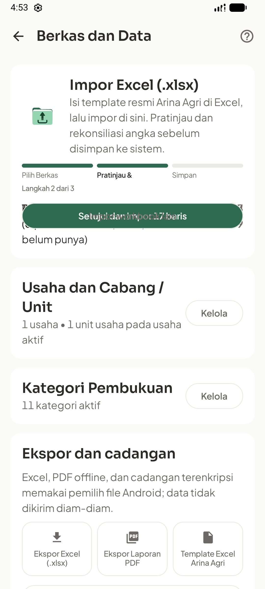
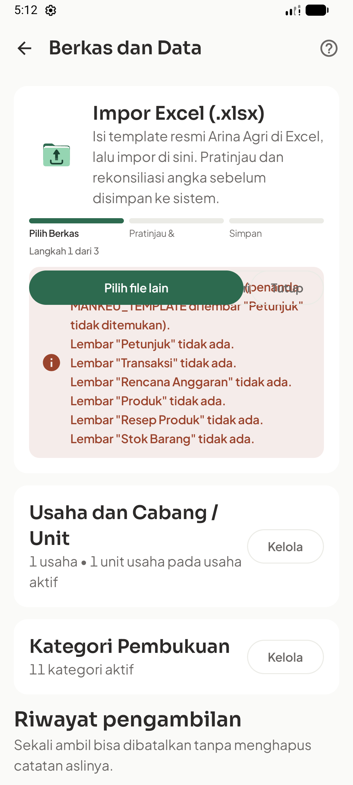

- [ ] Baca kembali cabang Ready/Committed/Failure dan transfer Working. Buat fixture test `WorkbookImportPreview(sourceName = "simulasi.xlsx", sourceSha256 = "ui-fixture")` dengan satu `ImportTransaction`, lalu `ImportReview(emptyList(), emptyList(), emptyList(), false, addedRowCount = 1)`. Gunakan `MankeuTheme(motion = MankeuMotion.Off)`. Buka `ImportCard` dari test dengan mengubah visibilitasnya menjadi `internal`; jangan memperluas API publik.
- [ ] Tambahkan test pada komponen asli: urutan bounds label `import_ready_transactions`, `import_ready_budget`, `import_ready_stock`, `import_ready_products`, `import_total_income`, `import_total_expense` harus vertikal; button `import_commit` berada sesudah ringkasan dan callback terpanggil tepat sekali. Jalankan test sebelum perbaikan; hasil yang diharapkan adalah kegagalan layout, bukan kegagalan compiler.

Assertion yang digunakan setelah memperoleh `boundsInRoot` keenam label, dalam urutan di atas:

```kotlin
bounds.zipWithNext().forEach { (previous, next) ->
    assertTrue("Import rows overlap", next.top >= previous.bottom)
}
assertTrue("Commit action overlaps summary", commitBounds.top >= bounds.last().bottom)
```

- [ ] Ganti target impor menjadi state immutable yang dirender, dengan `contentKey` tetap berdasarkan stage. Parameter `displayState` dipakai pada `when` beserta `preview`, `review`, `message`, dan `count`; jangan membaca `importState` luar dari konten outgoing. Terapkan satu `Column(Modifier.fillMaxWidth(), verticalArrangement = Arrangement.spacedBy(12.dp))` sebagai root **setiap konten target**, dengan seluruh cabang lama di dalamnya. Pertahankan cancel, konflik, duplicate notice, kategori baru, dan enablement commit.

Ekspresi konfigurasi yang dipakai pada `AnimatedContent` impor:

```kotlin
targetState = importState,
contentKey = { it.toStage() },
transitionSpec = { crossFade(motion) },
label = "importCardStage",
```

- [ ] Pada transfer gunakan `targetState = transferState`, `contentKey = { it::class }`, dan satu root `Column`; baca state parameter target. Progress dengan stage sama tidak boleh memulai ulang transisi.
- [ ] Uji Idle → Loading → Ready → Committed, Loading → Failure → pilih ulang, Ready duplicate warning, Ready conflict non-committable, serta cancel. Ulangi Full/Reduced/Off; pada Full inspeksi outgoing sebelum clock selesai agar tidak tertukar data.
- [ ] Jalankan test khusus dengan perintah instrumentation pada Bagian 6. Expected: `OK` dan seluruh test benar-benar berjalan. Selesaikan impor valid **melalui sentuhan**, tanpa workaround Tab/Enter.
- [ ] Commit `fix(ui): restore import stage layout and stable transition content`; sertakan screenshot sesudah dan log. Tidak boleh menandai task lulus hanya berdasarkan build.

**Acceptance:** semua ringkasan dapat dibaca; tidak ada intersection antar tombol/ringkasan; status lama tidak menampilkan payload baru; klik simpan satu kali menambahkan satu batch.

### Task 2 — Tambahkan aksen kategori metrik pada pemilik token

**Files:** baru `MetricColors.kt`; `SharedComponents.kt`: `SimpleMetric`, `SimpleMetricCard`; `verify_visual_system.py`; panduan visual dan ADR saat eksekusi.

- [ ] Tambahkan tipe presentasi berikut dalam package `com.mankeu.presentation`, dengan import `androidx.compose.ui.graphics.Color`. Nilai fungsi adalah pasangan container/icon dari tabel Bagian 3; `dark` berasal dari `LocalMankeuSemanticColors.current.isDark` sehingga tidak menambah provider atau preference.

```kotlin
enum class MetricAccent { CASH, PROFIT, INCOME, EXPENSE }

data class MetricAccentColors(val container: Color, val icon: Color)

fun metricAccentColors(accent: MetricAccent, dark: Boolean): MetricAccentColors =
    when (accent) {
        MetricAccent.CASH -> if (dark) MetricAccentColors(Color(0xFF233447), Color(0xFFA9CCF4)) else MetricAccentColors(Color(0xFFEDF4FF), Color(0xFF315D90))
        MetricAccent.PROFIT -> if (dark) MetricAccentColors(Color(0xFF332C45), Color(0xFFD0BDF4)) else MetricAccentColors(Color(0xFFF2EEFF), Color(0xFF66508D))
        MetricAccent.INCOME -> if (dark) MetricAccentColors(Color(0xFF223A2D), Color(0xFFA9D8BC)) else MetricAccentColors(Color(0xFFEAF6EF), Color(0xFF2D6A4F))
        MetricAccent.EXPENSE -> if (dark) MetricAccentColors(Color(0xFF3A3328), Color(0xFFDEC9A3)) else MetricAccentColors(Color(0xFFF5F0E6), Color(0xFF76603F))
    }
```

- [ ] Tambahkan properti opsional `val accent: MetricAccent? = null` pada akhir `SimpleMetric`; pertahankan `MetricTone` untuk makna status dan compatibility caller. `SimpleMetricCard` menggunakan accent container pada card ketika ada, accent icon pada ikon, dan `onSurface` pada nominal. Caller tanpa accent tetap memakai perilaku lama. Jika tone DANGER, gunakan teks/ikon status eksplisit lewat badge yang ada; jangan mewarnai ulang kategori.
- [ ] Tambahkan pasangan kontras light/dark: nominal/container, label/container, icon/container, dan danger text/container. Teks normal ≥4.5:1; ikon informatif ≥3:1. Sesuaikan token jika gagal; jangan menurunkan threshold.
- [ ] Pertahankan tooltip penuh, `TextAutoSize` nominal, outer `Box(modifier)` untuk Row weight, dan grid 2×2. Uji nominal Rp0, negatif, dan nominal besar pada 360 dp dan font 200% melalui capture, bukan test yang hanya menghitung jumlah warna.
- [ ] Jalankan `rtk proxy python scripts/verify_visual_system.py`; expected exit 0 dengan seluruh pemeriksaan lama dan baru lulus. Catat role kategori/status dalam ADR baru memakai nomor kosong berikutnya, bukan menimpa DEC-031/032.
- [ ] Commit `feat(ui): add category accents for financial metric cards` dengan panduan dan logs.

**Acceptance:** empat kategori berbeda secara visual pada dua tema; nol netral; warna kerugian tetap bermakna; nominal tidak hilang/dipotong.

### Task 3 — Terapkan hierarki Beranda

**Files:** `HomeScreen.kt`, `SharedComponents.kt`; screenshot test yang ada `HelpScreenshotTest.kt` hanya bila perlu menambah capture sesudah.

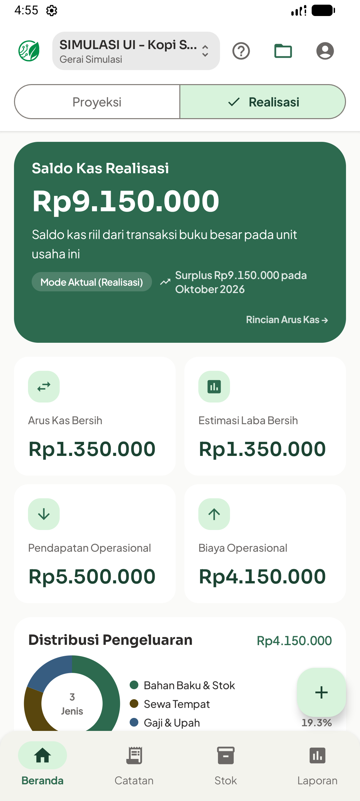

- [ ] Pada empat `SimpleMetric` di Beranda tetapkan `accent = MetricAccent.CASH`, `PROFIT`, `INCOME`, dan `EXPENSE` sesuai labelnya. Pertahankan penghitungan tone/nominal yang ada; jangan mengubah empat rumus agar menyesuaikan warna.
- [ ] Pertahankan hero saldo hijau tua serta letak distribusi pengeluaran, stok, BEP, dan notice. Kalibrasi heading/nominal/keterangan lewat typography Material yang ada dan padding 16 dp; variasi berasal dari Task 2, bukan empat gaya kartu berbeda.
- [ ] Render data fixture pada dua tema. Periksa saldo Rp9.150.000, arus kas/laba berbasis transaksi Rp1.350.000, pendapatan Rp5.500.000, biaya Rp4.150.000. Periksa pula no-business, no-unit, unit kosong, dan defisit sebagai skenario berbeda.
- [ ] Jalankan native capture empat tujuan utama; expected scope usaha/unit dan angka fixture tetap benar. Simpan screenshot sesudah pada direktori QA baru, tanpa mengganti baseline.
- [ ] Commit `feat(ui): refine home financial hierarchy` beserta log dan bukti.

**Acceptance:** saldo tetap fokus utama; empat kartu dapat dibedakan tanpa mengandalkan ikon kecil; isi dan urutan section tetap.

### Task 4 — Rapikan transaksi dan form nominal

**Files:** `EntryScreen.kt`, `SharedComponents.kt`: `EventCard`; strings ID/EN; `UiRefinementWorkflowTest.kt`.

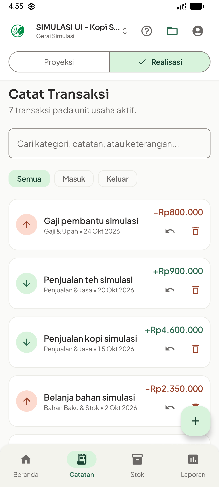
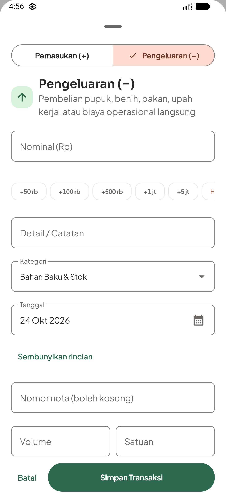

- [ ] Kelompokkan event yang sudah tersortir berdasarkan `dateEpochDay` untuk heading tanggal pada daftar yang sama. Pertahankan key event `event.id`, `eventsById`, pencarian/filter, banner daftar terpotong, dan aksi reverse/delete; jangan membuat salinan sumber data atau mengubah urutan event dalam tanggal.
- [ ] Rapikan `EventCard`: deskripsi dapat membungkus, nominal tetap di kolom kanan dan utuh, kategori/tanggal sebagai metadata. Pakai arah masuk/keluar dan badge sumber/pembalik yang sudah ada. Jangan menebak ikon dari substring kategori usaha pertanian; custom category mendapat ikon netral.
- [ ] Ganti container shortcut `LazyRow` menjadi `FlowRow` dengan gap horizontal 6 dp dan vertikal 4 dp, memakai `Modifier.fillMaxWidth()`. Iterasi `increments` menggunakan `forEach`; pindahkan item Hapus menjadi child biasa. **Isi kedua callback aritmatika lama dipindah utuh** agar derivasi kuantitas/harga tidak berubah.
- [ ] Gunakan `SuggestionChip(Modifier.heightIn(min = 48.dp))`, label tetap terbaca, dan warna netral untuk membersihkan nominal. Aksi membersihkan input bukan penghapusan data. Pastikan lima increment dan Hapus terlihat tanpa scroll horizontal pada font 100%; font 200% boleh menambah baris.
- [ ] Pertahankan sheet scroll/IME dan Save/Batal di luar area field scroll. Judul/ringkasan singkat mendahului kelompok nominal, detail wajib, dan detail opsional. Jangan memberi warna danger pada selector pengeluaran rutin.
- [ ] Test lewat form asli: +50 rb menghasilkan 50000; isi deskripsi, simpan satu kali, lalu balik. Periksa jumlah sumber/pembalik dan saldo kembali baseline. Masukkan nominal invalid dan pastikan error fokus ke field; buka keyboard pada field terakhir dan pastikan Save/Batal masih dapat disentuh.
- [ ] Jalankan workflow test; expected tidak ada duplikasi transaksi, kehilangan draft, atau perubahan saldo yang tidak dijelaskan. Capture daftar dan kedua jenis form.
- [ ] Commit `feat(ui): improve ledger scanning and entry form layout` dengan log.

**Acceptance:** angka utuh, target sentuh ≥48 dp, shortcut tidak terpotong, koreksi tetap mempertahankan audit trail.

### Task 5 — Perjelas identitas dan status stok

**Files:** `StockSection.kt`: `StockCard`, baris barang, `AddStockItemSheet`, `StockMovementSheet`; strings; workflow test.

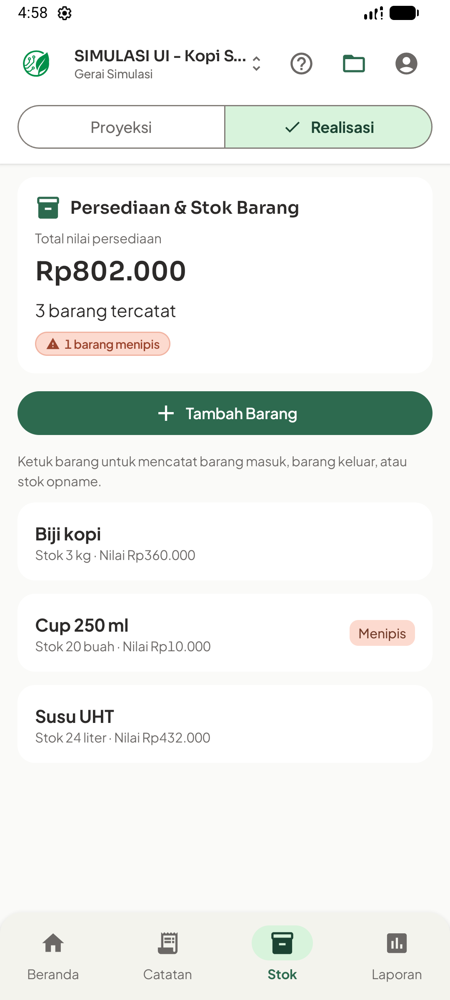
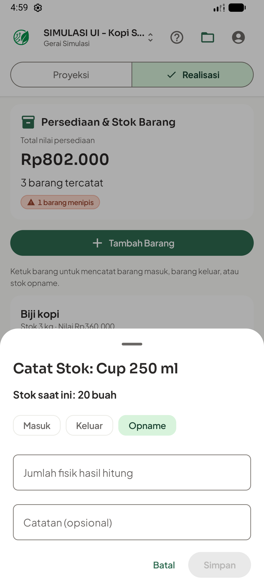

- [ ] Pada baris barang tambahkan tile ikon inventori netral 40 dp, nama, stok terkini sebagai nilai utama, minimum pada baris pendukung, dan nilai rupiah terpisah. `shared` tetap diberi label Semua unit. Buat seluruh baris target sentuh minimal 48 dp tanpa ikon chevron yang menyerupai tombol kedua.
- [ ] Pakai `item.isLowStock` yang sudah ada untuk badge WARNING berteks Menipis. Nol dapat diberi label Habis berbasis `item.currentStock.signum() == 0`; warning tidak berubah menjadi danger hanya karena barang rutin perlu diisi ulang. Tidak menjumlahkan kg, liter, dan buah menjadi satu total unit.
- [ ] Tampilkan minimum menggunakan `item.minAlertStock.toQuantityText()` bersama `item.unit`; tetap gunakan `TransactionCalculation.computeTotalRupiah` untuk nilai. Jangan memakai Float untuk jumlah fisik atau rupiah. Bar progres stok tidak ditambahkan karena belum ada kapasitas maksimum yang bermakna.
- [ ] Pada form mutasi, tampilkan stok saat ini dan jenis aksi di bagian atas; label Jumlah fisik hasil hitung tetap khusus opname. Input, validation, ownership unit/shared, dan callback save tidak diganti.
- [ ] Jalankan alur mutasi fixture: Cup 20 → masuk 20 menjadi 40 → keluar 5 menjadi 35 → opname 20 menjadi 20. Pastikan warning hilang di 40/35 dan kembali di 20. Uji keluar melebihi stok ditolak tanpa perubahan.
- [ ] Capture list, tambah barang, tiga form mutasi, warning, dan error. Expected saldo kas tidak berubah hanya karena mutasi stok; nilai persediaan mengikuti jumlah akhir.
- [ ] Commit `feat(ui): refine stock item hierarchy and warning states` dengan log.

### Task 6 — Perbaiki hierarki laporan dan pasangan perbandingan

**Files:** `ReportsScreen.kt`, `SharedComponents.kt`: `ReportRow`, `ComparisonRow`; strings; workflow test.

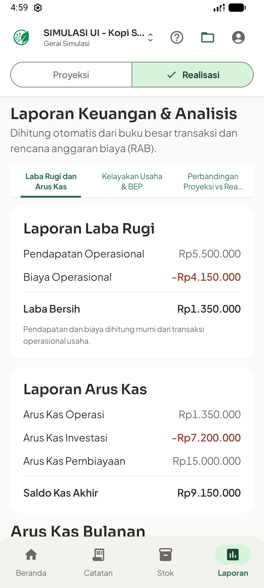
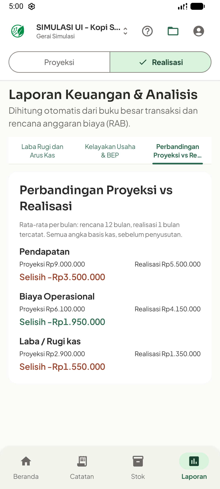

- [ ] Pertahankan tiga tab dan perhitungan yang sekarang. Beri heading, nilai utama, dan baris pendukung penekanan berbeda; biaya operasi rutin memakai angka netral meskipun ditulis dengan tanda minus pada laporan kas.
- [ ] Dalam `ComparisonRow`, pertahankan signature dan `higherIsBetter`. Buat label metrik di atas, lalu dua kolom berbobot sama berisi Proyeksi dan Realisasi; nilai titleMedium di bawah label, kemudian Selisih pada baris tersendiri. Pada font besar/lebar sempit, gunakan susunan vertikal sehingga nominal tidak terpotong.
- [ ] Untuk `delta = realization - projection`, nol netral; arah menguntungkan/tidak menguntungkan tetap dihitung dengan `higherIsBetter`. Perubahan gaya tidak boleh membuat biaya aktual lebih besar terlihat baik.
- [ ] Pada `ComparisonSection`, pertahankan rata-rata per bulan dan kalimat basis periode. Jangan membandingkan total rencana 12 bulan dengan realisasi 1 bulan. Pertahankan perbedaan laba kas dan laba setelah penyusutan pada BEP.
- [ ] Untuk Vico gunakan data dan formatter yang ada; tampilkan keadaan satu bulan dengan jujur. Legend menjelaskan seri yang benar-benar digambar, tanpa mini-chart atau tren fiktif untuk keadaan kosong.
- [ ] Uji angka fixture, lalu fixture biaya aktual di atas rencana dan di bawah rencana. Periksa chart tidak merusak scroll tab, pergantian mode tidak mengubah source data, dan label perbandingan masih utuh di 360 dp/font 200%.
- [ ] Commit `feat(ui): clarify report summaries and comparisons` dengan log dan capture ketiga tab.

### Task 7 — Susun ulang penekanan RAB dan editor resep

**Files:** `PlanScreen.kt`; reuse `MankeuSheet.kt`; strings; workflow test.

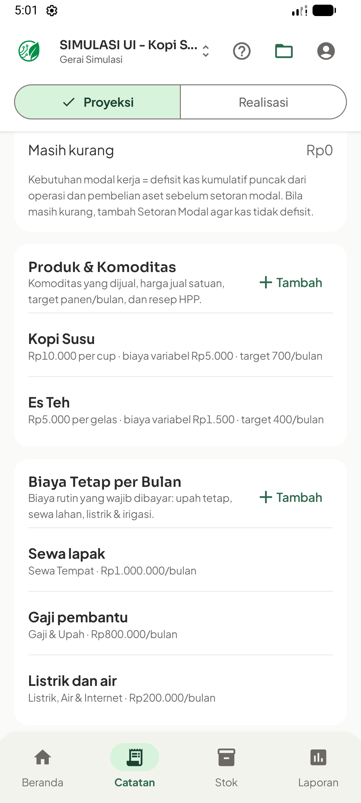
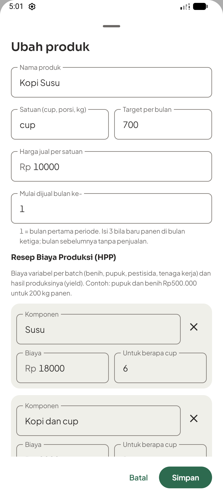

- [ ] Pertahankan urutan periode → kelayakan → produk → biaya tetap → biaya lain → aset → modal. Pada `PlanRow`, beri nama sebagai heading dan pecah metadata panjang menjadi baris yang jelas; jangan memakai satu subtitle dengan semua angka dipadatkan.
- [ ] Di `ProductSheet`, beri section heading Identitas produk, Target penjualan, Resep biaya, dan Hasil per satuan. Reuse state `name`, unit, harga, target, bulan mulai dijual, dan komponen yang ada; pengelompokan tidak menciptakan wizard atau draft baru.
- [ ] Tempatkan ringkasan HPP/margin yang sudah dihitung setelah komponen dengan container INFO/neutral. Margin negatif diberi danger dan teks penjelas. Biaya per unit tetap memakai kalkulasi/rounding yang ada, bukan perhitungan ulang di composable baru.
- [ ] Pertahankan identitas row komponen saat tambah/hapus, fokus field, footer Save/Batal, scroll sheet, dan bantuan satuan. Gunakan padding/spacing bersama, tanpa menambah gambar produk atau field domain baru.
- [ ] Uji edit Kopi Susu: biaya variabel Rp5.000 per cup dan margin Rp5.000 terlihat; ubah harga ke Rp4.000 untuk melihat margin negatif, batal dan pastikan data lama tetap; buka lagi, simpan perubahan terkontrol, lalu verifikasi BEP/laporan mengikuti sumber yang sama.
- [ ] Uji produk musiman mulai bulan ke-3, biaya tetap, biaya sekali, aset umur 36 bulan, modal, dan periode. Pastikan perpindahan section tidak menghapus field yang belum disimpan.
- [ ] Commit `feat(ui): improve business plan and recipe editor hierarchy` dengan log dan screenshot editor sebelum/sesudah.

### Task 8 — Rapikan Berkas/Data, cadangan, kategori, dan konfirmasi

**Files:** `MoreScreen.kt`, `ManageScopeScreen.kt`; `MankeuSheet.kt` hanya bila penyesuaian berlaku pada semua sheet; strings.

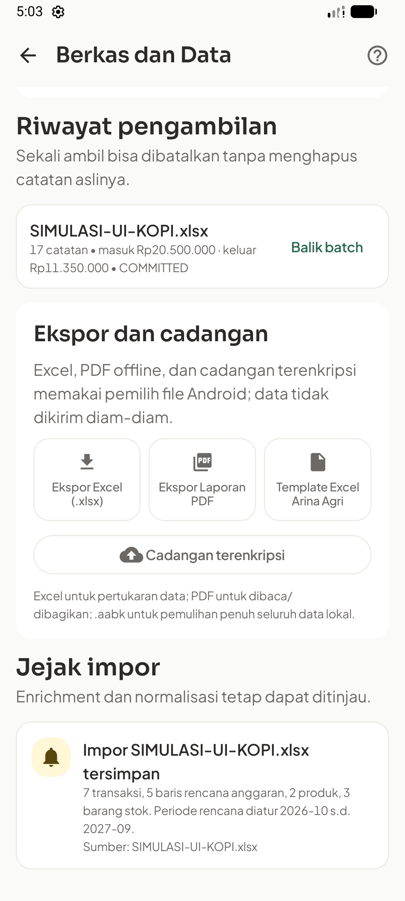
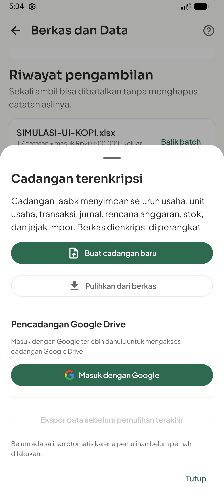
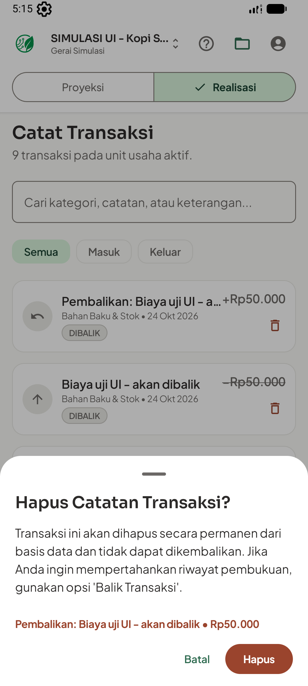

- [ ] Setelah Task 1 lulus, rapikan stepper impor dan ringkasan jumlah per jenis dengan layout vertikal; satu CTA primer per tahap, tindakan mengganti berkas sebagai sekunder. Konflik/duplikat tetap tampil sebelum commit.
- [ ] Pertahankan tiga aksi ekspor dalam komponen `ExportAction`. Ukuran dan line wrapping harus membuat Excel, PDF, dan Template terbaca; pada font besar boleh wrap ke dua baris layout. Status transfer berada sesudah aksi, tidak menimpa.
- [ ] Dalam cadangan, bedakan aksi Buat, Pulihkan, dan Google Drive lewat ikon/label serta penjelasan cakupan. Jangan menambah login wajib, melakukan login nyata, atau mengunggah data hanya untuk QA visual. Field password dan perilaku verifikasi/pemulihan tidak diubah.
- [ ] Pada pengelola kategori/usaha/unit, bedakan nama objek, jumlah unit, dan pilihan aktif; ikon pensil/arsip/hapus memiliki label aksesibilitas serta area sentuh 48 dp. Tetap gunakan aturan scope removal yang ada, bukan menyamakan arsip dengan penghapusan permanen.
- [ ] Jalankan import → notice → export Excel/PDF dan buka konfirmasi balik batch tanpa mengeksekusinya pada data nyata. Uji buat/pulihkan backup hanya pada fixture emulator terisolasi. Dialog destruktif tetap menamai objek dan menjelaskan akibatnya.
- [ ] Commit `feat(ui): unify data management and backup presentation` dengan log dan screenshot state sukses/gagal.

### Task 9 — Perjelas pengaturan dan bantuan; pertahankan first use

**Files:** `AccountSettingsScreen.kt`, `guide/HelpUi.kt`, `ManageScopeScreen.kt`; strings. `WelcomeScreen.kt` dan `EmptyCard` hanya untuk perbaikan regresi jika hasil QA menemukan kebutuhan nyata.


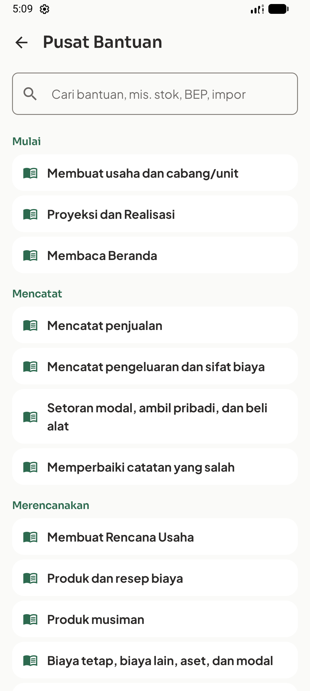
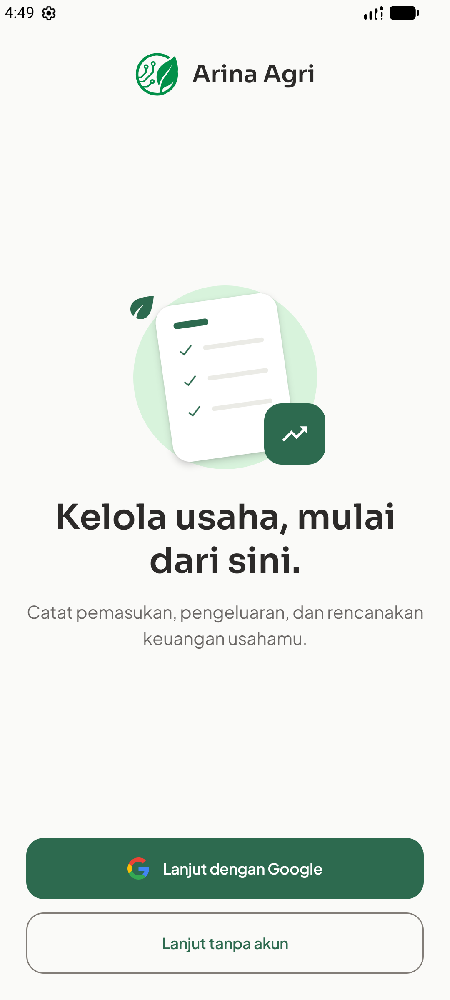

- [ ] Gunakan heading section pendek pada profil, kontak, dan akun; pertahankan semua field/copy yang ada. Tab Profil/Umum/Sistem tetap terlihat, Save tidak tertutup keyboard, dan `rememberSaveableStateHolder` tidak diganti.
- [ ] Di HelpUi buat mapping eksplisit berdasarkan enum `HelpGroup`: START→Storefront, RECORD→ReceiptLong, PLAN→Calculate, STOCK→Inventory2, REPORT→Assessment, DATA→FolderOpen, FAQ→HelpOutline. Gunakan Material Icons yang sudah tersedia; tidak mengambil ikon berbayar atau menambah library.
- [ ] Pertahankan pencarian artikel, judul, langkah, contoh screenshot, topik terkait, dan Tunjukkan di aplikasi. Setiap row tetap mudah disentuh; gambar panduan tidak didistorsi atau diwarnai ulang.
- [ ] Uji draft profil saat tab berpindah, pencarian bantuan lalu artikel dan kembali, serta deep link ke target yang benar. Refresh screenshot panduan hanya setelah UI akhir stabil, dengan mekanisme `HelpScreenshotTest` yang ada, dan dokumentasikan bahwa ini mengubah asset bantuan di aplikasi.
- [ ] Jalankan first use tanpa usaha, tanpa unit, unit kosong, dan offline. Pertahankan Lanjut tanpa akun dan ilustrasi Lottie yang sudah ada; Reduced/Off tetap statis untuk artwork.
- [ ] Commit `feat(ui): refine settings and contextual help presentation` dengan log dan capture.

### Task 10 — Penerimaan lintas layar dan pembaruan galeri

**Files:** `UiRefinementWorkflowTest.kt`, `VisualSystemTest.kt`, screenshot tests yang ada; `docs/qa/2026-10-24-ui-refinement/` (baru saat eksekusi), panduan visual, logs.

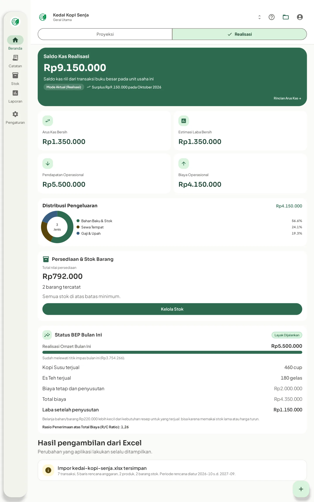
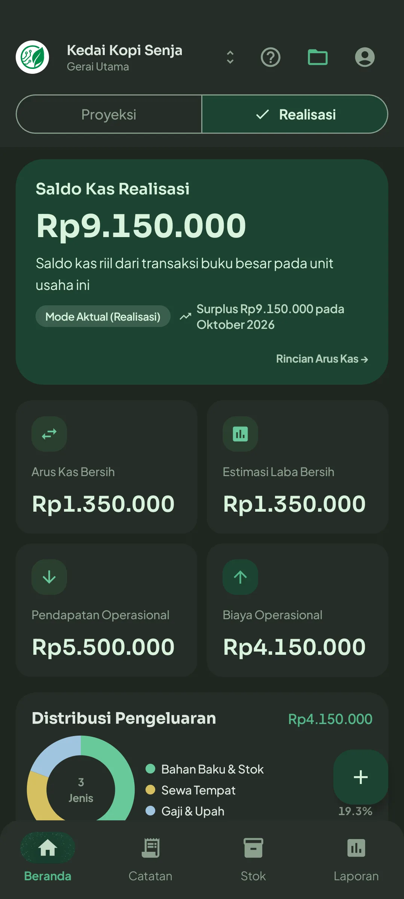

- [ ] Bangun fixture in-memory berdasarkan fixture `HelpScreenshotTest`; batasi util fixture di androidTest, bukan seed aplikasi produksi. Catat perbedaan fixture dua stok dan demo persisten tiga stok agar angka tidak dianggap mismatch.
- [ ] Jalankan workflow test pada komponen/aplikasi asli: setup offline, switch scope/mode, catat/balik, produk/HPP, mutasi stok, tiga tab laporan, impor valid/invalid/duplicate, ekspor, dan form backup. Auth cloud fiktif hanya menguji presentasi; layanan nyata tetap diberi label belum diuji.
- [ ] Uji ponsel light/dark, tablet light/dark, 360 dp, font 200%, dan keyboard terbuka. Periksa pembacaan angka, wrapping, fokus/TalkBack, target 48 dp, serta scroll/tombol bawah. Screenshot tidak menggantikan pengujian interaksi tersebut.
- [ ] Jalankan Full/Reduced/Off dan perpindahan cepat tab/section. Periksa outgoing state, draft, scroll, dan nilai rupiah tidak berubah selama transisi; jangan menyatakan smooth berdasarkan screenshot statis.
- [ ] Jalankan verifier warna, unit tests, lint, build, dan instrumentation relevan dari Bagian 6. Simpan perintah, jumlah test, hasil, emulator/API, serta kasus gagal; hasil skip bukan pass.
- [ ] Simpan screenshot sesudah pada folder QA baru dan buat pasangan sebelum/sesudah untuk tiap kelompok task. Gunakan baseline asli, bukan hasil edit gambar atau screenshot yang sudah diberi mockup. Perbarui manifest dan validator galeri agar aset baru diperiksa tanpa menimpa 91 capture baseline.
- [ ] Tinjau mapping 13 kelompok galeri lama: Mulai/scope, Beranda, transaksi, stok, laporan, rencana, data, cadangan, pengaturan, bantuan, tema/tablet, empty/cloud, dan sorotan. Setiap kelompok memiliki bukti sesudah atau keputusan eksplisit dipertahankan.
- [ ] Update UX guide, role palette native, ADR sesuai keputusan Task 2, changelog fitur yang benar-benar selesai, dan activity log. Commit `test(ui): record refinement workflow and visual acceptance evidence`.

## 6. Perintah verifikasi saat implementasi

Semua perintah dijalankan dari root native, menggunakan SDK/JDK lokal. Contoh berikut hanya untuk emulator uji `emulator-5554`; baca `adb devices -l` dahulu dan ganti serial jika berbeda. Jangan menjalankan connected tests secara generik ketika ponsel berisi data nyata terhubung.

```powershell
rtk git status --short
rtk proxy python scripts/verify_visual_system.py
rtk proxy .\gradlew.bat testDebugUnitTest lintDebug assembleDebug assembleDebugAndroidTest --console=plain
rtk proxy "E:\Android SDK\platform-tools\adb.exe" devices -l
rtk proxy "E:\Android SDK\platform-tools\adb.exe" -s emulator-5554 install -r app/build/outputs/apk/debug/app-debug.apk
rtk proxy "E:\Android SDK\platform-tools\adb.exe" -s emulator-5554 install -r app/build/outputs/apk/androidTest/debug/app-debug-androidTest.apk
rtk proxy "E:\Android SDK\platform-tools\adb.exe" -s emulator-5554 shell am instrument -w -e class com.mankeu.presentation.ImportCardLayoutTest,com.mankeu.presentation.UiRefinementWorkflowTest,com.mankeu.presentation.VisualSystemTest com.mankeu.test/androidx.test.runner.AndroidJUnitRunner
rtk git diff --check
```

Expected saat eksekusi: verifier exit 0; Gradle `BUILD SUCCESSFUL`; instrumentation `OK (N tests)` tanpa failure/skip pada kasus wajib; diff check kosong. Nama kedua class test baru adalah **target yang harus dibuat**, bukan test yang sudah tersedia sekarang. Bila JDK belum terpasang pada PATH, set `JAVA_HOME` hanya pada proses PowerShell menuju JDK lokal yang valid; jangan menulis path mesin ke source atau membuat kredensial Firebase baru.

Capture baseline native memakai metode yang sudah ada:

```powershell
rtk proxy "E:\Android SDK\platform-tools\adb.exe" -s emulator-5554 shell am instrument -w -e class com.mankeu.presentation.HelpScreenshotTest -e helpScreenshots true -e brandScreenshots true com.mankeu.test/androidx.test.runner.AndroidJUnitRunner
rtk proxy "E:\Android SDK\platform-tools\adb.exe" -s emulator-5554 shell am instrument -w -e class com.mankeu.presentation.HelpScreenshotTest#captureBrandScreenshotsThroughRealNavigation -e brandScreenshots true -e brandTheme dark com.mankeu.test/androidx.test.runner.AndroidJUnitRunner
```

Run tersebut bukan pengganti capture seluruh editor pada Task 10. Jalankan Gradle secara berurutan untuk menghindari kontensi cache; tunggu `sys.boot_completed=1` sebelum instrumentasi. Tarik bytes gambar dengan cara biner. Batas tema gelap dan tablet baseline sebelumnya tidak boleh dianggap bukti semua dialog sudah benar.

## 7. Kriteria selesai dan rollback

- [ ] Impor dapat ditinjau/disimpan lewat sentuhan, termasuk kegagalan dan duplikasi, tanpa overlap atau payload outgoing salah.
- [ ] Empat kartu mempunyai aksen yang konsisten dan angka terbaca pada dua tema; nol, defisit, biaya rutin, dan warning memiliki makna yang benar.
- [ ] Transaksi, stok, RAB/HPP, laporan, data/cadangan, pengaturan, bantuan, first use, dan tablet tercakup oleh bukti nyata sesuai task.
- [ ] Angka fixture tetap dapat dijelaskan; selisih laba kas vs setelah penyusutan tidak disamarkan sebagai perubahan gaya.
- [ ] Form tidak kehilangan draft atau menutup Save/Batal; TalkBack/fokus/target sentuh dan font besar diperiksa.
- [ ] Tidak ada schema/dependensi/kewajiban akun/akses cloud baru. Tidak ada data finansial nyata atau kredensial dalam artefak.
- [ ] Log dan panduan mencatat hasil sebenarnya. Kegagalan, pengujian yang tidak dijalankan, dan keterbatasan layanan nyata tetap terlihat.

Rollback per task memakai revert commit task beserta perubahan log yang sesuai. Tidak ada migrasi atau data rollback yang dibutuhkan oleh perubahan presentasi; jangan memakai reset/restore seluruh working tree yang dapat menimpa perubahan sesi lain. Jika suatu task ternyata perlu migrasi/domain change, hentikan perluasan scope itu dan buat keputusan terpisah.

## 8. Checklist validasi dokumen ini

- [x] Pemetaan fungsi/file dicocokkan dengan source saat penyusunan.
- [x] Sepuluh task berurutan mencakup seluruh kelompok layar dalam rekomendasi.
- [x] Screenshot kondisi sekarang disandingkan dengan sasaran perbaikan dan tiga screenshot browser beratribusi.
- [x] Status temuan, usulan, dan hal yang belum diuji dipisahkan.
- [x] `rtk proxy python scripts/qa/verify_ui_refinement_plan.py` lulus: 10 task, 22 gambar tersemat, 24 tautan lokal, tiga hash screenshot browser, code fence seimbang, dan tanpa placeholder. `rtk git diff --check` bersih. Pemeriksaan ini memvalidasi dokumen, bukan hasil UI yang belum diimplementasikan.
- [ ] Persetujuan visual pemilik atas plan; implementasi dan hasil verifikasi runtime belum dilakukan pada sesi penyusunan dokumen ini.
