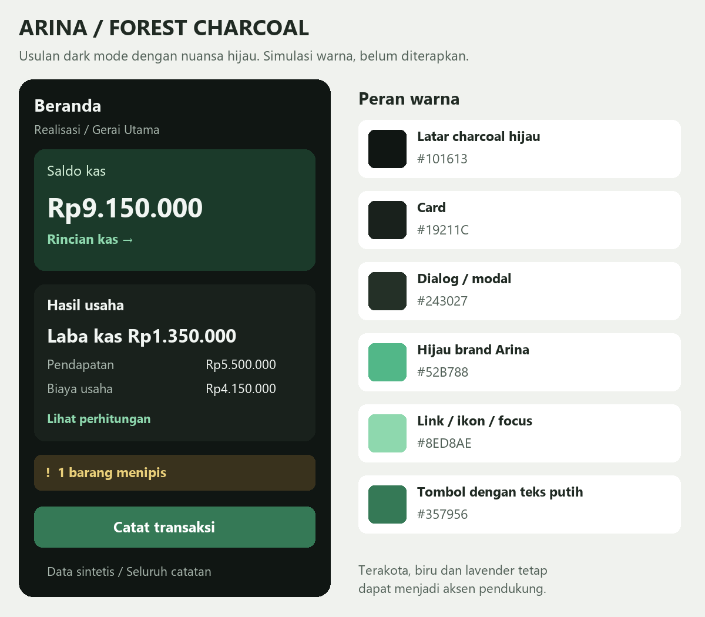
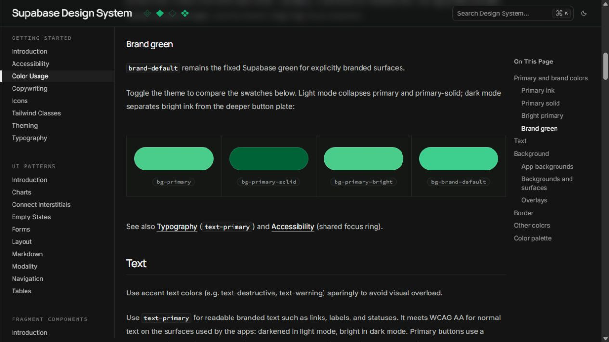
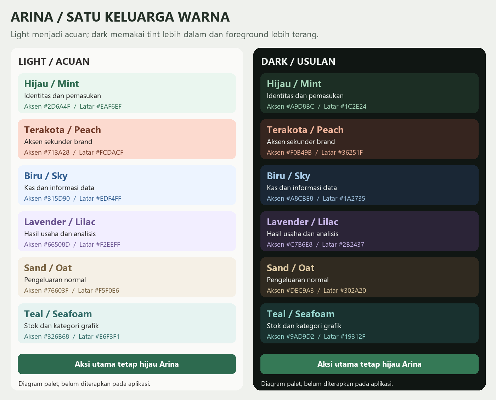

# Consolidated UI, Color Palette, and Settings Implementation Plan

> **For agentic workers:** REQUIRED SUB-SKILL: Use `executing-plans` to implement this plan task-by-task. Steps use checkbox (`- [ ]`) syntax for tracking. Execute sequentially with checkpoints; no subagent dispatch is needed.

**Goal:** Menyatukan perbaikan UI Arina: informasi card yang ringkas, dark mode bernuansa hijau dengan variasi selaras light, dan Settings yang mudah dipindai melalui ringkasan serta halaman detail.

**Architecture:** Reuse domain, `AppUiState`, `AppPreferencesState`, motion tokens, komponen disclosure dan callback existing. Warna dimiliki `Theme.kt`/`MetricColors.kt`; Settings memakai state UI lokal yang saveable dan satu pemilik Back di `MankeuApp.kt`. Tidak menambah library navigasi, persistence, schema, theme picker baru, atau mekanisme analisis keuangan.

**Tech Stack:** Kotlin, Jetpack Compose Material 3, `rememberSaveable`/Saver, Compose UI Test, JUnit, native Lottie Compose dan verifier Python existing.

---

## 1. Status, prioritas dan hubungan dengan rencana sebelumnya

Tanggal rencana: **25 Oktober 2026**. Semua checkbox di dokumen ini adalah pekerjaan eksekusi, bukan laporan bahwa perubahan sudah diterapkan.

| Pernyataan | Status bukti saat plan dibuat |
| --- | --- |
| Pengguna ingin seluruh hasil riset masuk implementation plan | **user-confirmed** |
| Hijau Arina tetap identitas dark; warna pendukung mengikuti keluarga light | **user-confirmed** |
| Source sudah memiliki CardDetails, perubahan Home/BEP/produk/impor dan test terkait | **verified dari source**, bukan klaim runtime lulus |
| QA card menyebut unit/lint/instrumentation PASS | **laporan sesi lain**, belum dijalankan ulang di sesi planning ini |
| Theme dark masih Slate Garden; Settings masih Profil/Umum/Sistem | **verified dari source** |
| Forest Charcoal + enam keluarga warna + Settings hub/detail | **proposed**, menjadi arah pelaksanaan yang direncanakan |
| Paritas seluruh screenshot lama dengan source/APK terkini, TalkBack dan user comprehension | **unknown** sampai dibuktikan pada eksekusi |

**Dokumen ini menjadi titik masuk eksekusi UI terbaru.** Urutan keputusan yang berlaku:

1. Pengguna meminta hijau tetap menjadi identitas: kandidat primary cyan/indigo/plum pada riset dark awal **tidak dipakai**.
2. Fondasi dark menggunakan Forest Charcoal, dengan enam keluarga warna dari penyelarasan light–dark.
3. Settings memakai arah hub ringkas + detail; tiga tab lama digantikan setelah perilaku Back/draft/tour disiapkan.
4. Perbaikan card dan motion yang sudah ada diperiksa lalu dipertahankan; kerjakan hanya gap yang terbukti, bukan mengulang seluruh implementasi.

| Rencana terkait | Perlakuan dalam master plan |
| --- | --- |
| [Motion navigasi dan section](2026-10-23-navigation-section-motion.md) | Reuse token/pola; audit dan regresi pada Task 1, 5, 10, 11 |
| [UI refinement lintas fitur](2026-10-24-ui-refinement.md) | Retain perbaikan list/form/import/stok/laporan; cek gap Task 1 dan regresi Task 11 |
| [Penyederhanaan card](2026-10-24-card-information-simplification.md) | Acceptance tetap berlaku; Task 1 merekonsiliasi status aktual |
| [QA card](../../qa/2026-10-24-card-simplification/README.md) | Bukti historis yang harus dicocokkan dengan hasil eksekusi nyata |

Ruang lingkup mencakup UI Android native di checkout ini. Folder web `D:\Arina Agri\arina-agri` tetap read-only. Tidak ada perubahan rumus, angka uang `Long`, impor template DEC-012, schema Room, autentikasi provider, bisnis/unit, atau kontrak backup/export. Login tetap opsional.

## 2. Bukti visual dan referensi

Gambar berikut adalah hasil riset/diagram, **bukan screenshot implementasi baru**. Capture Settings Arina berasal dari simulasi 24 Oktober dan bersifat historis.

### Fondasi dark bernuansa hijau





[Supabase resmi](https://supabase.com/design-system/docs/color-usage#brand-green) menginformasikan pemisahan ink/solid/brand. [MongoDB resmi](https://www.mongodb.com/) menjadi acuan penempatan hijau di fondasi gelap; warna neon dan layout marketingnya tidak disalin. [Riset green dark](../../design/2026-10-25-arina-green-dark/README.md).

### Variasi light–dark satu keluarga



[Data pasangan warna](../../design/2026-10-25-light-dark-palette-alignment/palette.json). Foreground terakota light adalah teks terbaca `#713A28`, bukan secondary main `#E07A5F`. Container teal light merupakan usulan; accent-nya sudah ada pada chart.

### Settings sebelum perubahan dan referensi


[Riset Settings](../../design/2026-10-25-settings-ui-references/README.md) memisahkan observasi dan adaptasi. [TickTick](https://help.ticktick.com/external/articles/7254750337695744000) memberi acuan struktur; ilustrasinya bergaya iOS. [Bitwarden](https://bitwarden.com/help/change-theme/) memberi acuan kontrol mobile. [Android guidelines](https://source.android.com/docs/core/settings/settings-guidelines#grouping-dividers) memberi acuan perilaku native; diagramnya bukan styling Material 3 terbaru. Tidak menyalin badge premium, fitur vault, kewajiban login, dynamic colors, atau katalog custom theme.

## 3. Kontrak desain dan perilaku

### 3.1 Fondasi dan keluarga warna

| Role | Nilai rencana dark |
| --- | --- |
| Background / surface dim | `#101613` |
| Card rendah / input | `#19211C` / `#131B16` |
| Container biasa / high / highest | `#1D2720` / `#243027` / `#29382E` |
| Teks utama / pendukung | `#F1F5F2` / `#AAB8AF` |
| Hijau brand | `#52B788` |
| Material primary untuk ink/ikon/focus | `#8ED8AE` |
| Filled primary action / foreground | `#357956` / `#FFFFFF` |
| Primary container / foreground | `#1B3A2A` / `#D8F3DC` |
| Control outline / divider dekoratif | `#799382` / `#36483C` |

**Keputusan penting:** jangan mengisi `MaterialTheme.colorScheme.primary` dengan green button `#357956`. Primary dipakai juga oleh teks/ikon, sehingga harus cukup terang di atas surface gelap. Role filled action dipisahkan pada pemilik token existing. Preview riset menyebut primary/button secara visual; tabel ini memperjelas alias implementasinya.

| Keluarga | Foreground dark | Container dark | Penggunaan |
| --- | --- | --- | --- |
| Mint | `#A9D8BC` | `#1C2E24` | Income dan highlight hijau |
| Terakota | `#F0B49B` | `#36251F` | Brand sekunder |
| Blue | `#A8CBE8` | `#1A2735` | Kas dan informasi data |
| Lavender | `#C7B6E8` | `#2B2437` | Hasil usaha/analisis |
| Sand | `#DEC9A3` | `#302A20` | Pengeluaran normal |
| Teal | `#9AD9D2` | `#19312F` | Stok dan kategori grafik |

Palet light existing dipertahankan. Penambahan pasangan light untuk teal hanya digunakan jika keluarga itu benar-benar dipakai; tidak mengubah seluruh light theme. Angka utama memakai `onSurface`; loss/deficit dan warning tetap menggunakan intent dengan label/ikon. Jangan memakai semua hue pada setiap halaman atau menyamakan kategori pengeluaran dengan status masalah.

### 3.2 Struktur Settings target

```text
Pengaturan (HOME)
  Ringkasan profil pemilik -> PROFILE (editor)
  Pengalaman aplikasi
    Tampilan + nilai sekarang -> APPEARANCE
    Bahasa + nilai sekarang -> LANGUAGE
    Gerakan + nilai sekarang -> MOTION
    Getaran dan suara -> FEEDBACK
  Akun opsional
    Akun Google + status -> ACCOUNT
  Bantuan
    Pusat bantuan -> overlay HELP existing
    Panduan interaktif -> GUIDES
  Tentang
    Tentang Arina -> ABOUT
```

Tampilan memilih Terang/Gelap/Ikuti perangkat saja. Profile menyimpan keenam field existing; komoditas/luas tetap metadata opsional, tidak menjadi syarat penggunaan umum. Akun tidak terhubung bukan error. Masuk Google tidak boleh menghasilkan label backup berhasil. Impor/ekspor/backup tetap dimiliki Berkas dan Data; Settings tidak menyalin operasional itu.

### 3.3 Back, draft, motion dan aksesibilitas

- Satu pemilik Back tetap `MankeuApp.kt`: tour modal lebih dahulu; dialog konfirmasi; detail Settings; overlay; destination. Toolbar Back dan system Back memanggil tindakan Settings yang sama.
- HOME Back menutup Settings. Detail Back kembali HOME. PROFILE kotor menampilkan Simpan / Buang perubahan / Lanjut mengedit; tidak menutup overlay atau menyimpan diam-diam.
- Draft, baseline editor, halaman detail dan scroll disimpan melalui state UI saveable. Theme/language yang memakai `Activity.recreate()` tidak boleh menghilangkan sesi Settings atau draft.
- Full memakai helper motion existing pada batas halaman saja; Reduced fade-only, Off instan. Tidak menumpuk transisi parent dan child yang sama-sama bergerak.
- Target minimal 48dp, font 200%, ID/EN, label membungkus, nilai dapat dibaca TalkBack, focus/selected state tidak hanya dibedakan warna. Tidak mengecilkan font untuk memaksa satu baris.

## 4. Peta file dan ownership

Root semua path adalah `D:\Arina Agri\Arina Agri Kotlin`.

| File | Tindakan / tanggung jawab |
| --- | --- |
| `app/src/main/java/com/mankeu/presentation/Theme.kt` | Seluruh dark roles, semantic/action roles, helper netral dan chart |
| `app/src/main/java/com/mankeu/presentation/MetricColors.kt` | Enam accent families; empat metric role mendelegasikan ke keluarga |
| `app/src/main/java/com/mankeu/presentation/components/ActionColors.kt` (baru) | Shared primary filled button colors, tanpa wrapper Button baru |
| `app/src/main/res/values-night/colors.xml` | Splash/background dan resource dark terkait |
| `app/src/main/java/com/mankeu/presentation/SettingsNavigation.kt` (baru) | Enum detail, pure Back/tour mapping, profile draft dan Saver |
| `app/src/main/java/com/mankeu/presentation/screens/AccountSettingsScreen.kt` | Settings coordinator/content, profile editor, account, About; reuse section existing |
| `app/src/main/java/com/mankeu/presentation/screens/SettingsHub.kt` (baru) | Ringkasan profil serta grouped rows HOME |
| `app/src/main/java/com/mankeu/presentation/screens/SettingsPreferencePages.kt` (baru) | Detail appearance/language/motion/feedback/guides |
| `app/src/main/java/com/mankeu/presentation/MankeuApp.kt` | Hoisted saveable page/draft, overlay title, satu Back action, callback dan tour |
| `app/src/main/java/com/mankeu/presentation/AppPreferences.kt` | Reuse existing keys/update methods; tidak migrasi preference |
| `app/src/main/java/com/mankeu/presentation/guide/Guides.kt` | Copy tour dan target jika struktur berubah |
| `app/src/main/java/com/mankeu/presentation/components/SharedComponents.kt`, `MankeuSheet.kt`, `RecordFab.kt`, `PlanCards.kt`, `SpotlightTour.kt`, `guide/HelpUi.kt` | Audit pemakaian warna dan primary action existing |
| `app/src/main/java/com/mankeu/presentation/screens/HomeScreen.kt`, `EntryScreen.kt`, `PlanScreen.kt`, `ReportsScreen.kt`, `StockSection.kt`, `MoreScreen.kt`, `WelcomeScreen.kt`, `ManageScopeScreen.kt` | Pemakaian token/filled action dan regresi workflow |
| `app/src/main/java/com/mankeu/presentation/components/charts/CashFlowChart.kt` | Audit warna chart dan label; rumus chart tidak diubah |
| `scripts/prepare_lottiefiles.py`, `app/src/main/res/raw/*_dark.json` | Hanya derivative dark berlisensi bila warna perlu diadaptasi |
| `scripts/verify_visual_system.py`, `docs/design/ASSET_PROVENANCE.md`, `app/src/main/assets/licenses/lottie-attribution.txt` | Actual-token contrast dan provenance hasil regenerasi |
| `app/src/main/res/values/strings.xml`, `app/src/main/res/values-en/strings.xml` | Label hub/detail/discard dan copy ID/EN |
| `app/src/test/java/com/mankeu/presentation/SettingsNavigationTest.kt` (baru) | Pure Back/tour/draft equality |
| `app/src/androidTest/java/com/mankeu/presentation/SettingsRedesignTest.kt` (baru) | Settings UI/state/callback/restoration |
| `app/src/androidTest/java/com/mankeu/presentation/VisualSystemTest.kt` | Regresi tema, token, draft dan aksi |
| `docs/qa/2026-10-25-ui-colors-settings/README.md` (baru saat eksekusi) | Evidence per scenario dan screenshot baru |

Tidak membuat preference search, akun baru, custom palette editor, data repository baru, atau generik navigation framework. Pemisahan dua file UI Settings diperlukan karena form/account/About dan preferensi/hub mempunyai tanggung jawab berbeda; tidak membagi setiap row menjadi modul sendiri.

## 5. Urutan task pelaksanaan

### Task 1: Rekonsiliasi baseline card/motion dan bukti build

**Read:** ketiga plan lama, QA card, `docs/QUALITY_GATES.md`, Git status, `HomeScreen.kt`, `PlanCards.kt`, `CardDetails.kt`, test dan motion source.
**Create saat eksekusi:** `docs/qa/2026-10-25-ui-colors-settings/README.md`.

- [ ] Catat `rtk git status --short`, `rtk git diff --cached --name-only` dan `rtk git rev-parse HEAD`. Preserve dirty changes termasuk `.gitignore` dan logs; jangan membersihkan checkout atau menggabungkan semua dirty file sebagai milik task ini.
- [ ] Buat matriks requirement lama -> source -> test -> runtime evidence. CardDetails, Home summary, top-three expenses, compact stock, BEP warnings, HPP/form guidance, import conflict/duplicate guards serta motion Full/Reduced/Off harus memiliki baris sendiri.
- [ ] Jalankan baseline `rtk proxy python scripts/verify_visual_system.py` dan `rtk proxy .\gradlew.bat testDebugUnitTest --console=plain` secara serial. Expected: exit 0 / `BUILD SUCCESSFUL`; catat kegagalan sebelum perubahan sebagai baseline, bukan memperlakukan klaim di log sebagai hasil baru.
- [ ] Jalankan test card/import/visual yang sudah ada setelah build APK test, memakai perintah Task 11. Cocokkan hasil/report nyata dengan klaim QA lama. Bila ada gap, perbaiki mengikuti task spesifik plan card/motion yang terkait, dengan log dan testnya; jangan mengulang fitur yang sudah lolos.
- [ ] Fixture wajib: saldo 9.150.000, income 5.500.000, biaya kas 4.150.000, laba kas 1.350.000, laba setelah penyusutan 1.150.000 untuk bulan sumber. Tambah fixture dua bulan agar seluruh catatan tidak disalahlabelkan sebagai bulan ini. Gunakan data sintetis saja.
- [ ] Capture baseline kedua tema: Home, tiga tab Settings, editor, BEP, stok, laporan dan import preview. Simpan screenshot baru dengan scope, mode, font scale, commit + dirty manifest dan APK yang benar-benar dijalankan.

**Acceptance:** requirement existing terpetakan; status `implemented` tidak disamakan dengan `workflow-verified`. Task ini adalah checkpoint sebelum warna/Settings berubah.

### Task 2: Ganti dark Material roles dan pisahkan ink dari filled action

**Modify:** `Theme.kt`, `values-night/colors.xml`, `scripts/verify_visual_system.py`.
**Create:** `components/ActionColors.kt`.

- [ ] Tambah expectation dark baru pada verifier actual-token sebelum mengganti source; run dan rekam failure yang menunjuk token lama. Pertahankan expectation light existing. Jangan melonggarkan threshold supaya token lolos.
- [ ] Ganti **seluruh** blok `MankeuDarkColors` dengan peta berikut, bukan hanya background. Import dan `darkColorScheme` existing dipakai kembali.

```kotlin
internal val MankeuDarkColors = darkColorScheme(
    primary = Color(0xFF8ED8AE),
    onPrimary = Color(0xFF10251B),
    primaryContainer = Color(0xFF1B3A2A),
    onPrimaryContainer = Color(0xFFD8F3DC),
    inversePrimary = Color(0xFF2D6A4F),
    secondary = Color(0xFFF0B49B),
    onSecondary = Color(0xFF3B2118),
    secondaryContainer = Color(0xFF36251F),
    onSecondaryContainer = Color(0xFFFADBCB),
    tertiary = Color(0xFF9AD9D2),
    onTertiary = Color(0xFF103632),
    tertiaryContainer = Color(0xFF19312F),
    onTertiaryContainer = Color(0xFFD1F4EF),
    background = Color(0xFF101613),
    onBackground = Color(0xFFF1F5F2),
    surface = Color(0xFF101613),
    onSurface = Color(0xFFF1F5F2),
    surfaceVariant = Color(0xFF29382E),
    onSurfaceVariant = Color(0xFFAAB8AF),
    surfaceTint = Color(0xFF8ED8AE),
    inverseSurface = Color(0xFFE8EFEA),
    inverseOnSurface = Color(0xFF18221B),
    surfaceBright = Color(0xFF29382E),
    surfaceDim = Color(0xFF101613),
    surfaceContainerLowest = Color(0xFF0B100D),
    surfaceContainerLow = Color(0xFF19211C),
    surfaceContainer = Color(0xFF1D2720),
    surfaceContainerHigh = Color(0xFF243027),
    surfaceContainerHighest = Color(0xFF29382E),
    outline = Color(0xFF799382),
    outlineVariant = Color(0xFF36483C),
    scrim = Color(0xFF000000),
    error = Color(0xFFF2A99D),
    onError = Color(0xFF3D1713),
    errorContainer = Color(0xFF3D2825),
    onErrorContainer = Color(0xFFFFDAD4),
    primaryFixed = Color(0xFFD8F3DC),
    primaryFixedDim = Color(0xFF52B788),
    onPrimaryFixed = Color(0xFF10251B),
    onPrimaryFixedVariant = Color(0xFF1B4332),
    secondaryFixed = Color(0xFFFCDACF),
    secondaryFixedDim = Color(0xFFD4836A),
    onSecondaryFixed = Color(0xFF2C2A29),
    onSecondaryFixedVariant = Color(0xFF713A28),
    tertiaryFixed = Color(0xFFE1EFE4),
    tertiaryFixedDim = Color(0xFF7DB88A),
    onTertiaryFixed = Color(0xFF142A19),
    onTertiaryFixedVariant = Color(0xFF284B30),
)
```

- [ ] Extend `MankeuSemanticColors` dengan dua required fields `actionContainer: Color` dan `onActionContainer: Color`. Isi light `#2D6A4F`/`#FFFFFF`; dark `#357956`/`#FFFFFF`. Ini role nyata untuk seluruh filled action, bukan provider/dependency baru. Tambahkan kontras pasangan ini di verifier.
- [ ] Tambah satu helper colors di `components/ActionColors.kt` dan imports Compose Material 3 serta `LocalMankeuSemanticColors`:

```kotlin
@Composable
fun primaryActionButtonColors(): ButtonColors {
    val colors = LocalMankeuSemanticColors.current
    return ButtonDefaults.buttonColors(
        containerColor = colors.actionContainer,
        contentColor = colors.onActionContainer,
    )
}
```

- [ ] Set background splash night ke `#101613` dan sinkronkan resource brand dark berdasarkan role; hijau brand tetap `#52B788`. Jangan mengubah warna logo sumber atau key preference. Fixed roles tetap sesuai kontrak lintas light/dark.
- [ ] Run actual-token verifier. Expected semua pasangan text/container 4.5:1 dan icon/control 3:1. Verifikasi button pair serta primary text pada semua container yang benar-benar dipakai; kegagalan harus diperbaiki pada pasangan yang bertanggung jawab, bukan mengurangi standar.
- [ ] Update activity log, ADR untuk pemisahan dark ink/filled action dan penggantian dark foundation saat implementasi; commit `feat(ui): replace dark foundation with Arina Forest Charcoal`.

**Acceptance:** seluruh role dark eksplisit; primary ink terbaca, filled button memakai pasangan sendiri, light palette dan splash light tidak berubah.

### Task 3: Selaraskan enam accent families, semantic states dan kategori chart

**Modify:** `Theme.kt`, `MetricColors.kt`, `HomeScreen.kt`, `scripts/verify_visual_system.py`.

- [ ] Extend pemilik `MetricColors.kt` dengan `AccentFamily { MINT, TERRACOTTA, BLUE, LAVENDER, SAND, TEAL }` serta fungsi `accentFamilyColors(family, dark)` yang mengembalikan DTO container/icon existing. Empat `MetricAccent` tetap CASH/PROFIT/INCOME/EXPENSE dan mendelegasikan pemilihan ke keluarga, bukan menggandakan tabel warna.

```kotlin
fun metricAccentColors(accent: MetricAccent, dark: Boolean): MetricAccentColors =
    accentFamilyColors(
        when (accent) {
            MetricAccent.CASH -> AccentFamily.BLUE
            MetricAccent.PROFIT -> AccentFamily.LAVENDER
            MetricAccent.INCOME -> AccentFamily.MINT
            MetricAccent.EXPENSE -> AccentFamily.SAND
        },
        dark,
    )
```

- [ ] Isi `accentFamilyColors` persis dari tabel keluarga pada Bagian 3 dan pasangan light pada [palette.json](../../design/2026-10-25-light-dark-palette-alignment/palette.json). Pasangan mint, blue, lavender, sand light tidak diganti. Foreground terakota light `#713A28`; teal light `#326B68` di atas `#E6F3F1`.

```kotlin
fun accentFamilyColors(family: AccentFamily, dark: Boolean): MetricAccentColors = when (family) {
    AccentFamily.MINT -> if (dark) MetricAccentColors(Color(0xFF1C2E24), Color(0xFFA9D8BC))
        else MetricAccentColors(Color(0xFFEAF6EF), Color(0xFF2D6A4F))
    AccentFamily.TERRACOTTA -> if (dark) MetricAccentColors(Color(0xFF36251F), Color(0xFFF0B49B))
        else MetricAccentColors(Color(0xFFFCDACF), Color(0xFF713A28))
    AccentFamily.BLUE -> if (dark) MetricAccentColors(Color(0xFF1A2735), Color(0xFFA8CBE8))
        else MetricAccentColors(Color(0xFFEDF4FF), Color(0xFF315D90))
    AccentFamily.LAVENDER -> if (dark) MetricAccentColors(Color(0xFF2B2437), Color(0xFFC7B6E8))
        else MetricAccentColors(Color(0xFFF2EEFF), Color(0xFF66508D))
    AccentFamily.SAND -> if (dark) MetricAccentColors(Color(0xFF302A20), Color(0xFFDEC9A3))
        else MetricAccentColors(Color(0xFFF5F0E6), Color(0xFF76603F))
    AccentFamily.TEAL -> if (dark) MetricAccentColors(Color(0xFF19312F), Color(0xFF9AD9D2))
        else MetricAccentColors(Color(0xFFE6F3F1), Color(0xFF326B68))
}
```
- [ ] Set semantic dark: success `#8ED8AE`/on `#10251B`, container `#1B3A2A`/on `#D8F3DC`; danger `#F2A99D`/on `#3D1713`, container `#3D2825`/on `#FFDAD4`; warning `#E9CF7A`/on `#30260C`, container `#39321D`/on `#FFF0B8`; info `#A8CBE8`/on `#112A3A`, container `#22313C`/on `#D5EAFB`.
- [ ] Perbarui literal dark pada `softContainer`, `softContent`, `softBorder`: neutral container `#243027`, content `#AAB8AF`, border `#36483C`; status border mengambil semantic role miliknya. Alpha yang hanya dekoratif tidak digunakan sebagai satu-satunya batas kontrol.
- [ ] Urutan chart **harus sama maknanya** di kedua tema: green, terracotta, blue, lavender, teal, sand. Dark memakai `#8ED8AE`, `#F0B49B`, `#A8CBE8`, `#C7B6E8`, `#9AD9D2`, `#DEC9A3`; light memakai array existing dalam urutan yang sama. Jangan menggunakan urutan tabel presentasi lain tanpa menyelaraskan mapping.
- [ ] Ubah resolver kategori existing agar pemakaian known category memakai hue kategori, bukan `danger` untuk pestisida atau `warning` untuk sewa. Known visual mapping: pupuk green, tenaga kerja blue, irigasi teal, pestisida lavender, alat/sewa sand. Fallback berdasarkan nama kategori yang dinormalisasi, bukan posisi setelah sort nominal:

```kotlin
val key = category.trim().lowercase(java.util.Locale.ROOT)
val index = Math.floorMod(key.hashCode(), chart.size)
```

Gunakan `chart[index]` untuk fallback; tidak perlu tabel database warna. Palette existing nonempty (diverifikasi). Bila caller memiliki category ID yang stabil, gunakan ID sebagai identitas visual; jangan mengubah query/domain hanya untuk warna. Collisions enam warna tetap mungkin: label/nominal harus ada dan jangan mengklaim semua kategori mempunyai warna unik. Nama kategori yang diubah boleh berubah hue; warna tidak menyimpan makna finansial.

- [ ] Tambah assertion bahwa urutan input kategori dan sort nominal tidak mengubah mapping kategori yang sama. Extend actual-token verifier agar membaca `AccentFamily` dan delegasi metric yang baru; verifikasi `onSurface`, `onSurfaceVariant`, icon dan danger pada setiap container di kedua tema. Jika paired secondary text gagal, gunakan foreground keluarga yang kontrasnya cukup pada card tersebut, bukan alpha untuk menyamarkan teks.
- [ ] Run verifier; log/changelog dan commit `feat(ui): align accent families and separate chart colors from status`.

**Acceptance:** enam keluarga tersedia tanpa mengubah makna empat metric; status dan kategori berbeda; warna tidak menjadi satu-satunya alat baca data.

### Task 4: Terapkan token pada UI, tombol dan artwork dark

**Modify:** file presentation pada peta ownership; `scripts/prepare_lottiefiles.py` dan derivative dark hanya jika audit membuktikan perlu.

- [ ] Inventarisasi semua `Button(`, custom `ButtonDefaults`, literal `Color(0x...)`, white/black serta alpha di presentation. File yang sekarang mempunyai filled Button: SharedComponents, SpotlightTour, PlanCards, MankeuSheet, EntryScreen, AccountSettingsScreen, MoreScreen, StockSection, WelcomeScreen, ManageScopeScreen dan HelpUi. Periksa tambahan yang muncul sejak baseline.
- [ ] Pada filled primary action biasa, pasang `colors = primaryActionButtonColors()`. Contoh perubahan lengkap pada tombol simpan yang memakai callback existing:

```kotlin
Button(
    onClick = onSave,
    colors = primaryActionButtonColors(),
    modifier = Modifier.fillMaxWidth().heightIn(min = 48.dp),
) {
    Text(stringResource(R.string.action_save))
}
```

Gunakan resource save yang memang dipakai call site; contoh `onSave` mewakili callback existing di lokasi penggantian, tidak menambah callback baru. Destructive/warning action tetap menggunakan pasangan intent-nya. Outlined/TextButton tetap primary ink; FAB/action eksplisit harus diperiksa sesuai peran, bukan diganti semua secara regex.

- [ ] Cek Hero memakai container dan foreground matching; badge/table/chart tidak menyimpan literal Slate Garden. Inspect `CashFlowChart.kt`, HelpUi screenshots frame, `RecordFab.kt`, `MankeuSheet.kt`, snackbar, loading/empty, selected/disabled/error controls. Jangan mengubah angka, sorting atau data state untuk mengatasi warna.
- [ ] `StateIllustration.kt` memilih resource dark statis, bukan recolor otomatis melalui theme. Jika perlu, ubah **hanya sisi dark** pada tuple `PALETTES`/`PLAN_GRADIENTS` di generator existing, regenerate lima derivative dan metadata. Pertahankan source archives, shapes, timing, masks, skin tones dan lisensi. Light derivative harus byte-identical terhadap baseline.
- [ ] Jalankan `rtk proxy python scripts/prepare_lottiefiles.py --check`, actual-token verifier dan `ContextualLottieTest`. Simpan frame sebelum/sesudah dark untuk plan/report/stock/import/cloud. Tidak membuat Lottie baru sebagai animasi navigasi.
- [ ] Commit `feat(ui): apply coherent dark colors across actions and artwork` bersama provenance/log bila asset berubah.

**Acceptance:** seluruh permukaan menggunakan family/role yang sesuai; tidak ada tampilan setengah palet lama, tombol dan artwork light tidak mengalami perubahan tak sengaja.

### Task 5: Definisikan state Settings dan pertahankan satu pemilik Back

**Create:** `presentation/SettingsNavigation.kt`, `test/.../SettingsNavigationTest.kt`.
**Modify:** `MankeuApp.kt`, signature SettingsScreen di `AccountSettingsScreen.kt`.

- [ ] Buat pure types/functions berikut dalam package `com.mankeu.presentation`, dengan import `com.mankeu.R`, `com.mankeu.presentation.components.TourTarget`, `androidx.compose.runtime.saveable.listSaver`, dan `androidx.compose.runtime.saveable.Saver`. Nama page ini dipakai konsisten pada semua task berikut.

```kotlin
enum class SettingsPage {
    HOME, PROFILE, APPEARANCE, LANGUAGE, MOTION, FEEDBACK, ACCOUNT, GUIDES, ABOUT,
}

enum class SettingsBackAction { CLOSE, HOME, CONFIRM_DISCARD }

fun settingsTitleRes(page: SettingsPage): Int = when (page) {
    SettingsPage.HOME -> R.string.settings_title
    SettingsPage.PROFILE -> R.string.settings_tab_profile
    SettingsPage.APPEARANCE -> R.string.settings_display
    SettingsPage.LANGUAGE -> R.string.settings_language
    SettingsPage.MOTION -> R.string.settings_motion
    SettingsPage.FEEDBACK -> R.string.settings_feedback
    SettingsPage.ACCOUNT -> R.string.settings_optional_account
    SettingsPage.GUIDES -> R.string.settings_tour_title
    SettingsPage.ABOUT -> R.string.settings_about_entry
}

fun settingsBackAction(page: SettingsPage, dirty: Boolean): SettingsBackAction = when {
    page == SettingsPage.HOME -> SettingsBackAction.CLOSE
    page == SettingsPage.PROFILE && dirty -> SettingsBackAction.CONFIRM_DISCARD
    else -> SettingsBackAction.HOME
}

fun settingsPageForTour(target: TourTarget): SettingsPage? = when (target) {
    TourTarget.SETTINGS_DISPLAY -> SettingsPage.APPEARANCE
    TourTarget.SETTINGS_GUIDES -> SettingsPage.GUIDES
    TourTarget.SETTINGS_DRIVE -> SettingsPage.ACCOUNT
    else -> null
}

data class ProfileDraft(
    val name: String = "",
    val whatsapp: String = "",
    val telegram: String = "",
    val location: String = "",
    val commodity: String = "",
    val landArea: String = "",
) {
    companion object {
        val StateSaver: Saver<ProfileDraft, Any> = listSaver(
            save = { listOf(it.name, it.whatsapp, it.telegram, it.location, it.commodity, it.landArea) },
            restore = { ProfileDraft(it[0], it[1], it[2], it[3], it[4], it[5]) },
        )
    }
}
```

- [ ] Tulis pure tests berikut; tambah test seluruh page selain HOME/PROFILE kembali HOME dan tour non-Settings menghasilkan null.

```kotlin
@Test fun dirtyProfileNeedsReview() {
    assertEquals(SettingsBackAction.CONFIRM_DISCARD, settingsBackAction(SettingsPage.PROFILE, true))
}
@Test fun settingsHomeClosesOverlay() {
    assertEquals(SettingsBackAction.CLOSE, settingsBackAction(SettingsPage.HOME, false))
}
@Test fun cleanProfileReturnsHome() {
    assertEquals(SettingsBackAction.HOME, settingsBackAction(SettingsPage.PROFILE, false))
}
@Test fun unsavedContactIsDirty() {
    val baseline = ProfileDraft(name = "Pemilik")
    assertNotEquals(baseline, baseline.copy(whatsapp = "081234567890"))
}
```

- [ ] Hoist `settingsPage`, `profileDraft`, `profileBaseline`, `showDiscardDialog` di MankeuApp dengan `rememberSaveable`; draft/baseline memakai `ProfileDraft.StateSaver`. Jangan menyimpan dirty boolean kedua: `dirty = profileDraft != profileBaseline`.
- [ ] Saat membuka editor, isi snapshot baseline dan draft dari keenam nilai `prefs` existing; perubahan field hanya mengubah draft copy. Google display name dapat menjadi fallback presentasi saat nama lokal kosong, tetapi login tidak diam-diam menimpa nama/draft lokal.
- [ ] Buat satu `requestSettingsBack()` di pemilik overlay: CLOSE -> `overlay = NONE`; HOME -> `settingsPage = HOME`; CONFIRM_DISCARD -> `showDiscardDialog = true`. Sambungkan toolbar Settings ke fungsi sama. Extend handler root existing: tour tetap didahulukan, dialog discard ditangani sebagai modal, kemudian Settings page. Tidak memasang BackHandler kedua pada child yang bergantung urutan composition.
- [ ] Pada PROFILE kotor, Simpan menjalankan callback Task 7; Buang mengembalikan draft ke baseline dan HOME; Lanjut mengedit menutup dialog saja. System Back ketika dialog terbuka menutup dialog dan mempertahankan editor. HELP detail Back tetap mempertahankan perilaku existing.
- [ ] Run `rtk proxy .\gradlew.bat testDebugUnitTest --tests com.mankeu.presentation.SettingsNavigationTest --console=plain`. Expected `BUILD SUCCESSFUL`, semua pure cases lulus. Log dan commit `refactor(ui): define saveable settings navigation and profile session`.

**Acceptance:** root tetap satu pemilik Back, page/draft mempunyai ownership jelas, field opsional tidak menjadi syarat baru.

### Task 6: Bangun Settings hub dengan grouped rows dan profil ringkas

**Create:** `screens/SettingsHub.kt`, `androidTest/.../SettingsRedesignTest.kt`.
**Modify:** `screens/AccountSettingsScreen.kt`, kedua `strings.xml`.

- [ ] Tulis test HOME: seluruh kelompok ditemukan melalui scroll, nama lokal tampil, tidak ada field profil di halaman awal, nilai theme/language/motion sesuai input state, dan tap row mengirim SettingsPage yang benar. Gunakan fixture nama sintetis, tidak memakai akun Google perangkat pribadi.
- [ ] Implementasikan `SettingsHub` yang menerima nilai preferensi/profile/auth existing dan `onOpenPage: (SettingsPage) -> Unit`, `onOpenHelpCenter: () -> Unit`. Tidak membaca SharedPreferences dari tiap row. Gunakan satu LazyColumn dengan key stabil; satu card per kelompok, bukan satu card besar per opsi.
- [ ] Tambahkan helper row lokal berikut dengan import Material `ListItem`, `Icon`, `Text`, `Icons.AutoMirrored.Filled.KeyboardArrowRight`, foundation `clickable`, `heightIn`, `Role` dan `dp`:

```kotlin
@Composable
internal fun SettingsLinkRow(
    title: String,
    value: String,
    icon: ImageVector,
    accent: MetricAccentColors,
    onClick: () -> Unit,
    modifier: Modifier = Modifier,
) {
    ListItem(
        modifier = modifier.fillMaxWidth().heightIn(min = 64.dp)
            .clickable(role = Role.Button, onClick = onClick),
        headlineContent = { Text(title) },
        supportingContent = { Text(value) },
        leadingContent = {
            Surface(color = accent.container, shape = RoundedCornerShape(10.dp)) {
                Icon(icon, null, Modifier.padding(8.dp).size(20.dp), tint = accent.icon)
            }
        },
        trailingContent = {
            Icon(Icons.AutoMirrored.Filled.KeyboardArrowRight, contentDescription = null)
        },
        colors = ListItemDefaults.colors(containerColor = Color.Transparent),
    )
}
```

`MetricAccentColors` adalah DTO container/icon yang dipakai kembali dari Task 3; nama tipe tidak mengubah peran finansial. Ikon dekoratif tidak mempunyai content description ganda. Title/value tidak memakai `maxLines = 1` atau ellipsis untuk menyembunyikan pilihan.

- [ ] Profil ringkas memakai initial/name lokal dan satu tindakan Edit. Nama kosong memakai `Profil pemilik`/`Belum diisi`, bukan email atau login wajib. Google identity ditampilkan pada ACCOUNT, tidak mengubah identitas usaha aktif.
- [ ] Kelompok serta urutan persis seperti Bagian 3. Tambahkan resource ID/EN: `settings_experience` = Pengalaman aplikasi/App experience; `settings_optional_account` = Akun opsional/Optional account; `settings_about_entry` = Tentang Arina/About Arina; `settings_profile_empty` = Belum diisi/Not provided; judul page memakai resource existing bila cocok. Bahasa EN tidak memakai literal ID.
- [ ] Gunakan accent BLUE untuk Tampilan, LAVENDER untuk Gerakan, SAND untuk respons, TEAL untuk bantuan/data-context; primary navigation/aksi tetap hijau. Ikon berwarna cukup pada leading tile, isi group memakai surface netral. Tidak menambahkan search bar atau badge dekoratif premium.
- [ ] Run `SettingsRedesignTest` kasus hub. Expected callback sekali per tap, opsi aktif dibaca dari state dan semua row dapat diakses di 360dp/200%. Log/changelog dan commit `feat(ui): introduce grouped Settings home`.

**Acceptance:** tampilan awal menjadi overview, nilai mudah dipindai, profil tidak langsung berupa form panjang.

### Task 7: Pindahkan editor profil dengan save/discard yang jelas

**Modify:** `AccountSettingsScreen.kt`, `MankeuApp.kt`, `SettingsRedesignTest.kt`, kedua `strings.xml`.

- [ ] Refactor form existing menjadi editor stateless dengan `draft: ProfileDraft`, `onDraftChange: (ProfileDraft) -> Unit`, dan aksi Simpan. Semua textfield membaca draft hoisted; contoh perubahan nama:

```kotlin
OutlinedTextField(
    value = draft.name,
    onValueChange = { onDraftChange(draft.copy(name = it)) },
    label = { Text(stringResource(R.string.profile_full_name)) },
    singleLine = true,
    modifier = Modifier.fillMaxWidth(),
)
```

Terapkan pola copy yang sama pada `whatsapp`, `telegram`, `location`, `commodity`, `landArea`; jangan menyisakan state kedua `nameInput`/`locationInput` yang berbeda dengan draft pemilik Back. Pertahankan section pemilik/kontak dan metadata usaha opsional. Keyboard/insets serta scroll harus membuat field terakhir dan Simpan dapat dicapai.

- [ ] Pada Simpan normalisasikan melalui utility existing, lalu panggil **satu** callback `onSaveProfile` yang menuju `prefs.updateProfile`. Method itu sudah menyimpan nama dan lima field lain; jangan memanggil `updateAccountName` kedua kali untuk aksi sama.

```kotlin
val normalized = profileDraft.copy(
    name = profileDraft.name.trim(),
    whatsapp = ProfileContactUtils.normalizeWhatsAppPhone(profileDraft.whatsapp),
    telegram = ProfileContactUtils.normalizeTelegramContact(profileDraft.telegram).displayValue,
    location = profileDraft.location.trim(),
    commodity = profileDraft.commodity.trim(),
    landArea = profileDraft.landArea.trim(),
)
```

Sesudah callback berhasil, assign draft dan baseline ke normalized lalu HOME. Pertahankan validation/normalization existing; tidak menambah syarat nomor telepon, komoditas, luas lahan atau login. Jika penyimpanan menghasilkan exception, tampilkan error melalui jalur feedback existing dan pertahankan draft; jangan menampilkan sukses sebelum callback selesai.

- [ ] Tambahkan dialog discard menggunakan resource ID/EN: `Perubahan belum disimpan` / `Unsaved changes`, `Simpan` / `Save`, `Buang perubahan` / `Discard changes`, `Lanjut mengedit` / `Keep editing`. Mengganti tema atau bahasa tidak dianggap menyimpan profil.
- [ ] Test: ubah setiap field -> Back -> lanjut edit; Back -> discard -> reenter nilai lama; edit -> save -> callback sekali dengan keenam field -> reenter nilai baru; rotasi/recreate saat editor terbuka -> draft tetap ada; Google auth state berubah -> draft tidak tertimpa.
- [ ] Jalankan `SettingsNavigationTest`, `SettingsRedesignTest` dan `ProfileContactTest`. Expected draft/persisted values terpisah sampai Save, normalization sama dengan domain utility. Log dan commit `feat(ui): add safe profile editing within Settings`.

**Acceptance:** tidak ada silent save atau kehilangan draft akibat Back, auth update, font/theme/language recreation.

### Task 8: Detail Tampilan, Bahasa, Gerakan serta Getaran/Suara

**Create:** `screens/SettingsPreferencePages.kt`.
**Modify:** `AccountSettingsScreen.kt`, `SettingsRedesignTest.kt`, kedua `strings.xml`.

- [ ] Pindahkan UI yang sesuai dari tab GENERAL existing ke page APPEARANCE/LANGUAGE/MOTION/FEEDBACK. Pemilik callback tetap di MankeuApp; key preference dan default tidak diubah.
- [ ] APPEARANCE menampilkan tiga pilihan ThemeMode existing beserta mini preview statis: System, Light, Dark. Pada lebar sempit/font besar, susun vertikal agar label tidak dipotong. Pilihan adalah radio/selectable row, dengan semantics selected; bukan toggle boolean.
- [ ] LANGUAGE memakai dua `AppLanguage` existing dengan label native masing-masing. Contoh binding per pilihan, memakai resource/label existing:

```kotlin
Row(
    Modifier.fillMaxWidth().heightIn(min = 56.dp)
        .selectable(
            selected = language == option,
            onClick = { onLanguageChange(option) },
            role = Role.RadioButton,
        ),
    verticalAlignment = Alignment.CenterVertically,
) {
    RadioButton(selected = language == option, onClick = null)
    Text(option.label, modifier = Modifier.padding(start = 12.dp))
}
```

`option` berasal dari iterasi `AppLanguage.entries`; tidak membuat enum baru. Terapkan pola selected row yang sama untuk ThemeMode/MotionMode dengan label resource masing-masing. Tidak menambah setting untuk banyak palette, app icon, ukuran font sendiri atau wallpaper.

- [ ] MOTION mempertahankan FULL/REDUCED/OFF dan help singkat. FEEDBACK memakai `ToggleRow` existing untuk getaran/suara; seluruh row dan switch harus memberi satu aksi yang konsisten, tanpa toggle ganda ketika switch ditap.
- [ ] Theme/language memanggil callback existing yang memperbarui prefs dan `Activity.recreate()` pada nilai berbeda. `settingsPage`, profile snapshot/draft serta scroll root tetap saveable; setelah recreation muncul page yang dipilih dengan label dan dialog dalam bahasa baru. Memilih nilai yang sudah aktif tidak merecreate ulang.
- [ ] Test immediate selection, persistence/recreation, System mengikuti konfigurasi perangkat, RadioButton semantics dan haptic/sound callback satu kali. Simpan nilai test sebelumnya dan restore pada finally; jangan mengubah preferensi pengguna permanen.
- [ ] Run focused UI test dan `MotionPreferenceTest`; log/changelog dan commit `feat(ui): add focused preference pages with current values`.

**Acceptance:** current values di HOME selalu benar; setting instan tidak menunggu Simpan global; perubahan visual tidak merusak editor/profile state.

### Task 9: Akun opsional, panduan dan Tentang yang ringkas

**Modify:** `AccountSettingsScreen.kt`, `SettingsPreferencePages.kt`, `SettingsHub.kt`, `SettingsRedesignTest.kt`, kedua `strings.xml`.

- [ ] ACCOUNT reuse `AccountCard`: state signed-out, signed-in, cancellation/failure mengikuti auth flow existing. Copy menyatakan Google opsional untuk cloud backup; signed-out tidak memakai danger. Jangan menampilkan Last backup/Synced tanpa sumber state backup aktual.
- [ ] Sign-out hanya tersedia saat signed-in; nilai keuangan, selection dan akses offline tetap ada. Test simulated auth callbacks; jangan mengklaim OAuth/Drive live tervalidasi dari auth fixture.
- [ ] GUIDES memuat akses Help, switch tour-offers dan reset tur existing. Copy reset menyebut reset panduan, bukan data usaha. Aksi tetap melalui `prefs.resetAllTours`, `toursLater.clear` dan tujuan yang sudah diputuskan shell; bukti UI harus menunjukkan efek sebenarnya.
- [ ] ABOUT reuse SystemBannerCard, versi/build dari BuildConfig, kebijakan offline, lisensi animasi dan ContactCard. Susun ringkas; detail spesifikasi teknis boleh melalui CardDetails existing. Informasi privasi tidak dikurangi menjadi klaim cloud otomatis atau kontak/notifikasi yang belum terimplementasi.
- [ ] Account backup notice boleh mengarahkan lewat alur existing yang tepat bila tersedia; tidak menambahkan mirror backup/import/export dalam Settings. Help article DATA_BACKUP existing menjelaskan operasional Berkas dan Data.
- [ ] Test signed-out offline -> edit profil & ubah preferensi tetap bekerja; About menunjukkan versi aktual dan license dialog dapat dibuka; contact action memakai intent existing tanpa otomatis mengirim pesan. Reset tour tidak memanggil callback hapus data.
- [ ] Log/changelog lalu commit `feat(ui): organize account help and app information pages`.

**Acceptance:** semua fungsi tab lama tetap dapat ditemukan; teknis/login tidak mendominasi HOME dan tidak ada fitur cloud palsu.

### Task 10: Integrasikan tour, overlay Help, scroll dan motion Settings

**Modify:** `MankeuApp.kt`, `SettingsNavigation.kt`, `AccountSettingsScreen.kt`, `guide/Guides.kt`, tests Settings/navigation yang relevan.

- [ ] Hapus `SettingsTab`/PrimaryTabRow hanya setelah semua isi lama mempunyai page target dan test. Retain comments/notes yang menjelaskan perilaku; perbarui komentar tab menjadi page, jangan menghapus riwayat arsitektur yang tidak terkait.
- [ ] `OverlayScaffold` existing tetap memberi satu toolbar. Title dan onBack pada SETTINGS mengikuti `settingsPage`; jangan menambahkan scaffold/top bar kedua di page child.
- [ ] Saat tour menargetkan Settings, gunakan `settingsPageForTour`. Target DISPLAY berada di APPEARANCE, GUIDES pada GUIDES, DRIVE pada ACCOUNT. Tour harus menunggu page target composed dan layout tersedia sebelum spotlight diukur. Jangan memaksa perpindahan dari editor kotor lalu membuang draft; tour hanya dapat dilanjutkan setelah guard draft diselesaikan atau sesi edit aman ditinggalkan dengan draft hoisted.
- [ ] Aksi Help dari Settings menyimpan return overlay/page; Back dari help root kembali Settings sebelumnya. Help dari fitur lain tetap mengikuti perilaku existing. Gunakan satu return marker UI yang saveable, bukan navigation stack/library baru. `helpArticle != null` tetap dikembalikan ke daftar help lebih dahulu.
- [ ] Gunakan `rememberSaveableStateHolder`/list state existing dengan key SettingsPage untuk scroll detail/HOME; draft tetap di pemilik sesi root. Pada `AnimatedContent`, isi membaca lambda page yang dirender, bukan mutable outer page yang sedang berganti.

```kotlin
val motion = LocalMotion.current
AnimatedContent(
    targetState = page,
    transitionSpec = { crossFade(motion) },
    label = "settingsPage",
) { displayedPage ->
    stateHolder.SaveableStateProvider(displayedPage) {
        content(displayedPage)
    }
}
```

`content` di contoh adalah renderer page yang menerima displayedPage. `stateHolder` berasal dari `rememberSaveableStateHolder()` pada composable Settings yang sama. Jangan mengubah seluruh navigation motion; fade-only sudah cukup untuk Settings, dan Off memakai transisi None melalui helper existing.

- [ ] Test toolbar Back vs system Back pada HOME/detail/profile dirty/dialog; tour aktif punya prioritas; Help return menjaga page/draft; scroll HOME bertahan setelah mengunjungi detail; Full/Reduced/Off tidak kehilangan selected option. Jika nested root/page transition berlangsung bersamaan, hilangkan transisi halaman yang duplikatif pada boundary itu.
- [ ] Jalankan `SettingsNavigationTest`, `SettingsRedesignTest`, `NavigationMotionTest`, `SectionMotionTest`, `GuidesTest`. Log dan commit `fix(ui): preserve Settings back tours and saved state`.

**Acceptance:** toolbar dan system Back setara, tour dapat menemukan target baru, help dan penggantian tema tidak membuang sesi Settings.

### Task 11: Verifikasi lintas aplikasi, aksesibilitas dan bukti visual

**Modify:** tests visual/workflow existing dan `docs/qa/2026-10-25-ui-colors-settings/README.md`.

- [ ] Jalankan static checks dan Gradle **serial**, dari root, memakai konfigurasi JDK/debug yang valid dan non-secret. Tidak membuat Firebase project, credential, signing key atau akun baru untuk QA.

```powershell
rtk proxy python scripts/verify_visual_system.py
rtk proxy python scripts/prepare_lottiefiles.py --check
rtk proxy .\gradlew.bat testDebugUnitTest lintDebug assembleDebug assembleDebugAndroidTest --console=plain
rtk git diff --check
```

Expected: exit 0, `BUILD SUCCESSFUL`, tidak ada whitespace error pada perubahan task. Bila repository mempunyai warning/perubahan unrelated, catat dan lakukan scoped check juga; jangan menyatakan global clean jika bukan hasil sebenarnya.

- [ ] Cek emulator dengan `rtk proxy adb devices` dan `rtk proxy adb -s emulator-5554 shell getprop sys.boot_completed`. Nilai boot harus `1`. Set serial hanya ke perangkat yang benar-benar terdaftar dan targetkan satu device saat Gradle:

```powershell
rtk proxy powershell -NoProfile -Command '$env:ANDROID_SERIAL = "emulator-5554"; & .\gradlew.bat connectedDebugAndroidTest "-Pandroid.testInstrumentationRunnerArguments.class=com.mankeu.presentation.SettingsRedesignTest,com.mankeu.presentation.CardDetailsTest,com.mankeu.presentation.CardSimplificationTest,com.mankeu.presentation.VisualSystemTest,com.mankeu.presentation.NavigationMotionTest,com.mankeu.presentation.SectionMotionTest,com.mankeu.presentation.ContextualLottieTest,com.mankeu.presentation.ImportCardLayoutTest,com.mankeu.presentation.UiRefinementWorkflowTest,com.mankeu.data.ImportCommitTest" --console=plain'
```

Nama SettingsRedesignTest merupakan class yang dibuat pada Task 6; nama lain sudah ada saat inspeksi. Expected: tidak ada failure/skip untuk kasus wajib. Rekam report aktual dari `app/build/reports/androidTests/connected/debug/index.html` jika dihasilkan, beserta jumlah test dan cakupannya; jangan menyalin angka kelulusan dari QA lama.

- [ ] Workflow wajib: offline tanpa login -> pilih usaha/unit -> Home kas/laba -> buka rincian -> Settings HOME -> editor profil -> Back/save/discard -> ubah light/dark/System -> ubah bahasa/motion/feedback -> account optional -> Help dan kembali -> About/license -> kembali ke Home -> catat transaksi -> rencana/BEP -> Stok -> Laporan -> impor konflik/duplikat/valid -> reversal batch. Nilai laporan sebelum/sesudah sama untuk dataset yang sama.
- [ ] Matriks render: light/dark, ponsel 360dp dan tablet, font 100%/200%, ID/EN, Full/Reduced/Off, loading/empty/error/positive/loss, nama panjang/nominal besar, signed-out/simulated signed-in. Minimal satu pass TalkBack untuk urutan baca, nilai aktif, selected/expanded, focus dan kontrol dialog.
- [ ] Periksa warna aktual pada komposisi alpha/gradient, pressed/focus/disabled/error, sheet/scrim/snackbar, splash dan dark Lottie. Rasio pair solid saja tidak membuktikan frame aktual. Chart memerlukan label/marker dan pemeriksaan color vision deficiency; bila belum dilakukan tulis statusnya, bukan klaim lulus.
- [ ] Capture before/after dengan scope/mode/font/data setara; simpan HOME Settings, tiap detail, dirty dialog, light/dark, font besar, Home/BEP/Stok/Laporan/Import. Jangan menimpa 91 capture simulasi lama atau menyebut diagram riset sebagai hasil aplikasi.
- [ ] QA README mencatat `scenario | expected | actual | result | evidence`, versi APK + source state, test reports dan keterbatasan. Review pemahaman internal: menemukan tema/bahasa, tahu nilai aktif, edit profil tanpa kehilangan draft, menemukan bantuan. Klaim usability improvement membutuhkan uji pengguna representatif yang hasilnya tercatat.

**Acceptance:** warna konsisten lintas fitur, Settings tidak memutus workflow/persistence/tour, angka invariant dan seluruh gap Task 1 terselesaikan atau dinyatakan belum terverifikasi secara spesifik.

### Task 12: Finalisasi panduan, decision records, logs dan rollback

**Modify:** `docs/UX_AND_ACCESSIBILITY.md`, `font-dan-color-palette.md`, `logs/ACTIVITY_LOG.md`, `logs/DECISION_LOG.md`, `logs/CHANGELOG.md`; QA/provenance bila berubah.

- [ ] Update panduan warna dengan actual native source sebagai authority. Dokumen font/palette sekarang mengandung rujukan web; bedakan bagian native yang diverifikasi agar tidak menyebut warna dark baru sebagai konfigurasi MUI yang tidak diubah. Font tetap existing.
- [ ] Tambah ADR untuk dark foundation/action ink-fill dan Settings hub/internal page/back ownership dengan nomor berikutnya yang benar setelah memeriksa DECISION_LOG; jangan menebak nomor. Dokumentasikan alasan reuse root Back dan prefs existing, alternatif mempertahankan tab, serta alasan tidak memakai primary deep fill sebagai ink.
- [ ] Update `[Unreleased]` pada CHANGELOG untuk perubahan user-facing yang benar-benar diimplementasikan. ACTIVITY_LOG setiap task mencantumkan file, hasil command, screenshot dan hal yang belum diuji. Tidak memasukkan data akun nyata atau fixture finansial pengguna.
- [ ] Tinjau staged diff per task. Stage hanya path/hunk milik task; jika log mempunyai entry sesi lain gunakan staging hunk/index agar entry unrelated tidak ikut. Jika folder docs di-ignore, cek rule dan force-add **hanya** file dokumentasi yang memang dibuat untuk task; jangan mengubah `.gitignore` secara tak sengaja.
- [ ] Commit dokumentasi final dengan log dalam atomic commit. Handoff melaporkan perubahan, named acceptance evidence, risiko dan omission aktual. Jangan menyebut release-ready hanya dari build/screenshot.
- [ ] Rollback: revert commit implementasi terkait bersama entry koreksi log. Palette dan Settings tidak memigrasi database/key prefs sehingga tidak memerlukan data conversion. Jangan reset seluruh checkout atau menghapus data untuk rollback UI. Bila Settings dikembalikan ke tab, restore mapping tour/Back yang cocok dalam commit yang sama.

**Acceptance:** dokumentasi sesuai source nyata, bukti dapat ditelusuri dan rollback tidak menghapus pekerjaan/data lain.

## 6. Matriks cakupan akhir

| Permintaan/perbaikan | Task | Bukti penerimaan |
| --- | --- | --- |
| Card lebih ringkas dan mudah dianalisis | 1, 4, 11 | Card tests, dua-bulan fixture, screenshot Home/BEP/Import |
| Animasi tab/section smooth dan reduced motion | 1, 8, 10, 11 | Navigation/Section/MotionPreference tests dan device |
| Dark palette baru tetap bernuansa hijau | 2, 4, 11 | Actual-token verifier, splash/artwork dan seluruh layar dark |
| Variasi dark sesuai keluarga light | 3, 4, 6, 11 | Enam keluarga + light regression + paired screenshots |
| Status tidak tertukar dengan kategori/normal expense | 3, 4, 11 | Stable category mapping, loss/warning cases |
| Settings dirombak menjadi hub/detail | 5, 6, 8, 9, 10 | Route/callback/current-value tests |
| Profil ringkas dan editor aman | 5, 7, 10, 11 | Save/discard/recreate/draft tests |
| Login opsional dan backup tetap pada layar data | 9, 11 | Offline workflow dan account-state fixtures |
| ID/EN, font besar, tablet, TalkBack, semua motion levels | 6–11 | Matriks QA dengan hasil aktual |
| Screenshot/referensi berada dalam plan | Bagian 2 | Delapan embedded image dan link sumber valid |
| Log, ADR, changelog dan rollback | 12 dan setiap commit task | Review staged diff + named evidence |

## 7. Verifikasi dokumen plan (sesi planning)

```powershell
rtk proxy python scripts/qa/verify_consolidated_ui_plan.py
rtk git diff --cached --check
```

Verifier memeriksa 12 task berurutan, delapan embedded image dan link lokal, hash lima screenshot referensi browser dari manifest asli, semua 48 role pada blok darkColorScheme, pasangan kontras fondasi yang direncanakan, code fences dan kelengkapan scope. Ini verifikasi rencana/evidence, **bukan** bukti bahwa task implementasi atau build/test Android telah dijalankan.
